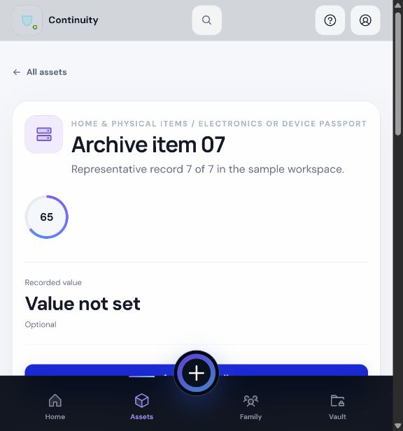
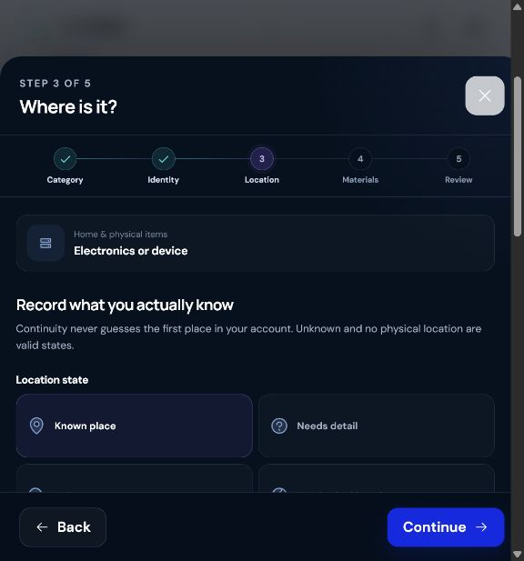
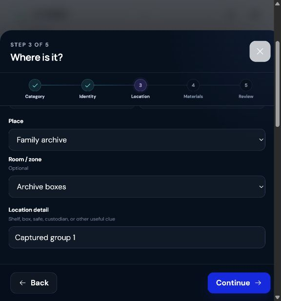
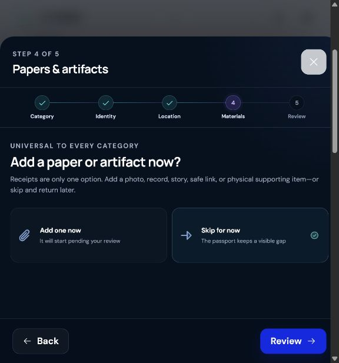
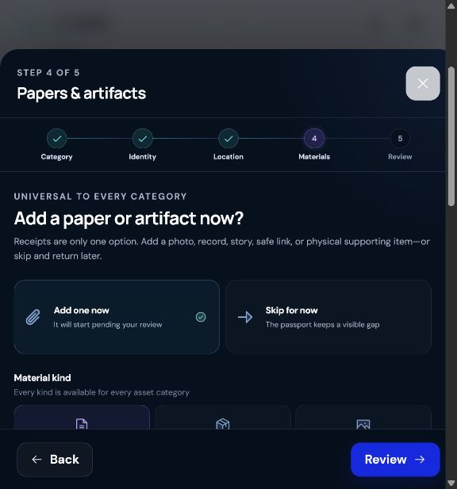
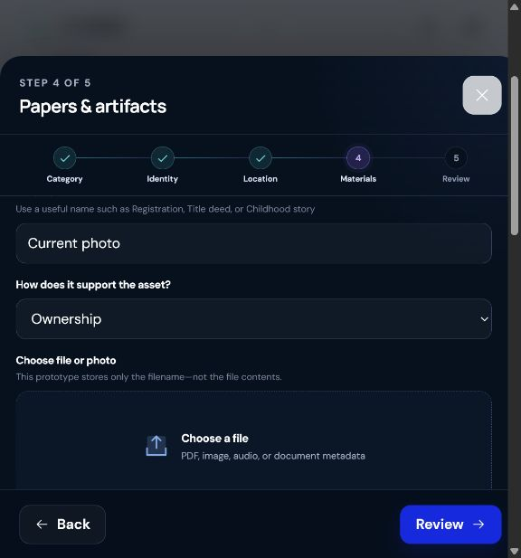
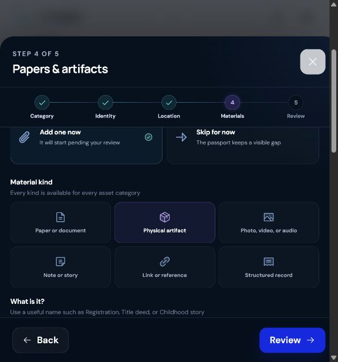
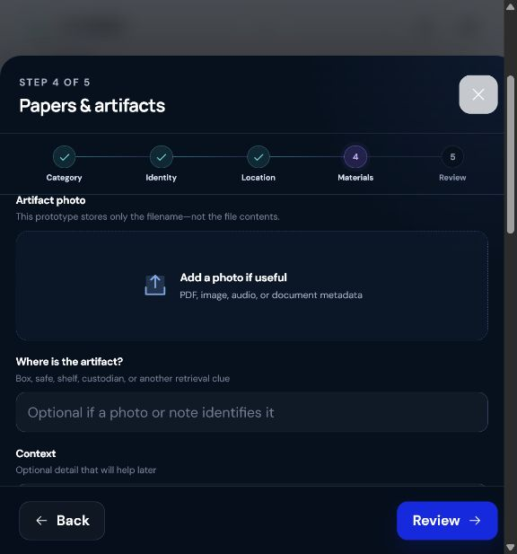

# Accurate Location and Attachments Capability Audit

Date: 2026-07-25  
Scope: current web prototype, asset `family-archive-item-07`, location capture, photos, documents, and physical artifacts

## Executive verdict

The current prototype does **not** yet meet the requested capability.

It has a useful foundation:

- honest location states;
- a Place and Space model;
- six universal material types;
- clear Add now / Skip decisions;
- explicit human review states.

But two P0 gaps prevent it from behaving like a trustworthy asset record:

1. A new Place receives the selected city's center coordinate, not the user's address, device position, or adjusted pin.
2. A selected photo or document is reduced to its filename. The file contents are not saved, previewed, uploaded, or retrievable.

The correct product model is:

> Globe = regional overview. Place pin = geographic truth. Space hierarchy = indoor retrieval truth.

GPS can help locate a property. It cannot reliably identify “Study → Safe → Shelf 2 → Watch roll.” Indoor accuracy must come from a user-confirmed retrieval path.

## Current journey

### 1. Asset detail — Partial

What works:

- The current asset and its state are understandable.
- “Edit details” and “Add paper or artifact” are visible.

What is missing:

- There is no direct **Set exact location** or **Change location** action.
- The displayed location can hide the finer retrieval clue when a Space is present.
- The user cannot see when, how, or by whom the location was confirmed.

### 2. Choose a location state — Partial

What works:

- Known, incomplete, unknown, and non-physical states are represented honestly.
- The user is not forced to invent a location.

What is missing:

- “Needs detail” is system language rather than a natural user action.
- The step asks the user to classify the record before helping them place the item.
- An accurate location should be derived from captured facts, not manually declared as a status.

### 3. Enter Place, room, and clue — Needs improvement

Current structure:

- Place
- optional Room/zone
- free-text Location detail

Critical gaps:

- no address search;
- no “Use my current location” action;
- no adjustable map pin;
- no visible accuracy radius;
- no manual latitude/longitude fallback;
- no nested container path;
- no capture source, confirmation date, or location history.

The prototype currently saves each new Place at the selected city cluster's fixed center. Multiple Doha properties can therefore receive the same coordinate.

### 4. Decide whether to add supporting material — Healthy

This is a strong choice architecture. Adding evidence is encouraged without blocking the user from finishing the asset record.

### 5. Choose a material kind — Healthy

Paper, physical artifact, media, note, link, and record form a flexible universal taxonomy. Keep this model.

### 6. Add a paper or media file — Prototype only

The interface correctly discloses that only the filename is stored. That honesty is good, but the capability is not an attachment system yet.

Missing:

- actual file bytes;
- durable storage and retrieval;
- preview and download;
- detected file type and size;
- upload progress, cancel, retry, and recovery;
- checksum and immutable version;
- malware scanning and safe document rendering;
- multi-device access;
- retention and permission controls.

### 7. Describe a physical artifact — Partial

What works:

- A physical supporting object is correctly distinguished from a digital file.
- The user can record a photo reference, location note, and context.

What is missing:

- the “photo” is still filename-only;
- artifact placement is unstructured free text;
- it cannot reuse the canonical Place → room → container path;
- there is no movement history;
- an artifact cannot be promoted cleanly to its own tracked Asset.

## Capability matrix

| Capability | Current prototype | Required target |
|---|---|---|
| Geographic Place | City centroid | Address search, device location, manual coordinates, or adjustable pin |
| Precision | No accuracy semantics | Accuracy radius, source, timestamp, and user confirmation |
| Indoor retrieval | One flat Space plus text | Place → room/zone → nested container path → retrieval clue |
| Location history | Current values overwritten | Time-ranged, append-only assignments |
| Photo/document | Filename only | Real bytes, preview, upload lifecycle, retrieval, checksum, versions |
| Physical artifact | Free-text location | Canonical location assignment plus optional real photo |
| Evidence ownership | Asset only | Link to Asset, Place, Space, assignment, or capture session |
| Privacy | Prototype metadata in local storage | Exact-location and document access private by default |

## Canonical flow: set an exact location

1. Start from **Set location** on the Asset, or from Add Asset.
2. Choose **Saved place**, **Add a place**, **Unknown**, or **No physical location**.
3. For a new Place, choose one method:
   - Search address
   - Use my current location
   - Drop or adjust a pin
   - Enter coordinates
   - Add without a pin for now
4. Show the result as a readable address plus:
   - source;
   - “Exact” or “Approximate” precision;
   - device-reported accuracy radius where available.
5. Let the user adjust the pin without losing the typed address.
6. Choose or create the indoor path:
   - building/property;
   - floor/unit;
   - room/zone;
   - cabinet/safe/shelf/drawer/box/bin.
7. Add an optional retrieval clue, such as “blue sleeve behind passports.”
8. Review the complete path before saving.
9. Save a new location assignment and preserve the previous assignment in history.

Example:

`West Bay Home → Study → Safe → Shelf 2 → Blue watch roll`

### Location business rules

- Never label a city center or geocoder locality as an exact Place.
- Ask for browser location permission only after the user taps **Use my current location**.
- Permission denial, timeout, or unavailable GPS must never block manual placement.
- Treat browser-reported accuracy as an uncertainty radius, not proof of exactness.
- Preserve a typed address when reverse geocoding fails.
- Never infer an indoor room or container from GPS.
- Derive Known / Needs detail / Unknown from the saved facts.
- Do not inherit a Place location onto an Asset without explicit confirmation.
- Photo EXIF coordinates are suggestions until the user confirms them.
- Exact home coordinates are private by default and redacted from broad sharing.
- A move closes the prior assignment and creates a new one; a correction remains auditable.
- The globe continues to show safe regional aggregation. Exact placement belongs in the Place detail flow.

## Canonical flow: attach a photo, document, or artifact

1. Start from the Asset, Place, Space, or location assignment.
2. Choose:
   - Take photo
   - Upload photo
   - Scan or upload document
   - Describe physical artifact
   - Add note
   - Add link
   - Add record
3. For files:
   - show a preview;
   - show filename, detected type, and size;
   - allow remove, replace, rotate where relevant, or retry;
   - show upload and processing state separately from human review.
4. Choose the relationship, such as proof of ownership, warranty, valuation, identity, service, or context.
5. Link the material to one or more relevant records.
6. For a physical artifact, assign the same canonical Place / Space path used by Assets.
7. Save only after the server or durable local store acknowledges the content.
8. Open an evidence detail view with preview, download, history, links, and access controls.

### Attachment business rules

- A filename is metadata, not a successful upload.
- Preserve the immutable original and create derived previews separately.
- Compare declared and detected MIME type.
- Enforce size, page-count, and image-dimension policies.
- Use a content checksum for integrity and duplicate detection.
- Make upload creation and parent linking idempotent.
- Keep processing state (`uploading`, `processing`, `ready`, `failed`, `quarantined`) separate from human review (`pending`, `reviewed`, `rejected`).
- Never allow “Reviewed” to imply authenticity or ownership verification.
- One canonical material may link to multiple Assets, Places, or people.
- Legacy filename-only records migrate as `missing_original`, never as uploaded.

## Proposed shared data contract

### Place location version

- `id`, `placeId`
- `latitude`, `longitude`
- `horizontalAccuracyMeters`
- optional altitude and vertical accuracy
- `source`: `device_gps | user_pin | geocoder | imported | photo_exif`
- `precision`: `exact | approximate | locality_only`
- original query and structured address
- `capturedAt`, `confirmedAt`, `confirmedByMemberId`

Location versions are immutable.

### Space node

- `id`, `placeId`, `parentSpaceId`
- `kind`: building, floor, unit, room, zone, cabinet, safe, shelf, drawer, box, bin, other
- `name`, optional label/code, sort order

Rules:

- parent must belong to the same Place;
- hierarchy must be acyclic;
- moving a node under its descendant is rejected;
- breadcrumbs are derived from the hierarchy.

### Asset location assignment

- `id`, `assetId`
- `mode`: physical, virtual, unknown, not-applicable
- `placeId`, optional deepest `spaceNodeId`
- optional independent point for a mobile asset
- `locatorText`
- `confirmationState`: suggested, user-confirmed, stale, disputed
- `source`, `observedAt`, `validFrom`, `validTo`
- `createdBy`, `reason`

Only one active primary assignment may exist per Asset.

### Materials and files

- `Material`: title, kind, relation, human review state
- `MaterialLink`: subject type and ID
- `FileObject`: object key, original filename, detected MIME, size, checksum, encryption metadata, processing state
- `FileVersion`: immutable original and derived previews
- `UploadSession`: draft, queued, uploading, processing, ready, failed, quarantined
- `CaptureSession`: resumable multi-photo room or property capture

## Recovery states that must be designed

### Location

- browser permission denied;
- device fix timeout;
- low accuracy;
- address not found;
- reverse geocoder unavailable;
- map unavailable;
- archived Place or container;
- a concurrent move occurred;
- user is offline.

Every error needs a visible recovery action, especially manual address, manual coordinate, or saved-Place selection.

### Attachments

- camera permission denied;
- unsupported or oversized file;
- MIME mismatch;
- interrupted or expired upload;
- offline draft;
- processing failure;
- malware quarantine;
- duplicate detected;
- parent record archived;
- insufficient access.

Draft state should survive refresh and upload retries must not duplicate the file or link.

## Accessibility requirements

- A map cannot be the only way to enter or understand a location.
- Address, coordinates, saved Places, and the indoor hierarchy must work with keyboard and screen reader.
- Pin placement cannot require precision dragging.
- Permission, locating, upload, and processing changes need live status announcements.
- Validation errors move focus to a useful summary or field.
- File controls expose filename, detected type, size, preview, and remove actions.
- Accuracy, state, and privacy cannot rely on color alone.
- Mobile targets remain at least 44px and the drawer works at 200% zoom.
- Full RTL behavior must be included in QA.

## Web-first implementation plan

### P0 — Honest, testable local capability

1. Stop saving city centers as exact Place coordinates.
2. Add the location method step and the new location data fields.
3. Add a direct **Set exact location** action to Asset detail.
4. Implement browser location with visible accuracy and manual fallback.
5. Add an adjustable pin behind a map adapter, plus manual coordinate entry.
6. Show Place → Space → retrieval clue as a full path everywhere.
7. Add camera-capable and normal file inputs, local preview, type/size validation, remove, and retry.
8. If files remain device-only during validation, store real blobs in IndexedDB and label them **On this device**.
9. Add resilient drafts for interrupted location and attachment flows.

### P1 — Production web storage and trust

1. Add authentication, tenancy, and deny-by-default authorization.
2. Add a server-created upload session and short-lived signed object-storage upload.
3. Confirm byte size and checksum before marking a file ready.
4. Add malware scanning, quarantine, safe thumbnails, and isolated previews.
5. Add evidence detail, download, version history, multi-record links, and audit events.
6. Add append-only location assignments and move history.
7. Add permission-filtered search, export, and sharing.

### P2 — Continuity intelligence and native adapters

- document scanning and OCR suggestions;
- batch room capture;
- multi-asset documents;
- deep container management;
- location-conflict and stale-location review;
- QR/NFC tagging;
- optional UWB or nearby-device assistance;
- native camera, scanner, and background-upload adapters that use the same API and state machine.

## Release acceptance criteria

The capability does not pass web alpha until:

### Location

- an address, device result, adjusted pin, or manual coordinate can be saved;
- the app displays the location source and accuracy/precision honestly;
- permission denial and timeout recover without data loss;
- coordinate bounds and paired latitude/longitude are validated;
- the full indoor path appears during review and on Asset detail;
- hierarchy cycles and cross-Place parents are rejected;
- moving an Asset preserves the prior assignment;
- exact coordinates are access-controlled.

### Attachments

- a selected file survives refresh and can be retrieved on another authenticated device for the production slice;
- downloaded bytes reproduce the stored checksum;
- retries cannot create duplicate files or links;
- camera denial offers upload fallback;
- unsupported, corrupt, oversized, duplicate, failed, and quarantined states recover safely;
- the user can preview, download, replace as a version, unlink, and delete with impact disclosure;
- automated browser tests assert stored bytes and retrieval, not only filenames;
- keyboard, screen-reader, zoom, and mobile-drawer flows pass.

## Current code evidence

- New Places use a static city coordinate: `src/App.jsx:3026-3043`.
- Place capture exposes only a city cluster: `src/App.jsx:3526-3538`.
- Place coordinates have no source, accuracy, or capture time: `src/domain.js:253-283`.
- Asset location stores Place, one Space, and a free-text detail: `src/domain.js:308-420`.
- The data model has `parentSpaceId`, but the UI does not expose it: `src/domain.js:286-305`, `src/App.jsx:3541-3557`.
- Location detail can be hidden when a Space exists: `src/App.jsx:1857-1861`.
- Review omits the selected room and retrieval clue: `src/App.jsx:3834-3850`.
- Moving an Asset overwrites current location values: `src/domain.js:1160-1229`.
- The file picker keeps only `File.name`: `src/App.jsx:4140-4152`.
- Evidence has no file object, content type, size, checksum, or version: `src/domain.js:437-487`.
- The README accurately says the prototype has no real uploads: `README.md:22-24`.

## External implementation evidence

- The browser Geolocation API does not guarantee the device's actual location; its reported accuracy is an uncertainty radius in meters. High-accuracy mode is a hint and may cost more time or power: [W3C Geolocation](https://www.w3.org/TR/geolocation/).
- Mobile browsers can be prompted toward the outward-facing camera using a file input such as `accept="image/*" capture="environment"`, but support varies and normal upload fallback remains necessary: [MDN capture attribute](https://developer.mozilla.org/en-US/docs/Web/HTML/Reference/Attributes/capture).
- A production map can combine geolocation, an accuracy circle, address geocoding, and an adjustable marker behind a provider-neutral adapter: [Mapbox GeolocateControl](https://docs.mapbox.com/mapbox-gl-js/api/markers/), [Mapbox Geocoding](https://docs.mapbox.com/mapbox-search-js/api/web/geocoding-md/).
- Direct object-storage uploads can use short-lived presigned requests; stored checksums should be verified independently: [AWS S3 presigned uploads](https://docs.aws.amazon.com/AmazonS3/latest/userguide/PresignedUrlUploadObject.html), [AWS S3 object integrity](https://docs.aws.amazon.com/AmazonS3/latest/userguide/checking-object-integrity-upload.html).

These sources describe implementation options and constraints, not a mandatory vendor choice.

## Evidence limits

- This audit covers the current local prototype and the visible asset/material journey at the tested state.
- Browser screenshots cannot establish full WCAG conformance, cross-browser behavior, real GPS accuracy, storage durability, backend security, or performance.
- The current automated tests validate metadata and reducer behavior. They do not prove real file persistence, server acknowledgement, cross-device retrieval, map precision, permission recovery, or checksum integrity.
- Production conclusions about authentication, object storage, malware processing, and access control require the backend implementation to exist and be tested.
