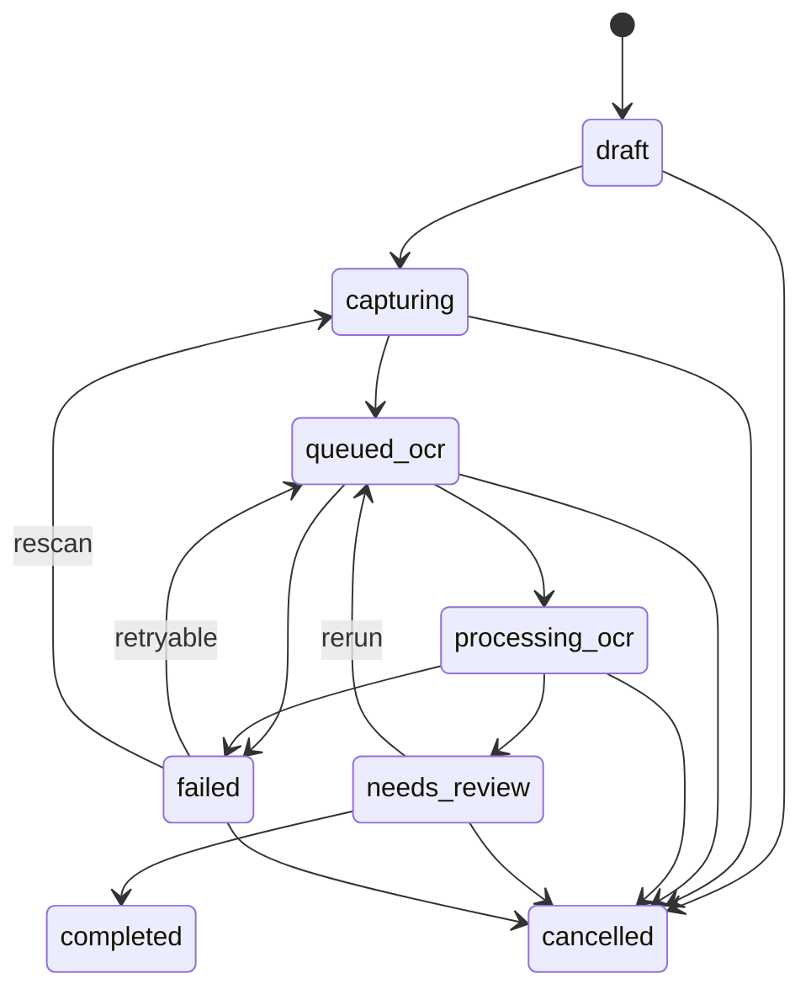

# ALYR Capture Pipeline and Adapter Contract

Status: deterministic P2 foundation implemented in `src/capturePipeline.js`  
Contract version: 1  
Scope: document scanning/OCR, room batches, QR/NFC labels, location-movement
conflicts, camera adapters, and upload adapters

This contract defines shared outcomes for responsive web, iOS, and Android. It
does not claim that the current web prototype performs server OCR, durable cloud
storage, native document scanning, NFC reads, or background execution. The
checked-in module is deliberately storage-free and service-free: it validates
records and returns the next serializable state, while platform and repository
adapters perform I/O.

## 1. Non-negotiable invariants

1. Every capture record receives a stable caller-generated ID before I/O.
2. Originals remain outside serializable session metadata and are addressed by
   opaque local or remote references.
3. Every original needs a content checksum before a room batch becomes ready.
4. OCR output is a proposal. It becomes a user-confirmed field only after an
   explicit accept or edit decision; it is never legal or external truth.
5. Media order is explicit and one-based. Array position is never an
   independent source of ordering truth.
6. A session checkpoint includes a version and integrity digest. A corrupt or
   unsupported checkpoint is rejected rather than partially restored.
7. An asset label contains only a versioned opaque label ID and checksum. It
   never contains an asset name, owner, household, exact location, value, or
   private reference.
8. A label can resolve to at most one active asset. Reuse or transfer is
   explicit and retains assignment history.
9. A movement command names the assignment ID and revision it observed. A
   contradictory stale movement creates a visible conflict; timestamps never
   silently choose a winner.
10. “Uploaded” requires a server acknowledgement whose checksum matches the
    local original. A transport success without checksum equality is
    `needs-attention`.
11. Web fallbacks disclose missing native capabilities. They never advertise
    background execution, edge detection, process-death survival, or resumable
    chunks when those behaviors are absent.
12. Adapter code cannot mutate canonical state directly. The caller applies
    adapter results through the pure transitions in this module.

## 2. Module boundary

`src/capturePipeline.js` owns:

- versioned capture records;
- deterministic state transitions and validation;
- adapter shape validation;
- OCR proposal and human-review semantics;
- ordered, resumable room-session metadata;
- opaque label payloads and append-only assignment history;
- location-movement conflict evaluation and explicit resolution;
- deterministic upload queue, leases, retries, and checksum acknowledgement;
- browser file-picker and foreground-upload fallback adapters.

It does not own:

- React UI or navigation;
- local file bytes, IndexedDB, SQLite, Keychain, or Keystore;
- authentication, authorization, encryption, or key management;
- OCR engines or network transports;
- camera permissions or native lifecycle callbacks;
- remote object storage or sync;
- authoritative asset/location mutations.

The application/repository layer must persist the returned state and the
relevant file bytes atomically enough that the checkpoint never points to bytes
already intentionally deleted.

## 3. Document scan and OCR lifecycle



Stored names use hyphens: `queued-ocr`, `processing-ocr`, and `needs-review`.
`completed` and `cancelled` are terminal.

Core transitions:

| Function | Precondition | Outcome |
|---|---|---|
| `createDocumentScanJob` | Stable job/household IDs | Empty `draft` job |
| `appendDocumentScanPage` | `draft` or `capturing` | Ordered page; status `capturing` |
| `removeDocumentScanPage` | `capturing` | Page removed and ordinals compacted |
| `queueDocumentOcr` | Page exists; capture/retry/review state | Adapter and language hints recorded |
| `startDocumentOcr` | `queued-ocr` | Attempt ID locks the active run |
| `applyDocumentOcrResult` | Matching active attempt | Validated proposals; `needs-review` |
| `failDocumentOcr` | Queued/active OCR | Typed retryable or terminal failure |
| `retryDocumentOcr` | Retryable `failed` job | New queue pass and incremented retry count |
| `reviewDocumentOcr` | Every proposal has a decision | Accepted/edited user-confirmed fields |
| `cancelDocumentScan` | Non-terminal job | Terminal cancellation with actor/time |

An OCR result must:

- identify its adapter and version;
- return exactly one page result per captured page;
- cite only page IDs present in the scan;
- give every proposal a stable field ID and one or more source pages;
- use confidence values in the inclusive range `0..1`;
- avoid duplicate page or field IDs.

The review step requires `accept`, `edit`, or `reject` for every proposal.
Accepted output uses `source: "user-confirmed-ocr"` and records reviewer and
time. This means “the user confirmed what the OCR suggested,” not “the issuer
or ALYR verified the fact.”

### OCR adapter v1

```js
{
  id: "platform-or-engine-id",
  version: "engine-contract-version",
  async extract({
    jobId,
    attemptId,
    pages: [{ id, mediaId, mimeType, checksum }],
    languageHints
  }) {
    return {
      pages: [{ pageId, text, confidence, language }],
      proposedFields: [{
        id,
        key,
        label,
        value,
        confidence,
        sourcePageIds
      }],
      warnings: []
    };
  }
}
```

`executeOcrAdapter` validates the request boundary and injects the registered
adapter identity into the result. Tests and offline demos can use
`createDeterministicOcrAdapter`; production clients must use a reviewed local
engine or an authenticated extraction service without changing result
semantics.

## 4. Batch room capture and resumability

A room session belongs to one household, Place, and nested space. It moves
through:

```text
draft → capturing ⇄ paused → ready → committed
             └──────────────→ abandoned
```

Each media descriptor contains:

```js
{
  id,                    // stable before capture
  localRef,              // opaque IndexedDB/native protected-file reference
  ordinal,               // explicit 1..n sequence
  kind,                  // photo, video, audio, scan, etc.
  mimeType,
  checksum,              // required before ready
  byteSize,
  source,                // camera/document-scanner/file-picker/share/unknown
  capturedAt,
  note
}
```

Append, removal, and reorder are allowed only while actively capturing.
Pausing preserves media and sequence. `createRoomCaptureCheckpoint` returns a
versioned JSON-safe envelope; `serializeRoomCaptureCheckpoint` produces a
canonical representation; `restoreRoomCaptureCheckpoint` verifies its digest,
version, session shape, and contiguous ordering.

The digest detects accidental metadata corruption. It is not a cryptographic
signature and must not be presented as tamper-proof security. Production
repositories still need authenticated encryption and a cryptographic checksum
for original bytes.

`commitRoomCaptureSession` is idempotent for the same commit ID. The integration
layer should use that ID as the server idempotency key when it creates evidence
links, proposed items, or room records.

## 5. QR and NFC label semantics

QR and NFC encode the same payload:

```text
alyr:asset-label:v1:<opaque-label-id>:<integrity-check>
```

`encodeAssetLabel` creates the payload. `createNfcAssetLabelRecord` wraps it in
MIME type `application/vnd.alyr.asset-label`. `decodeAssetLabel` accepts the QR
string or that NFC record and rejects unsupported versions, malformed IDs,
incorrect media types, and checksum mismatches.

The short payload check detects transcription/camera errors; it is not a
security MAC. A copied label can be replayed. Production resolution therefore
requires authenticated household access and must never return record-existence
details before authorization.

Label registry behavior:

- `assignAssetLabel` creates one active mapping and is idempotent by assignment
  ID.
- Assigning an active label to another asset returns
  `LABEL_ALREADY_ASSIGNED`.
- `unassignAssetLabel` requires the asset ID observed by the caller.
- `transferAssetLabel` atomically closes the observed assignment and appends a
  new one.
- `resolveAssetLabel` returns only the active local mapping; server-side
  authorization remains mandatory in production.

Assets may have multiple physical labels, but each label has at most one active
asset. A label stuck to a storage box should normally identify the box/container
record, not imply that every item inside has the same immutable location.

## 6. Location movement conflicts

Every offline-capable movement command contains:

```js
{
  id,                       // idempotency key
  assetId,
  expectedAssignmentId,     // active assignment observed by the client, or null
  expectedRevision,         // observed revision, 0 for no assignment
  to: { status, placeId, spaceId, locationDetail },
  proposedBy,
  deviceId,
  proposedAt,
  newAssignmentId
}
```

`evaluateMovementCommand` returns one of four outcomes:

| Kind | Meaning |
|---|---|
| `idempotent` | This command ID was already applied. |
| `already-satisfied` | Current canonical location already equals the target. |
| `apply` | Observed assignment ID/revision still match; close old and append new. |
| `conflict` | Another movement changed the location after the client observation. |

The conflict retains both the current assignment and proposed target. Neither
the latest client timestamp nor the device type wins automatically.
`resolveMovementConflict` requires one visible decision:

- `keep-current`;
- `apply-proposed`;
- `custom` location.

Applying the proposal or a custom location closes the current assignment and
appends a new assignment with `source: "conflict-resolution"`, resolver, time,
and conflict ID. Replaying an already resolved conflict returns the stored
outcome instead of changing the decision.

Server authorization and record-version checks remain authoritative. A revoked
member’s queued movement must be denied even when the local base revision still
matches.

## 7. Upload queue and background execution

The serializable queue has deterministic tasks:

```text
queued → uploading → uploaded
   ↑          ├────→ queued (retryable failure / expired lease)
   └──────────┴────→ needs-attention (terminal failure / checksum mismatch)
                         └── cancelled (repository integration)
```

Implemented v1 functions:

- `enqueueBackgroundUpload`: idempotent task creation with local checksum.
- `selectNextBackgroundUpload`: oldest eligible queued task.
- `claimNextBackgroundUpload`: time-bounded lease and attempt increment.
- `acknowledgeBackgroundUpload`: accepts only the active lease and matching
  server checksum.
- `failBackgroundUpload`: typed retry schedule or `needs-attention`.
- `recoverExpiredBackgroundUploads`: makes interrupted work resumable.

A native scheduler may wake and process a task, but it cannot declare the
canonical task uploaded by itself. It returns a receipt to the shared
transition, which verifies lease and checksum.

### Background upload adapter v1

```js
{
  id,
  kind: "native" | "web-foreground-fallback",
  getCapabilities() {
    return {
      backgroundExecution,
      resumableChunks,
      survivesProcessDeath,
      requiresForeground
    };
  },
  async upload(claimedTask, { signal }) {
    return { remoteRef, serverChecksum };
  }
}
```

The checked-in `createWebForegroundUploadAdapter` is intentionally honest:
background execution, chunk resume, and process-death survival are `false`, and
foreground is required. The injected transport is called only when application
code explicitly processes a claimed task.

Native implementations:

- iOS: protected file URL plus background `URLSession`; restoration maps the
  native task identifier to the stable ALYR upload task ID.
- Android: protected file URI plus WorkManager/foreground-service policy as
  appropriate; the worker maps its job identifier to the stable ALYR upload
  task ID.
- Both platforms must persist the lease/queue before scheduling work, stream
  rather than load large originals into memory, validate server checksum, and
  surface permission/storage/network failures with the shared error semantics.

## 8. Camera adapter and web fallback

### Camera adapter v1

```js
{
  id,
  kind: "native" | "web-fallback",
  getCapabilities() {
    return {
      camera,
      documentEdgeDetection,
      multiPageScan,
      rawCapture,
      backgroundCapture
    };
  },
  async capture({
    mediaIds,       // caller allocates one stable ID per possible result
    capturedAt,
    accept,
    multiple,
    captureHint
  }) {
    return [{
      id,
      fileOrNativeRef,
      fileName,
      mimeType,
      byteSize,
      source,
      capturedAt
    }];
  }
}
```

`createWebCameraFallbackAdapter` delegates to an injected browser file-picker
bridge. It supports camera capture hints where the browser honors them, but
reports no document-edge detection, RAW capture, or background capture. The
returned `file` is transient and must be validated/checksummed/stored through
the existing file repository before its opaque local reference enters a room
session.

iOS and Android adapters may use native camera/document-scanner APIs, but they
must return the same stable IDs, media metadata, ordered pages, and interruption
outcomes. Permission denial is a recoverable adapter error; it must retain the
draft and offer the platform picker fallback.

## 9. Integration order

1. Add repository tables/stores for scan jobs, room sessions, upload queues,
   label assignment history, and movement conflicts.
2. Wrap current IndexedDB originals behind a media repository returning opaque
   `localRef` values and cryptographic SHA-256 checksums.
3. Add web capture UI that maps each user action to these transitions and shows
   capability limitations.
4. Add an authenticated upload API with idempotency, resumable chunks,
   server-side checksum acknowledgement, authorization, and encrypted object
   storage.
5. Add OCR as an isolated adapter and require the shared review transition
   before any extracted proposal updates an Asset Passport.
6. Add permission-safe label resolution and a visible reassignment flow.
7. Integrate movement command revisions with canonical location history and a
   conflict-resolution screen.
8. Implement native adapters against this contract and run the same fixture
   vectors on web, iOS, and Android.

## 10. Acceptance vectors

The focused Node test suite proves:

- complete OCR queue/attempt/proposal/review behavior;
- stale and non-retryable OCR protection;
- deterministic adapter execution;
- ordered room batches, pause/checkpoint/restore/commit, corruption detection,
  and checksum gating;
- QR/NFC parity, privacy-minimal payload, checksum rejection, assignment
  idempotency, transfer history, and collision protection;
- successful, duplicate, already-satisfied, conflicting, and explicitly
  resolved movement outcomes;
- deterministic upload claiming, checksum acknowledgement, retry scheduling,
  expired-lease recovery, and mismatch attention state;
- honest web camera and foreground-upload fallback capabilities.

This suite is contract evidence for the pure foundation only. Production
completion still requires integration, authenticated storage/service tests,
browser journeys, native lifecycle tests, real-device camera/NFC tests, and
security review.
