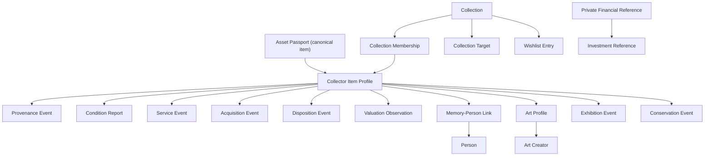

# Collector, Memory, Art, and Private-Finance Experience

Status: canonical workspace bridge, collection surfaces, and functional Care &
Goals flow implemented; production authorization and native adapters remain
future work  
Contracts: `src/collectorDomain.js`, `src/collectorWorkspace.js`  
Contract version: Collector schema v1, showcase projection v1

## 1. Product promise

Continuity should not feel like a cold inventory or a net-worth dashboard. It
should feel like a private museum, care log, family archive, and continuity
plan:

> I know what I have, why it matters, how to care for it, and how its story can
> continue.

The emotional outcome is pride without performance. The practical outcome is
that an item can be identified, found, cared for, explained, and eventually
handed to another person without losing its context.

## 2. Product hypothesis and research status

The following pain points are product hypotheses, not yet validated findings
from Continuity customers. They should drive interviews and usability tests:

1. **The record is fragmented.** Photos live in a camera roll, receipts in
   email, certificates in a drawer, service history in messages, and the
   collection list in a spreadsheet or a collector's memory.
2. **Collectors know an item visually but cannot name it precisely.** Edition,
   reference, variant, production year, serial, and catalog systems vary by
   collecting domain.
3. **Provenance disappears.** Who owned, made, gifted, exhibited, or serviced
   an item is often lost before the object is lost.
4. **Condition changes silently.** A collector may not notice that a service,
   inspection, conservation review, or insurance valuation is stale.
5. **Duplicate records are easy to create.** Imports, room scans, receipts, and
   family members can all describe the same item differently.
6. **Wishlists become shopping noise.** A useful wishlist should explain the
   gap an item fills, not become an endless commerce feed.
7. **Value can overpower meaning.** Collectors need private acquisition and
   valuation records, but the primary experience should celebrate knowledge,
   care, story, and curation.
8. **Sharing creates fear.** A beautiful public collection page must never
   reveal an exact location, serial, acquisition price, valuation, seller,
   account reference, or original document.
9. **Family objects are relational.** A random notebook, dress, photograph, or
   tool matters because of a person and a memory, not because it is a
   conventional collectible.
10. **Specialist domains need specialist facts.** Art needs creator,
    exhibition, edition, condition, and conservation data; watches need
    reference, variant, and service; other collecting domains will need
    optional profiles later.
11. **Financial continuity is useful and dangerous.** A household may need to
    know that an account or investment exists and where its official documents
    are, while Continuity must never become a password, PIN, seed-phrase, or
    full-account-number store.

Before treating these as market evidence, run contextual interviews with at
least five collectors across two collecting domains, three family archivists,
two art owners or collection managers, and three households responsible for
financial continuity.

## 3. Experience principles

### 3.1 One item, many meanings

The Asset Passport remains the canonical item. A watch can simultaneously be a
collectible, investment, heirloom, memory, insured item, and member of multiple
collections. The collector model adds facets; it does not create a second
inventory.

### 3.2 History is appended, not overwritten

Acquisition, disposition, provenance, condition, service, valuation,
exhibition, and conservation are histories. A correction adds a new event or a
future compensating record. Editing a title must not erase how a fact was
previously understood.

### 3.3 Completion and health answer different questions

- **Completion:** How well have I documented and curated this collection?
- **Health:** What needs attention to keep the collection safe and current?

A beautifully documented item can still need service. A healthy item can still
need a story. Neither result is stored as a counter; both are derived from
canonical records.

### 3.4 Pride is not a leaderboard

Celebrate stories preserved, pieces understood, care completed, gaps filled,
and a collection statement made coherent. Do not rank people by collection
value, quantity, rarity, or spending.

### 3.5 Private by default, showcase by projection

The showcase is not the private record with fields hidden in CSS. It is a new,
allowlisted projection that contains only deliberately public derivatives and
public summaries.

### 3.6 Financial references are pointers, never access

Continuity records that an account or position exists, the institution, an
optional four-character ending, a safe portal URL, responsible people, review
date, and linked documents. It never records how to sign in or recover access.

### 3.7 Memory subject determines location, not sentiment

A memory may preserve a physical object, a story, a person, or a moment. Only a
physical object enters the Place and room/container stage. Story, person, and
moment records use not-applicable location semantics so a meaningful memory is
never forced into a false physical Place.

People are canonical private records linked to memories through explicit
relationships. A living person's showcase identity requires granted consent
and a deliberate public label. Unknown living status fails closed. When two
canonical people share a name, capture must choose one explicitly or create a
distinct record; name similarity never silently merges them.

### 3.8 Review stays bound to the source

A material cannot be reviewed without a usable source. For a file, Continuity
loads the original and requires the evidence ID, file name/type/size, and
SHA-256 over the bytes to match canonical evidence metadata. Replacing any
file-identity field revokes review and reopens the proof task. A missing original
can be reattached to the same material, but the new file remains pending until
it passes the same integrity gate.

The original material's physical storage is independent of the parent Asset's
location. Paper and artifact records may be known at an exact Place plus
room/container or locator, need more detail, be honestly unknown, be held by
another person or organization, or be not applicable. Corrections append
actor-attributed history with immutable Place and nested-path snapshots.

On-device originals are account/household and recovery-generation scoped.
Replacement creates or reuses a content-derived immutable version and moves
only the current pointer. File-backed standard capture, document pages, and
room-photo sessions commit the next workspace, current pointers, immutable
versions, generation head, and idempotency receipt in one IndexedDB transaction,
so failure cannot leave partial metadata or orphan bytes.

The browser may store PDF, HEIC/HEIF/AVIF photos, MP4/MOV video, supported
audio, text, Word, and Excel originals. Inline viewing is limited to JPEG, PNG,
WebP, and AVIF; every other original is download-only until a separately
generated safe rendition exists.

## 4. User jobs

The collector experience supports six recurring jobs:

| Job | User question | Product response |
|---|---|---|
| Capture | “What is this?” | Fast item identity with photo, maker/title, variant, and duplicate check |
| Understand | “What exactly do I own?” | Edition, identifiers, provenance, acquisition, and specialist profile |
| Care | “What needs attention?” | Condition, service, conservation, and review timeline |
| Complete | “What is missing from this set?” | Explicit target plan and purposeful wishlist |
| Curate | “Why am I proud of this?” | Story prompts, highlights, cover, featured pieces, and collection statement |
| Continue | “Could someone else understand this?” | Person relationships, private references, documents, permissions, and handoff |

## 5. Domain model



### 5.1 Core entities

| Entity | Responsibility |
|---|---|
| `Collection` | Collection identity, collecting thesis, curation, completion mode, care policy, and showcase configuration |
| `ItemProfile` | Collector-specific identity linked to one canonical `assetId`; edition, variant, story, media derivatives, care plan, and optional art profile |
| `Membership` | Many-to-many collection membership with owned/former/reference role, order, and explicit showcase eligibility |
| `CollectionTarget` | A deliberate slot in a target list, edition run, or one-of-each plan |
| `WishlistEntry` | Research intent, priority, private budget, candidate links, and optional target relationship |
| `ProvenanceEvent` | Append-only chain of creation, ownership, gifting, inheritance, exhibition, publication, authentication, or rediscovery |
| `ConditionReport` | Dated grade, issues, next review, private assessor/source, and optional public summary |
| `ServiceEvent` | Planned or completed care, provider, cost, next due date, and supporting materials |
| `AcquisitionEvent` | Dated method, source, price, place, and supporting materials |
| `DispositionEvent` | Dated sale, gift, donation, trade, loss, destruction, or return |
| `ValuationObservation` | Dated value in integer minor units, ISO currency, kind, source, confidence, and evidence |
| `Person` | A household person's display identity, relationship, living status, consent, and optional public label |
| `MemoryPersonLink` | The relationship between an item and person, private memory, public summary, and showcase choice |
| `ArtCreator` | Creator identity and intentionally public biographical fields |
| `ExhibitionEvent` | Exhibition, venue, dates, catalog reference, sources, and public summary |
| `ConservationEvent` | Treatment or review, conservator, before/after condition links, next review, sources, and public summary |
| `PrivateFinancialReference` | Private institution/account pointer with no credential or full account number |
| `InvestmentReference` | Private position pointer linked to an optional financial reference; not a trading or live-price record |

### 5.2 Edition and variant rules

Edition is optional and independent from general identity:

- `unique`
- `numbered`
- `limited`
- `artist-proof`
- `printer-proof`
- `open`
- `production`
- `unknown`
- `not-applicable`

For numbered and limited editions, the edition number cannot exceed the edition
size. Production variants use a variant name and attributes. An item's private
serial or certificate identifier is separate from its edition identity and is
never included in a showcase.

### 5.3 Collection roles

A profile can join several collections:

- `owned`: currently part of this collection.
- `former`: previously part of the collection, preserving its story.
- `reference`: useful research or comparison material, not owned.

This prevents a collector from duplicating an Asset Passport merely to show the
same piece in “Family heirlooms,” “Mechanical watches,” and “Travel memories.”

## 6. Canonical flows

### 6.1 Start a collection

1. Name the collection.
2. Choose a broad collecting character: collectibles, art, memory, archive,
   portfolio, or mixed.
3. Optionally state the idea that connects the pieces.
4. Choose open-ended or a target-based completion mode.
5. Add an existing Asset Passport or capture the first item.
6. Show one next action: identify, photograph, tell its story, or define the
   first target.

Do not begin with a long taxonomy questionnaire. A collection may begin with
one photograph and a sentence.

### 6.2 Add a collectible

1. Take or select a photo.
2. Search existing items and run duplicate detection before creating.
3. Capture a human name, then optional maker, model/title, series, reference,
   year, variant, edition, and private identifiers.
4. Link one or more collections.
5. Record how it was acquired.
6. Add condition only if useful now; preserve a recoverable draft otherwise.
7. Ask an emotional prompt after the practical save: “Why did you keep this?”

Quick capture must remain valid with missing specialist fields. Completion
surfaces the gaps later without calling the item “bad.”

### 6.3 Resolve a possible duplicate

Duplicate detection proposes, never auto-merges:

1. Compare photos and high-confidence identity reasons.
2. Show which identifiers, maker/title/edition, or reference/variant matched.
3. Choose:
   - same item: attach new material/history to the existing Passport;
   - two physical examples: keep both and describe differentiating details;
   - uncertain: save as possible duplicate and review later.
4. Preserve every source and acquisition record during a future merge.

### 6.4 Build a purposeful wishlist

1. Start from an explicit gap or create an open research wish.
2. Record why it belongs, desired identity, priority, optional private budget,
   and candidate links.
3. Suggest already-catalogued items that match the target, but never auto-link.
4. When acquired, link the new or existing Asset Passport and mark the gap
   filled.
5. Keep `passed` wishes as private research history or archive them.

No marketplace ranking, urgency timer, or price-pressure mechanic belongs in
the core experience.

### 6.5 Care for a collection

1. Home presents one most important care action.
2. Collection Health explains why: poor condition, service overdue, stale
   condition review, stale private valuation, provenance gap, or possible
   duplicate.
3. Complete the relevant record and attach supporting material.
4. Health recalculates from facts.
5. Show a quiet confirmation such as “Care history updated,” not confetti for
   expensive maintenance.

### 6.6 Tell the story and feel proud

1. Select a cover and a small featured set.
2. Write the collection statement.
3. Add one public excerpt per item; keep the full private narrative separate.
4. Show milestones such as pieces brought together, stories preserved, target
   plan completed, and public-ready pieces.
5. Preview exactly what another person would see.

The pride surface should feel editorial: generous imagery, quiet typography,
clear provenance, and restrained progress. Avoid dense dashboard cards.

### 6.7 Link a memory or loved person

1. Choose the subject: physical object, story, person, or moment.
2. For a physical object, create or choose the canonical item and locate it at
   an exact Place plus room/container path when known. A story, person, or
   moment skips physical location.
3. Choose an existing canonical person or create a distinct person record, then
   describe the memory relationship. Never auto-merge ambiguous same-name
   people.
4. Add the private memory, date, media, voice note, or document.
5. Set a public label and public summary only if desired.
6. For a living person, require explicit granted consent before showing their
   identity in a showcase. Unknown living status and declined/not-requested
   consent fail closed.
7. A deceased person's identity remains private by default and appears only
   after an explicit curator choice and public label.

Person links are relational context, not ownership proof.

### 6.8 Catalog art

1. Identify title, creator, medium/support, creation year, dimensions,
   signature, edition, inscriptions, and catalog reference.
2. Attach authenticity-related material without claiming that Continuity
   itself authenticates the work.
3. Append exhibition events with catalog evidence.
4. Record condition and conservation separately; link before/after reports.
5. Schedule the next conservation or framing review where relevant.
6. Create a public art label from allowlisted fields and public summaries.

Private appraiser, conservator, seller, price, exact location, catalog inventory
number, and original reports never enter the showcase projection.

### 6.9 Add a financial or investment reference

1. Explain the boundary before entry: “Reference only—never enter passwords,
   PINs, keys, recovery phrases, or a full account number.”
2. Record label, institution, kind, optional four-character ending, currency,
   jurisdiction, safe portal link, responsible people, linked documents, and
   review date.
3. Optionally add private investment references with asset class, public
   ticker/reference, quantity, responsible people, and documents.
4. Validate before saving. A credential-like key, credential-like note, full
   account number, embedded URL credentials, or credential query parameter
   fails closed.
5. Force visibility to `private`; ignore any request to publish.

Continuity is not a password manager, bank connection, trading app, tax ledger,
or authoritative statement of balance.

## 7. Derived completion

`selectCollectionCompletion` derives item and target completion.

### 7.1 Applicable item dimensions

| Dimension | Complete when |
|---|---|
| Identity | Human name plus a distinguishing maker, model, title, reference, identifier, or memory meaning |
| Visual | Cover, original, or public derivative exists |
| Edition | Edition is not applicable, or its required number/size/proof/variant is documented |
| Provenance | At least one provenance or acquisition event exists |
| Condition | A non-memory item has a condition report |
| Care | An item requiring service has a completed service event |
| Story | Narrative, meaning, or pride note exists |
| Art | Artwork title, known creator, and medium exist |
| Valuation | Only when the collection opted into private valuation tracking |

Not-applicable dimensions are excluded, not counted as failures. For a
target-based collection, the overall result weights item documentation at 75%
and required target completion at 25%. The return value includes each
checklist and dimension, so UI copy can explain the result.

This score is a guide, never an appraisal or measure of collector quality.

## 8. Derived collection health

`selectCollectionHealth` accepts an explicit `asOf` time and derives:

- condition requiring attention;
- stale or missing condition review;
- overdue service;
- stale or missing private valuation when opted in;
- missing provenance/acquisition;
- likely duplicate pairs.

Health states:

- `empty`: no current owned items;
- `healthy`: no due care or documentation alerts;
- `attention`: non-urgent reviews or documentation gaps;
- `needs-care`: poor/attention condition or overdue service.

The selector returns visible reasons and recommended item targets. It does not
store or increment a health score.

## 9. Duplicate-detection contract

`detectLikelyDuplicates` returns candidates, confidence, and human-readable
reasons:

| Signal | Approximate confidence |
|---|---:|
| Same canonical Asset Passport | 1.00 |
| Same normalized private identifier type/value | 0.98 |
| Same maker, title, and numbered edition | 0.92 |
| Three matching identity fields or maker + reference | 0.84 |
| Same display name plus year or identity detail | 0.72 |

The default review threshold is 0.70. Category or collection membership alone
never creates a match. This is candidate discovery, not automatic truth.

Future visual similarity, OCR, registry, and import matching must add reasons
and sources rather than replacing these rules with an unexplained score.

## 10. Showcase privacy contract

`projectCollectionForShowcase` and `projectItemForShowcase` build new allowlisted
objects. They do not clone and redact the private records.

### 10.1 Allowed

- chosen public title, subtitle, theme, statement, and story excerpt;
- explicitly eligible collection memberships;
- public derivative media IDs;
- maker, model, artwork title, series, year, variant, and optional edition
  display;
- public condition summary when opted in;
- public provenance summaries;
- public creator biography and explicitly public exhibition/conservation
  summaries;
- a person public label and summary only after the relationship and person are
  both opted in, with granted consent for a living person.

### 10.2 Always excluded

- household, asset, profile, membership, event, person, and account IDs;
- serial, certificate, registry, or other private identifiers;
- exact or approximate location;
- acquisition price, valuation, service cost, sale proceeds, and budget;
- seller, buyer, appraiser, provider, conservator, and private party labels;
- private person names or memories;
- financial and investment references;
- original media, receipts, certificates, reports, and material IDs;
- private notes, full provenance text, and private art catalog references.

The projection has its own version because a privacy contract must be reviewed
as an API, not treated as presentation code.

## 11. Financial safety contract

Allowed fields are deliberately narrow. Every saved financial and investment
record has `visibility: "private"` regardless of input.

### 11.1 Never accepted

- password, passcode, PIN, OTP, username, or login;
- API/client secrets or access/refresh/bearer tokens;
- private keys, seed/mnemonic/recovery phrases, or recovery codes;
- CVV/CVC or security answers;
- full account, routing, IBAN, SWIFT/BIC, or sort-code fields;
- account-number-like long numeric content;
- URL-embedded credentials or credential-like query parameters;
- freeform access instructions.

Unknown fields are not persisted. Valid portal URLs keep only the HTTP(S)
origin and path; query parameters and fragments are removed.

### 11.2 Production requirement

This domain contract prevents supported serializers from retaining credential
fields. It is not a substitute for P1 authentication, tenant authorization,
encrypted durable storage, secure key handling, audit logs, and redaction in
telemetry and support tooling. Financial-reference UI should remain disabled
or clearly local-only until the production security boundary exists.

## 12. Technical API

| Export | Purpose |
|---|---|
| `createEmptyCollectorState` | Explicit schema-versioned empty state |
| `normalizeCollectorState` | Fail-closed normalization and reference repair |
| `collectorReducer` | Idempotent upserts and append-only history commands |
| `validatePrivateFinancialReference` | Blocks credentials, full account numbers, and unsafe portal URLs |
| `validateInvestmentReference` | Blocks credentials and invalid position references |
| `detectLikelyDuplicates` | Candidate duplicate matches with reasons |
| `selectDuplicateGroups` | Unique possible-duplicate pairs |
| `selectCollectionCompletion` | Explainable documentation and target completion |
| `selectCollectionHealth` | Explainable care and freshness state |
| `selectCollectionGaps` | Open target slots, purposeful wishlist, and existing candidates |
| `selectCurrentCollectorLifecycle` | Acquisition/disposition history projection |
| `selectCollectionPrideSummary` | Non-financial collection and story milestones |
| `projectItemForShowcase` | Privacy-safe public item projection |
| `projectCollectionForShowcase` | Privacy-safe public collection projection |

All selectors are pure and derived. The module has no browser storage, React,
network, authentication, or file access.

### 12.1 Canonical workspace bridge

`src/collectorWorkspace.js` is the integration boundary between the simple
canonical workspace and the richer collector contract:

| Export | Purpose |
|---|---|
| `collectorProfileIdForAsset` | Deterministically maps one Asset Passport to one collector profile |
| `reconcileCollectorState` | Reconciles canonical assets, collections, memberships, and material-derived history without duplicating the inventory |
| `applyCollectorCommand` | Applies one collector command and immediately reconciles it with current canonical workspace context |

`src/domain.js` owns the integrated source of truth. It:

1. Reconciles `workspace.collector` while normalizing a snapshot.
2. Reconciles again after every canonical workspace mutation.
3. Routes UI collector mutations through `APPLY_COLLECTOR_COMMAND`.
4. Keeps simple collection membership authoritative for corresponding
   collector memberships.
5. Retains append-only collector history and user-defined targets while
   refreshing canonical names, status, media links, and evidence-derived
   history.

The bridge means the rich collector model is no longer an isolated parallel
store. An Asset Passport remains canonical; the collector profile adds
specialist facets and derived views.

## 13. Web and native presentation contract

The same business meanings apply to web, iOS, and Android:

1. Collections remain inside Assets, not a fifth primary destination.
2. Capture begins from item intent and runs a duplicate check.
3. Collection detail uses editorial sections: Showcase, Catalog, Story, Proof,
   Care, and Access.
4. Completion explains documentation; Health explains due care.
5. Wishlist is organized by gaps and research state.
6. Memory/person linking defaults private and shows consent state.
7. Art adds specialist sections without changing the universal Asset Passport.
8. Financial references live in Vault/private surfaces and never appear in
   collection showcases.
9. Public preview renders the exact showcase projection, not a simulated mask
   over private data.
10. Each surface presents one next-best action rather than a grid of equal
    calls to action.

### 13.1 Current Care & Goals web flow

The collection `Care` tab is functional and persisted:

1. Health and documentation completion are derived separately.
2. Attention cards explain stale condition reviews or overdue service.
3. **Add care record** appends a private dated condition report.
4. A piece row can append a dated service event with provider, outcome, and
   next-due context.
5. **Define a collection gap** adds a deliberate target and changes the
   collection to target-list completion.
6. **Add research wish** creates a research record optionally linked to a
   target; it is not a marketplace feed.
7. **Match an existing piece** explicitly fills a target. Candidate matches
   are suggestions only.
8. Every command flows through the canonical workspace reducer and survives
   refresh through the versioned local snapshot.

Condition and service records are append-only and idempotent by record ID.
Targets and research wishes are explicit upsert records so their status can
progress without rewriting historical care events. No health or completion
counter is authoritative; selectors derive both from current records.

## 14. Validation plan

### 14.1 Automated foundation

`tests/collector-domain.test.mjs` covers:

- schema and referential normalization;
- collection membership and curation repair;
- edition and variant validity;
- append-only/idempotent history;
- acquisition/disposition projection;
- target completion and wishlist gaps;
- duplicate matching and false-positive boundaries;
- condition, service, valuation, and provenance health;
- credential and full-account-number rejection;
- private financial/investment normalization;
- living-person consent;
- art creator, exhibition, and conservation projection;
- showcase allowlist exclusions;
- non-financial pride milestones.

`tests/collector-workspace.test.mjs` additionally proves:

- one reconciled collector state is carried by the canonical workspace;
- Asset Passport/profile and simple/rich collection membership mapping;
- append-only/idempotent care history through canonical workspace commands;
- persisted collection targets without a second inventory;
- integrity-gated material review and placement snapshots.

`tests/memory-continuity.test.mjs` proves the physical versus story/person/moment
capture stages, canonical person reuse, explicit living-person consent/public
labels, fail-closed unknown status, and no silent merge for ambiguous same-name
people.

`tests/app-flow.test.jsx` exercises the actual Care & Goals UI, persists a new
condition report, persists a high-priority collection target, and reloads the
same canonical snapshot. These checks run with the broader domain, UI,
file/recovery, account-scope, local-service, and routing suites that protect the
current web baseline.

Run:

```sh
node --test tests/collector-domain.test.mjs
```

### 14.2 Product validation

Prototype and test these scenarios before expanding taxonomy:

1. A watch collector imports a spreadsheet and two photo folders, detects one
   duplicate, and reconstructs service history.
2. An art owner records a numbered print, exhibition, condition, and
   conservation review, then previews a public label.
3. A family archivist captures an ordinary kitchen object and connects three
   people without exposing a living relative.
4. A collector defines a five-piece target set and turns one gap into a
   research wishlist entry.
5. A household records a brokerage reference and tries to paste a password,
   account number, seed phrase, and credential-bearing URL.
6. A user previews and publishes a showcase, then searches the rendered payload
   for every excluded private value.

Measure:

- time to first meaningful item;
- duplicate saves avoided or resolved;
- percentage of users who add a story after practical capture;
- successful retrieval of provenance/service evidence;
- care actions understood and completed;
- showcase preview confidence;
- attempted credential entry blocked;
- household successor able to explain an item without coaching.

## 15. Integration status and remaining sequence

Implemented in the current web build:

1. Collector schema v1 lives inside the versioned canonical workspace.
2. The reconciliation bridge maps current Asset Passports, collections,
   memberships, and materials without duplicating records.
3. Collection list/detail, art, memory, private-reference, safe showcase, and
   Care & Goals surfaces use that integrated state.
4. Collection Completion, Health, condition/service history, targets,
   research wishes, and explicit target matching are functional.
5. OCR, room batches, and QR/NFC outputs can become canonical materials or
   location history while remaining reviewable and sourced.
6. Memory capture distinguishes physical objects from stories, people, and
   moments and links canonical people through consent-safe private relations.
7. Location assignment revisions preserve Place pins and room/container paths,
   while original-material storage has its own state/history and material review
   is gated by canonical file identity and SHA-256.
8. File-backed standard capture, document pages, and room-photo sessions commit
   workspace metadata and content-derived immutable originals atomically inside
   the active account/recovery-generation scope.
9. Owned/co-owned property uses one reciprocal Place/real-estate passport pair;
   the collector bridge consumes the canonical passport rather than creating a
   duplicate collector property record.
10. The current First Useful Vault guide includes a successful Search
    retrieval, recorded against the active member and result without retaining
    the private query.
11. Authenticated browser workspaces, drafts, recovery state, and originals are
    account-and-household scoped; encrypted local-service backup rejects a
    foreign household context.

Still required before production/native release:

1. Version and publish the collector shapes through the production API rather
   than treating the browser snapshot as a service contract.
2. Enforce household, record, field, original-download, and showcase
   permissions on the server.
3. Add authenticated durable event storage, audit, migrations, conflict
   handling, and multi-device sync.
4. Bind iOS/Android camera, document, background-upload, secure-storage, and
   accessibility adapters to the same commands and selectors.
5. Complete cross-browser, Arabic/RTL, real-device, and production-scale
   validation.

The second requirement remains a production release blocker, but the current
web baseline no longer uses one shared browser workspace. The active session
selects an account-and-household scope for metadata, generations, drafts,
recovery, routes, Search, export, backup context, and IndexedDB originals;
account switching and sign-out remount the matching scope, and local records
move into an account only after explicit verified claim. The local service also
binds encrypted backup to the authenticated household.

Those controls prove a same-device prototype boundary, not production
authorization. Production still requires deployed server enforcement, managed
keys and registered devices, revocation, permission-safe download/showcase
checks, multi-device conflict handling, monitored retention, and
production-like cross-account E2E validation.
