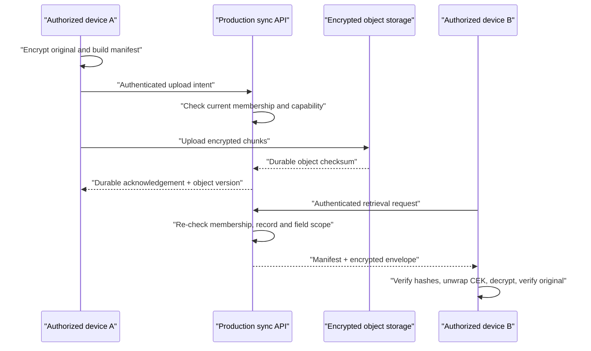

# Asset Continuity secure sync contract

Status: **P1 local integration slice implemented; production services not implemented**  
Contract version: 1  
Last reviewed: 2026-07-25

This document defines the client boundary introduced by
`src/securityVault.js` and `src/syncEngine.js`. The implementation is runnable
and tested, but it does not turn the local prototype into a production vault.
The included sync transport and queue remain deterministic in-memory test
doubles.

`src/recoveryKit.js` is the one production-adjacent use of the cryptographic
foundation in the current UI. Vault can create and restore either a manually
transferred encrypted portable kit or the latest kit stored through the local
same-origin development service in `server/`. Both flows encrypt in the browser
and require the separate vault passphrase to decrypt.

The local service has real cookie authentication, CSRF protection, role
enforcement, atomic filesystem persistence, and durable acknowledgement on this
computer. It is deliberately not an internet-facing production identity,
tenant-isolated database, object store, or automatic sync service. UI may say
that a local encrypted account backup was stored only after that local durable
acknowledgement. It must not call the current product cloud backed up,
production cross-device, automatically synced, or remotely revocable.

## 1. What this foundation now proves

| Capability | Implemented foundation | Still required for production |
|---|---|---|
| Account/session state | Same-origin local account API with opaque `HttpOnly`, `SameSite=Strict` cookies, CSRF checks, salted scrypt passwords, throttling, and owner/admin role enforcement; memory-only client contract remains tested | Production identity provider, passkeys, verified contact points, device registration, session rotation/revocation, recovery, tenant-isolation review |
| Original encryption | AES-256-GCM content key plus PBKDF2/AES-GCM portable key wrapping | Reviewed household/device key hierarchy, secure device key storage, rotation, recovery ceremony |
| Integrity | AEAD validation, internal original SHA-256, ciphertext SHA-256, manifest hash | Resumable chunk checks, object-store verification, backup restore checks |
| Upload | Immutable encrypted-package contract and durable-ack requirement; local whole-vault ciphertext is content-addressed and atomically persisted after checksum/size/context validation | Resumable production network upload API, transactional metadata link, object storage, retention, malware and abuse controls |
| Preview | Explicit inline/generated/download-only policy; SVG/HTML/XML blocked inline | Quarantine, malware scanning, PDF/image transcoding, isolated preview origin |
| Permissions | Deny-by-default capability, record scope, place/collection scope, and sensitive field-group hints; local whole-vault backup and grant endpoints enforce household membership and owner/admin authority | Production policy engine, complete membership lifecycle, row/field enforcement, invitation proof, revocation propagation |
| Sync | Stable operation IDs, idempotency keys, offline queue states, versions, disjoint merge, visible overlap conflicts | Encrypted durable queue, sync API, transactional versions, tombstones, retention, load testing |
| Retrieval | Local authenticated service returns the latest household ciphertext; client rechecks byte length and SHA-256, decrypts in memory, reviews, then atomically replaces originals before metadata | Internet-facing multi-device service, protected local cache, registered devices, revocation, restore drills |
| Audit | Privacy-scrubbed, hash-chained client/server-shaped events | Independent append-only server writer, retention, export, monitoring, clock authority |

## 2. Security boundary and threat statement

The client encrypts originals before a transport adapter receives them. The
transport can validate ciphertext integrity and route the object without
decrypting it. The original SHA-256 is stored inside the encrypted payload,
which avoids exposing a stable plaintext fingerprint to storage infrastructure.

Client-side encryption does **not** protect against:

- malicious script already executing in the app origin;
- a compromised browser, extension, operating system, or unlocked device;
- screen capture or an authorized person copying content;
- weak recovery secrets;
- server traffic analysis from object size, timing, account, or access metadata;
- authorization mistakes in a production service.

No secret, private key, recovery secret, access token, or decrypted content may
be written to logs, analytics, URLs, `localStorage`, or an ordinary serialized
workspace snapshot. IndexedDB and any native cache are untrusted inputs and
must be encrypted and account-scoped in a production adapter.

## 3. Session contract

`MemorySessionStore` has two observable states:

```text
anonymous -> authenticated -> expired
          \-> authenticated -> anonymous (sign out/revocation)
```

`getState()` returns only public session metadata. `getAuthorization()` is the
explicit boundary that releases the in-memory credential to a transport
adapter. JSON serialization returns the public state and never the access
token.

Production requirements:

1. Prefer a same-origin BFF and `HttpOnly`, `Secure`, appropriately `SameSite`
   session cookie where the architecture permits it.
2. If a browser token is unavoidable, keep it memory-only, short-lived,
   audience-scoped, rotated, and sender-constrained where supported.
3. Cookie-authenticated writes require server-side CSRF protection in addition
   to SameSite cookies.
4. Session expiry, account switching, device revocation, and household switching
   clear decrypted caches and active queue views.
5. Client permission checks are presentation only. The service checks current
   membership and capability for every read and write.

## 4. Envelope encryption

### 4.1 Package layout

Each original receives a fresh random 256-bit AES-GCM content-encryption key
(CEK). The plaintext encrypted under the CEK is:

```text
"ALYR01" | SHA-256(original) | uint64(original length) | original bytes
```

The CEK is wrapped with a separately derived AES-256-GCM key:

```text
PBKDF2(secret, random 128-bit salt, SHA-256, iterations)
    -> AES-256-GCM key-encryption key
    -> wrap CEK using a fresh 96-bit IV
```

Both content encryption and key wrapping bind the household ID, blob ID,
purpose, and envelope version as AES-GCM additional authenticated data. Moving
ciphertext to another household/blob/purpose therefore fails decryption.

Defaults:

- content cipher: AES-256-GCM with 128-bit tag;
- key wrap: AES-256-GCM with 128-bit tag;
- PBKDF2: SHA-256 and 310,000 iterations;
- minimum accepted PBKDF2 work factor: 100,000;
- maximum accepted PBKDF2 work factor: 2,000,000, preventing a malicious
  envelope from triggering unbounded client work;
- string wrapping secret: at least 12 characters;
- binary wrapping secret: at least 128 bits.

The client foundation rejects plaintexts above 100 MB and validates exact
envelope overhead before decoding/decrypting. The current product capture limit
can remain lower. Production large-file support uses bounded resumable chunks
rather than raising an unbounded in-memory limit.

The work factor and envelope format are versioned. Production must benchmark
supported devices, review password/recovery UX, and define a migration and key
rotation policy. A user password should not be treated as the long-term
household master key. The preferred target is a random household/content key
wrapped to registered device keys and a separately reviewed recovery method.

### 4.2 Integrity behavior

Decryption succeeds only when all of these agree:

1. supported envelope and algorithm identifiers;
2. expected household/blob/purpose context;
3. ciphertext byte length;
4. ciphertext SHA-256;
5. AES-GCM authentication tags for wrapped key and content;
6. internal original byte length;
7. internal original SHA-256.

Failures return one generic integrity error. They must not reveal whether the
secret, key, context, ciphertext, or metadata was wrong.

## 5. Encrypted upload manifest

`prepareEncryptedUpload()` returns:

```js
{
  envelope: {
    version,
    context,
    contentCipher,
    wrappedKey,
    ciphertext,
    ciphertextSha256,
    ciphertextBytes,
    plaintextBytes,
    createdAt
  },
  manifest: {
    version,
    blobId,
    householdId,
    purpose,
    objectContentType: "application/octet-stream",
    ciphertextSha256,
    ciphertextBytes,
    envelopeVersion,
    createdAt,
    createdByDeviceId,
    preview,
    manifestSha256
  }
}
```

The upload manifest intentionally excludes the original file name, plaintext
checksum, document text, asset name, value, address, and story. Sensitive
metadata belongs in encrypted record mutations. A production object API stores
ciphertext as `application/octet-stream`; it must not infer execution behavior
from a user-supplied extension or media type.

`verifyUploadPackage()` recalculates the manifest and ciphertext hashes before
upload and after download. The backend must also verify the manifest, enforce
size/chunk limits, and acknowledge only after durable object storage and the
metadata transaction succeed.

### 5.1 Required durable state language

```text
On this device -> Queued -> Uploading -> Synced
                            \-> Needs attention
```

- **Queued** means an encrypted local queue accepted the operation.
- **Uploading** means transfer is in progress; it does not imply persistence.
- **Synced** is allowed only when `durableAcknowledgement === true`.
- **Needs attention** covers integrity failure, permission change, conflict,
  unsupported schema, and retry exhaustion.

The in-memory mock returns a durable-shaped acknowledgement for contract tests
only. Product UI must not bind to the mock and display Synced.

## 6. Safe preview contract

`createSafePreviewMetadata()` makes a delivery decision; it does not sanitize
content.

| Source type | Original inline? | Required mode |
|---|---:|---|
| JPEG, PNG, WebP, AVIF | Yes, after access check and decoder hardening | `inline-original` |
| PDF, audio, video | No | server-generated sanitized/transcoded rendition, otherwise download |
| SVG, HTML, XHTML, XML | Never | attachment/download only |
| Word, Excel, unknown binary | Never | attachment/download only |

**Current web enforcement:** persisted evidence detail calls this policy before
rendering an original. JPEG, PNG, WebP, and AVIF can render inline. PDF, audio,
video, SVG/HTML/XML, office, and unknown originals show a protected
download-only surface. Because the local build does not create sanitized
renditions, `generated-rendition` is not used in the live UI. This protects the
browser presentation boundary; it does not replace production access
authorization, content scanning, quarantine, or short-lived delivery URLs.

All preview and download URLs require a current access check and short-lived
authorization. Production preview generation runs in quarantine, stores a
separate rendition object, uses an isolated origin/sandbox, and never feeds the
original into `dangerouslySetInnerHTML`, `srcdoc`, `<object>`, or `<embed>`.
Client validation is UX only; the server validates actual bytes, size, type,
archive structure, and malware policy.

## 7. Permission contract

Roles are presets over capabilities; they are not the final authority:

- owner;
- admin;
- editor;
- contributor;
- viewer.

The model can additionally constrain:

- explicit record IDs;
- Place subtrees;
- collections;
- sensitive field groups;
- expiry;
- active, suspended, or revoked state.

Sensitive field groups are location, value, ownership, legal documents, private
stories, financial references, and export. A missing field group is denied.
Revoked/expired grants are denied. Permission errors are neutral and do not
confirm whether a hidden record or blob exists.

Every production query must apply authorization **before** list counts, search
ranking, snippets, task generation, thumbnails, exports, or notifications.
Moving an asset must preview and then enforce any place-derived access change.
Revocation blocks new fetches immediately; it cannot erase copies already made.

## 8. Offline queue and sync operation

Every mutation receives a stable client ID before upload:

```js
{
  version: 1,
  operationId,
  idempotencyKey,
  householdId,
  deviceId,
  entityType,
  entityId,
  kind,
  changedFields,
  baseVersion,
  encryptedPayload,
  createdAt
}
```

The queue public view never includes `encryptedPayload`. The production queue
adapter must encrypt its contents at rest, namespace them by account and
household, use an atomic write, recover after termination, and keep revoked
unsynced contributions quarantined until the user deliberately discards or
exports them under policy.

Retries reuse the same idempotency key. Reusing an operation ID or idempotency
key with different content is rejected. Accepted mutations receive a
monotonically increasing server record version.

### 8.1 Conflict rules

For a stale base version:

- disjoint changed-field sets can append as separate encrypted field patches;
- overlapping fields never silently use last-write-wins;
- ownership, permissions, value, identifier/reference, lifecycle, and location
  overlaps are explicitly marked sensitive;
- a conflict remains `needs-attention` until a user/client creates a new
  operation against the reviewed server version.

The server stores encrypted mutation patches and version metadata. It does not
need plaintext to detect field overlap. The client with keys pulls authorized
patches, decrypts them, constructs the resolved record, and submits a new
idempotent mutation.

Deletes require tombstones and retention policy in the production schema. They
are not implemented by this foundation.

## 9. Transport adapter interface

`SyncEngine` expects the following asynchronous service-shaped methods:

```js
transport.pushOperation({ authorization, operation })
transport.pullChanges({ authorization, cursor })
transport.uploadEncryptedPackage({ authorization, recordId, uploadPackage })
transport.downloadEncryptedPackage({ authorization, recordId, blobId })
```

Production adapters additionally need:

- fixed same-origin/allowlisted base URL;
- TLS and authenticated requests;
- request cancellation and bounded timeouts;
- resumable, checksummed chunks for large originals;
- CSRF protection when cookies authenticate writes;
- structured, permission-safe errors;
- opaque cursors;
- exponential backoff with jitter and retry budgets;
- device/account change cancellation;
- telemetry that excludes names, addresses, values, identifiers, queries,
  document text, ciphertext, tokens, and keys.

The service must enforce household isolation with database constraints and
policy checks. Client-supplied household, actor, role, version, or audit values
are never trusted as authority.

## 10. Cross-device retrieval sequence



Device B displays the original only after package verification and successful
decryption. A revoked device receives no new envelope or key wrap. Cached
decrypted content is cleared according to platform policy.

## 11. Audit contract

Client audit entries are hash chained and metadata is restricted to an
allowlist of opaque IDs, reason/result codes, device ID, and record version.
Names, stories, queries, OCR text, addresses, values, identifiers, and document
contents are dropped.

Client audit history is useful for local troubleshooting and tamper evidence,
but it is not authoritative: a compromised client can omit or rewrite its full
history. Production creates an independent append-only event after
authorization and transaction completion, using server-received time. Audit
read/export is itself permission scoped.

## 12. Deterministic mock limitations

`DeterministicMemoryTransport` exists only to exercise behavior:

- all state disappears when the process reloads;
- there is no network, database, object store, TLS, backup, or restore;
- bearer tokens are test strings in process memory;
- grants are registered directly by tests;
- cursors are deterministic strings, not production opaque tokens;
- there is no malware pipeline, chunked transfer, key rotation, tombstone, or
  server clock;
- it must never be enabled as a production API.

`corruptBlobForTest()` and `getRecordVersionForTest()` are explicit test hooks.

## 13. Production acceptance gates

The product may claim secure cross-device continuity only after all gates pass:

1. Passkey/device/recovery threat model and independent cryptographic design
   review.
2. Authenticated backend with current-membership and field-scope enforcement on
   every read/write/list/search/export.
3. Durable encrypted queue and protected cache on web, iOS, and Android.
4. Resumable immutable upload with chunk and final checksum verification.
5. Quarantine, malware policy, safe rendition pipeline, and isolated preview.
6. Transactional record versions, idempotency, tombstones, explicit conflict
   resolution, and revocation tests.
7. Encrypted backup plus documented restore drills across device loss and key
   rotation.
8. Privacy-scrubbed server audit, monitoring, retention, and incident response.
9. Cross-tenant, revoked-user, hidden-record inference, CSRF, XSS, and malicious
   file security tests.
10. UI journey tests for offline, expired session, permission denied, conflict,
    corruption, interrupted upload, restore, and account switching.

Until then, the current prototype limitation copy remains authoritative.
