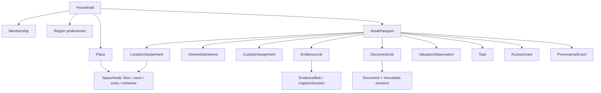
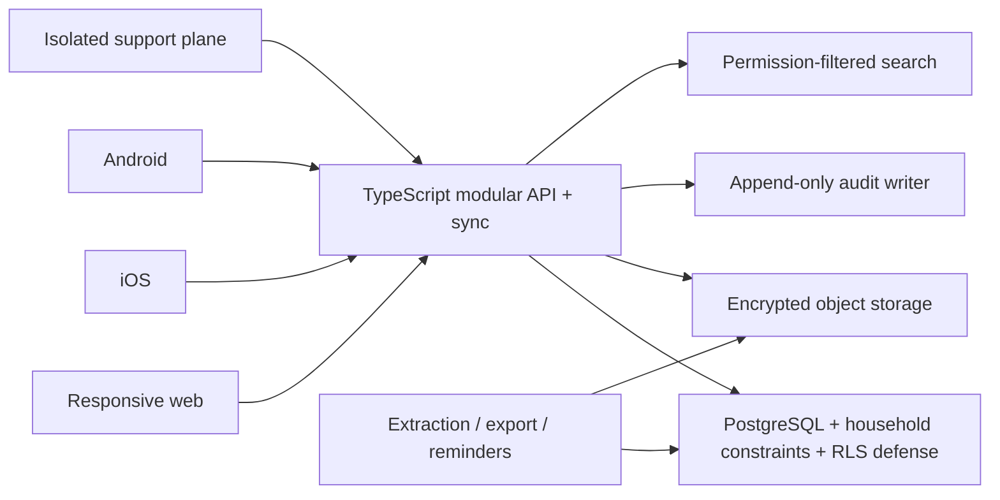

# Asset Continuity — Web-First Architecture

Status: implementation contract with explicit current-prototype and production-target boundaries  
Decision horizon: responsive web walking skeleton now; production platform next; native iOS/Android after the canonical flow is validated

Statements labeled **Current prototype** describe the checked-in web
implementation. Statements labeled **Production/native target** preserve the
approved product direction but are not evidence that the behavior has already
been built or validated on the web.

## 1. Why the web app comes first

The web build is the fastest place to validate information architecture, terminology, business rules, responsive composition, and the complete First Useful Vault journey. It is not evidence that browser storage is an acceptable production vault. The product should prove the flow once, then implement the same domain contracts behind secure web and native clients.

The web-first order is:

1. Working responsive prototype with synthetic/local data.
2. Moderated flow and visual validation.
3. Stable domain schema, state machines, routes, and API contract.
4. Production identity, authorization, persistence, file, search, audit, and sync platform.
5. iOS and Android clients consuming the same contracts with native capture and security adapters.

## 2. Approved experience architecture

### Desktop

- A quiet left rail holds household switcher and Home, Assets, Family, and Vault.
- A global Search control is always reachable.
- Home uses the cinematic asset globe as its primary spatial overview.
- The center pane contains the active job; a right contextual pane shows the next action, details, or recent places when width permits.
- Capture appears in the context that supplies place, room, asset, or document intent.

### Tablet

- The rail compacts to icons plus accessible labels/tooltips.
- The contextual pane becomes a drawer or stacked panel.
- Globe and list remain equivalent views.

### Mobile web

- The same four destinations use a bottom bar.
- Content stacks in the approved Option 3 order and density.
- Search opens as a full-screen command surface.
- Capture remains prominent but does not become a fifth tab.

All layouts use the same content hierarchy, terminology, component states, and business outcomes.

## 3. Walking skeleton: current web prototype

The prototype is a client-first vertical slice with an optional same-origin
local identity/backup service for integration proof:

| Layer | Prototype responsibility |
|---|---|
| Runtime | Vite, React, and TypeScript-ready ES modules |
| Routing | Browser-visible app routes plus nested record identifiers and URL-addressable overlay state |
| UI | Responsive shell, Home/globe, Assets, Collections, Memories, Private References, Family, Vault, overlays, drawers, forms, and state feedback |
| Motion | Restrained `motion` transitions; reduced-motion fallback |
| Globe | `cobe` visualization with an accessible synchronized List view |
| Icons | One consistent Phosphor icon family with text/accessibility labels |
| State | Reducer commands and selectors in `src/domain.js`, backed by one schema-versioned workspace inside a local-demo or account-and-household storage scope |
| Data | Synthetic fixtures in `src/sampleData.js` plus user-created Personal Vault demo metadata |
| Location | Address search, measured GPS, adjustable/user-confirmed pins, manual coordinates, Add later, nested room/zone/container paths, and time-ranged asset assignments with immutable historical Place/path snapshots |
| Property | Reciprocal Place and real-estate Asset Passport projections for owned/co-owned property; rented, managed, family, third-party, and unknown Places remain location-only |
| Materials | Universal paper, artifact, media, record, note, and link records; the original material's physical storage/custodian path is independent of the parent Asset's location and retains actor-attributed correction history |
| Local files | Account- and generation-scoped IndexedDB originals and draft blobs with canonical name/type/size/SHA-256 identity, content-derived immutable versions, current pointers, and atomic workspace-plus-file capture; PDF, HEIC/HEIF/AVIF, MP4/MOV, audio, text, Word, and Excel storage; inline viewing only for JPEG/PNG/WebP/AVIF; missing-original reattachment; and atomic recovery replacement |
| Portable recovery | One passphrase-protected AES-GCM kit containing the scoped workspace and available originals; manual transfer, plus optional authenticated household-bound storage by the local development service |
| Capture Studio | Asset-linked page scanning with optional browser OCR and review, recoverable ordered room-photo sessions at an exact room, and persisted opaque QR/NFC labels with revision-safe moves |
| Local service | Same-origin cookie-authenticated test accounts, household roles, CSRF checks, salted scrypt passwords, and atomic content-addressed encrypted backup storage on this computer |
| Collector integration | `collectorWorkspace.js` reconciles canonical Asset Passports, collections, memberships, and materials into one rich collector state; the Care & Goals UI writes back through canonical workspace commands |
| Contract foundations | Collector history/health/showcase, movement conflicts, encrypted upload envelopes, permissions, offline queues, and native adapter boundaries |
| Tests | Automated domain, property-linkage, collector, capture, recovery, account-scope, UI/accessibility, local API/persistence, and Sites-routing coverage; a passing production/Sites build; zero `npm audit` vulnerabilities; and focused desktop/mobile visual evidence; no production-like browser E2E yet |

The current-run browser inspection covers desktop Home/Add/category at
1280 × 720 and mobile Home/Add at a same-origin 390 × 844 viewport, including a
reference/implementation comparison and no-horizontal-overflow check. This is
focused prototype evidence, not a completed cross-browser, real-device, or full
responsive matrix.

The prototype persists a metadata workspace and selected originals on one
device. The anonymous/local demo and every authenticated account/household use
separate storage scopes for metadata, active generations, drafts, recovery
markers, and IndexedDB originals. It can export/restore a manual encrypted kit,
and the optional local service can durably store/retrieve household-bound
ciphertext for authenticated test accounts on the same development computer.
It is not a production multi-device service. It must use honest status
language:

- “Stored on this device” rather than “Synced” or “Backed up.”
- “Demo invitation” rather than “Invitation sent.”
- “Browser OCR · review required” rather than “Verified scan.”
- “Readable records JSON” for the unencrypted metadata export.
- “Manual encrypted recovery kit” rather than “Cloud backup” or “Account recovery.”
- “Stored by the local Continuity service” only after a durable local
  acknowledgement; never “Production cloud backup.”

## 4. Frontend module boundaries

The walking skeleton deliberately starts small:

- `src/domain.js` owns the schema guard, reducer commands, selectors, readiness,
  and derived Home/Search models. It does not access browser storage.
- `src/sampleData.js` owns deterministic synthetic fixtures and the sample snapshot version.
- `src/App.jsx` and feature components own rendering, interaction,
  route/dialog orchestration, selection of the active account/household storage
  scope, and coordination of the current local repository.
- `src/Globe.jsx` owns progressive enhancement of the synchronized geographic read model.
- `src/storageScope.js` owns local-demo versus account/household key derivation,
  generation keys, capture-draft keys, and scope-local cleanup.
- `src/fileStore.js` owns the IndexedDB-authoritative workspace generation and
  compare-and-swap head, current original pointers, content-derived immutable
  original versions, capture drafts, checksums, idempotent atomic
  workspace-plus-file commits, and atomic replacement during explicit restore.
- `src/securityVault.js` and `src/recoveryKit.js` own client cryptographic
  envelopes and portable-kit validation. They do not represent an identity or
  cloud-key service.
- `src/syncEngine.js` owns offline/conflict interfaces plus a deterministic
  test transport that is never bound to production UI.
- `src/capturePipeline.js` owns document-review, batch room, label, movement,
  camera, and background-upload state machines and adapter contracts.
- `src/DocumentScanPanel.jsx`, `src/RoomCapturePanel.jsx`, and
  `src/AssetLabelPanel.jsx` implement those current web workflows;
  `src/CaptureStudioDrawer.jsx` provides their canonical entry and connects
  accepted results to reducer commands.
- `server/` is an explicitly local development identity/backup slice. It does
  not replace the production sync and object-storage architecture.
- `src/collectorDomain.js` owns collector identity/history, completion versus
  care health, art/memory/financial safety, and allowlisted showcase projection.
- `src/collectorWorkspace.js` is the canonical bridge: it maps each Asset
  Passport to one collector profile, reconciles simple collection membership
  and supporting-material history, and preserves collector-only records.
- `src/CollectionCarePanel.jsx` renders functional Care & Goals and dispatches
  append-only condition/service records plus target/wishlist commands through
  `APPLY_COLLECTOR_COMMAND`.

As features grow, preserve those ownership rules while extracting feature folders:

```text
src/
├── app/                 app shell, router, providers, error boundary
├── domain/              records, invariants, state transitions, readiness
├── data/                schema version, sample seed, local repository
├── features/
│   ├── onboarding/
│   ├── home/
│   ├── places/
│   ├── capture/
│   ├── assets/
│   ├── proof/
│   ├── search/
│   ├── family/
│   ├── vault/
│   └── lifecycle/
├── components/          shared field, status, dialog, list, card, shell
├── visual/              globe and synchronized geographic list
├── a11y/                announcements, focus restoration, reduced motion
└── styles/              tokens, themes, responsive layout, RTL
```

Feature modules call domain commands. They do not write storage directly. The globe consumes a read model and never becomes a second source of place truth.

## 5. Domain hierarchy

### Production/native target



### Production/native target modeling rules

1. `Household` is the tenant, audit, and eventual key boundary.
2. Region is household context: country/jurisdiction, language, timezone, and default currency. It is not a Place.
3. A Place is a user-recognizable physical or virtual location.
4. A property appears once but is composed of a Place plus one linked real-estate Asset Passport when owned/co-owned.
5. Category, location, ownership, custody, lifecycle, collection, and access are independent facets.
6. One asset has at most one active primary location; history is time-ranged.
7. Ownership and custody are time-ranged.
8. Evidence/document originals are immutable; corrections create versions or compensating events.
9. Values are dated observations in integer minor units with ISO currency and source.
10. Memory Items do not count toward current totals or active-place readiness.
11. A device GPS Place fix is `exact` only when horizontal accuracy is at most
    15 metres. A weaker fix is recorded as `approximate`; the user may instead
    place and confirm a pin deliberately.
12. Location truth changes only through movement/revision commands. A generic
    asset edit cannot change `placeId`, `spaceId`, mode, status, or locator text
    and therefore cannot bypass `MOVE_ASSET`.
13. Place pin/address corrections and room/container path corrections close the
    active location assignment and append a new one. Closed assignments keep
    immutable Place and nested-space snapshots so later renames or pin changes
    do not rewrite where the asset was previously recorded.
14. A memory subject is one of `physical`, `story`, `person`, or `moment`. Only
    `physical` enters the Place/room capture stage; the other subjects use
    `not-applicable` location semantics.

### Current prototype boundary

The checked-in snapshot is intentionally flatter than the target model:

- `region` is a geographic globe aggregate with `id`, `name`, `lat`, and `lng`;
  household locale and currency live on the household record.
- `place` and nested `space` records provide the physical hierarchy.
- An owned/co-owned property may carry `place.propertyAssetId`, with the
  reciprocal real-estate Asset Passport carrying `asset.propertyPlaceId`.
  Normalization retains only one eligible, active, reciprocal pair and repairs
  one-sided, dangling, wrong-type, archived, or conflicting links without
  inventing ownership. Rented, managed, family, third-party, and unknown Places
  remain location-only.
- Each asset retains current `placeId`/`spaceId` projections for simple reads;
  append-only `locationAssignments` preserve moves, the Place name/address/pin
  and precision observed for each revision, and the nested room/container path.
  `UPDATE_PLACE` and `UPDATE_SPACE` revise an active assignment by closing it
  and appending a corrected assignment; closed snapshots never follow later
  edits. `UPDATE_ASSET` ignores location fields, so `MOVE_ASSET` remains the
  only generic asset-location command. Owner member ID, custodian member ID,
  value, and lifecycle status remain on the asset.
- Each supporting material is one serializable `evidence` record linked to one
  asset. Paper, artifact, media, record, note, and link share this universal
  record. `materialStorage` independently describes where the original paper or
  artifact is kept using known, needs-detail, unknown, external-custodian, or
  not-applicable state, immutable Place/path snapshots, and actor-attributed
  correction history; it does not reuse the parent Asset's location.
  Optional original bytes live in the active account/recovery-generation scope
  in IndexedDB. The evidence record stores canonical file identity plus the
  current immutable-version reference; blobs never enter the workspace
  snapshot.
- `collector` is a schema-versioned member of the same workspace. The
  reconciliation bridge derives profiles, memberships, and material-backed
  histories from canonical records while retaining append-only care history,
  purposeful targets, and research wishes.
- Members have a role and coarse access-scope label, but there is no enforcing
  access-grant model.
- Tasks and activity are simple records used by the Home read model.

The prototype now contains honest Place coordinate metadata, exact or
user-confirmed pins, time-ranged asset location assignments, nested spaces,
reciprocal Place/property-passport projections, universal materials with
separate original-storage history, canonical collections, an integrated
collector bridge, and collector-specific provenance/condition/service
histories. Memory capture distinguishes a located physical object from a story,
person, or moment and links memories to canonical people records. Living-person
showcase identity requires granted consent and an explicit public label;
unknown living status fails closed, and ambiguous same-name people are not
silently merged.

It does not yet contain ownership shares or time-ranged custody assignments,
a universal multi-record Document abstraction, multi-record material links,
authoritative access grants, a universal provenance/audit model, or tombstones.
The current property creation path can create the reciprocal projection, while
broader existing-record link/repair presentation remains incomplete. Archive
is represented by `lifecycleStatus: "archived"` and has no restore command.
Native clients must not infer the richer target schema from the prototype until
the shared contract is versioned.

## 6. Truth and provenance model

The distinctions below are the **production/native target**. The current
prototype implements supporting-material records with optional on-device
originals and `pending`, `verified`, or `rejected` status; the UI displays
`verified` as “Reviewed by you.” Collector profiles have append-only specialist
histories, but the app does not yet model universal extracted-fact assertions,
external legal-truth pointers, or a production provenance/audit system.

The UI and data model distinguish:

| Kind | Meaning |
|---|---|
| Assertion | A person states a fact, such as ownership. |
| Evidence | A source supports a fact: image, receipt, serial, deed copy, or certificate. |
| Verification | A person confirms entered or extracted information. |
| Legal truth | An external authority or agreement determines legal status. |

Material facts carry source type/id, asserted by, observed at, received at, confidence, verification status, verifier, and verification time. The selected display value follows precedence, but conflicts remain in history.

Production schemas, visible copy, and future contract tests must preserve these
distinctions without implying that the current prototype stores all four layers.

### Current material review and original-integrity contract

- The material record and the original material's physical storage are separate
  concerns. A paper or artifact may support an Asset while being stored in a
  different Place/space, with another person or organization, at an incomplete
  location, or at an honestly unknown location. Storage corrections append
  actor-attributed history with Place and nested-path snapshots.
- A note, link, record, or physical source must contain a usable source before
  it can be reviewed. An empty material record is never reviewable.
- A file-backed material starts `pending`. The evidence-detail flow loads the
  original, verifies the evidence ID plus file name/type/size metadata, computes
  SHA-256 over the bytes, and requires that digest to match both the IndexedDB
  record and canonical evidence metadata before enabling **Mark reviewed**.
- A missing or failed original keeps the material pending. The user can attach a
  replacement original to the same material; the replacement is stored with a
  newly computed canonical file identity and must pass integrity verification
  before review becomes available.
- Changing any file-identity field (`fileName`, `fileType`, `fileSize`, or
  `fileChecksum`) revokes a prior review and reopens the matching proof task.
  This prevents review from surviving a byte or identity replacement.
- A replacement creates or reuses a content-derived immutable original version
  and updates only the evidence record's current pointer. Prior versions remain
  available for integrity-checked download inside the same storage scope and
  recovery generation.
- File-backed standard capture, document-page capture, and room-photo capture
  use a stable operation ID and one IndexedDB transaction for workspace
  metadata, current file pointers, immutable versions, the active generation
  head, and an idempotency receipt. Abort, checksum failure, or stale
  compare-and-swap leaves neither a partial workspace mutation nor orphan file
  bytes.
- “Reviewed by you” means that the user reviewed the locally integrity-matched
  record. It is not authenticity, ownership, legal, insurance, or malware
  verification.

## 7. Routing contract

Canonical paths:

```text
/welcome
/home
/assets
/assets/:assetId
/evidence/:evidenceId
/collections
/collections/:collectionId
/family
/vault
/places/:placeId
/places/:placeId/spaces/:spaceId
```

Onboarding starts at `/welcome`. In the current prototype, Search, Capture,
Settings, and Help are URL-addressable overlays over the current route:

```text
?search=1
?capture=choose|place|space|asset|evidence
?settings=1
?help=1
?placeId=<placeId>&spaceId=<spaceId>&assetId=<assetId>
```

Routing rules:

1. Home, Assets, Family, and Vault are stable, shareable routes.
2. Search preserves the underlying route and restores focus when closed. Its
   entered query is component-local, is not persisted in activity, and is not
   currently shareable in the URL. Opening a result appends an
   actor-attributed retrieval activity containing only the result type and ID;
   this activity completes the Search outcome in the First Useful Vault guide.
3. Contextual Capture includes place/space/asset identifiers when available.
4. Record routes use stable opaque IDs, not array positions or display names.
5. Back closes the topmost modal/drawer before leaving the underlying screen.
6. Forward restores it.
7. Reload restores a valid record or shows a safe Record unavailable recovery.
8. Unknown IDs show a safe Record unavailable state.
9. Assets list query, category, location, and sort filters are URL-addressable.

Redirect metadata for retired/merged IDs, authorization-aware route guards, and
permission-safe existence handling are production targets, not current
prototype behavior.

The current prototype does not emit or translate legacy `?view=` links.

## 8. Local prototype persistence

The current prototype selects one storage scope before mounting the workspace:
`local-demo` while signed out, or an opaque account-and-household scope derived
from the authenticated session. Each scope has separate metadata/cache keys,
active-generation and rollback markers, capture drafts, recovery warnings, and
generation-scoped IndexedDB records. The local-demo compatibility key exported
by `src/domain.js` remains `alyr.asset-continuity.demo`; the former
`alyr.asset-continuity.demo.v1` key is read only as a migration source, and
unreadable/future snapshots may be quarantined under the scope's recovery key.

The IndexedDB recovery head is authoritative for the active generation and uses
compare-and-swap revisions across tabs. `localStorage` remains a best-effort
compatibility cache and cross-tab signal; changing a cached generation pointer
alone cannot activate a generation.

```ts
type LocalEnvelope = {
  version: number;
  mode: "unstarted" | "sample" | "personal";
  meta: {
    id: string;
    revision: number;
    createdAt: string;
    updatedAt: string;
  };
  household: Household;
  regions: Region[];
  places: Place[];
  spaces: SpaceNode[];
  assets: AssetPassport[];
  evidence: EvidenceRecord[];
  members: Member[];
  tasks: Task[];
  activity: ActivityEvent[];
};
```

Rules:

1. Resolve the storage scope before loading routes: local-demo while signed out,
   or account plus household while authenticated.
2. Keep workspace generations, active/rollback heads, drafts, recovery state,
   current original pointers, and immutable original versions inside that
   scope. Scope cleanup never enumerates or removes another scope.
3. Treat the IndexedDB recovery generation and compare-and-swap head as the
   durable browser authority. Keep the complete `localStorage` snapshot only as
   a compatibility cache and migration/cross-tab signal.
4. Seed Sample Space deterministically and allow a safe reset.
5. Starting Personal creates a fresh snapshot; it never copies sample records
   implicitly. Moving local records into an authenticated household requires a
   visible, explicit, verified claim; signing in never silently adopts them.
6. Returning to/resetting Sample from Personal is destructive to the selected
   scope's personal demo metadata and therefore requires an impact preview and
   explicit confirmation.
7. Generate stable client IDs and stable capture-operation IDs before save.
8. Validate and migrate the envelope before use.
9. `workspaceReducer` returns the next serializable snapshot and does not
   persist by itself. Ordinary metadata changes queue persistence against the
   active head revision.
10. File-backed standard capture, Document Scan, and Room Capture compute the
    next workspace first, then commit metadata, current pointers, immutable
    versions, the head revision, and an idempotency receipt in one IndexedDB
    transaction. A failed or stale commit publishes no partial metadata or
    orphan bytes.
11. When a stored snapshot is unreadable or from an unsupported future schema,
    preserve its raw contents under the scope's recovery key, load a safe
    unstarted workspace, and show an alert with **Download recovery copy**.
12. Write failures remain visibly announced and capture success changes to
    session-only language. Malformed or unsupported stored JSON is never treated
    as a valid workspace.
13. Avoid storing passkeys, credentials, seed phrases, private keys, or real
    sensitive customer data.
14. Persist only prototype metadata, safe references, and user-selected local
    originals. The local originals store is not authenticated cloud storage.
15. The readable JSON export contains metadata only and is not encrypted.
16. A portable recovery kit encrypts one versioned scoped workspace plus every
    available original, verifies checksums, opens in memory for review, and
    atomically replaces the selected scope's originals and active generation
    only after explicit confirmation. One rollback generation remains
    recoverable.
17. Manual portable recovery does not imply an account or sync. The optional
    local service may acknowledge one encrypted whole-vault backup only after
    authenticating the account, checking the household context and role,
    validating checksum/size, and completing the filesystem write. That local
    acknowledgement does not imply production cloud, remote revocation,
    registered devices, or automatic record sync.

The current browser boundary is account-and-household scoped on this device.
Account switching remounts the matching provider and hides the prior scope from
routes, Search, exports, drafts, recovery, and original access; sign-out returns
to the separate local-demo scope. Tests also reject backup/restore material from
another household. This is meaningful prototype isolation, but it is not a
production tenant-security claim. Server-authoritative authorization, managed
keys, cross-device revocation, monitored backup retention, and production-like
browser negative journeys remain release requirements.

Suggested local status vocabulary:

```text
Draft → Saved on this browser
Draft → Save failed → Retry / Download draft
```

Do not display the production sync vocabulary unless a real server acknowledges each transition.

## 9. Domain commands and derived read models

### Current prototype reducer actions

The checked-in reducer accepts:

```text
REPLACE_WORKSPACE
APPLY_COLLECTOR_COMMAND
SET_MODE
RECORD_RETRIEVAL
SET_ASSET_LABEL_REGISTRY
START_PERSONAL
RESET_DEMO
ADD_PLACE
UPDATE_PLACE
LINK_PROPERTY_PROJECTION
UNLINK_PROPERTY_PROJECTION
ADD_SPACE
UPDATE_SPACE
ADD_ASSET
ADD_EVIDENCE
SET_EVIDENCE_FILE_STATE
MOVE_MATERIAL_STORAGE
VERIFY_EVIDENCE
MOVE_ASSET
UPDATE_ASSET
ARCHIVE_ASSET
ADD_COLLECTION
UPDATE_COLLECTION
ADD_COLLECTION_MEMBER
REMOVE_COLLECTION_MEMBER
SET_COLLECTION_COVER
INVITE_MEMBER
```

It returns a new serializable snapshot or the unchanged snapshot. It does not
return domain events and it does not persist by itself. `VERIFY_EVIDENCE` is
idempotent; the stored status becomes `verified` while the UI says “Reviewed by
you.” The reciprocal property commands preserve exactly one eligible
Place/real-estate pair, `MOVE_MATERIAL_STORAGE` appends actor-attributed original
storage history, and `RECORD_RETRIEVAL` records the opened result without the
private Search query.

For file-backed captures, `WorkspaceProvider` applies the reducer actions to a
candidate snapshot and sends that snapshot, the selected originals, the
expected head revision, and a stable operation ID to one IndexedDB transaction.
The transaction advances the scoped generation only when every workspace,
current-pointer, immutable-version, checksum, and idempotency check succeeds.
Metadata-only action sequences continue through the ordinary queued persistence
path.

`APPLY_COLLECTOR_COMMAND` integrates idempotent collector commands into this
same snapshot. Condition and service records append by stable ID; target,
wishlist, collection, and explicit target-match changes are normalized upserts.
Every result is reconciled against current canonical assets, collections, and
materials before persistence.

The idempotent review command also fails closed: a material needs a usable
source, and a file-backed material needs the matching canonical SHA-256 from a
successfully verified original. `SET_EVIDENCE_FILE_STATE` revokes review and
reopens the proof task whenever file identity changes or the original becomes
missing, failed, or quarantined. `UPDATE_ASSET` cannot mutate location fields;
only `MOVE_ASSET` can change an asset's current location. `UPDATE_PLACE` and
`UPDATE_SPACE` append correction revisions for affected active assignments.

### Production/native target commands

The production contract should evolve toward explicit commands such as:

```text
createHousehold
setHouseholdRegion
createPlace
createSpaceNode
saveCaptureDraft
commitEvidenceSession
createAssetPassport
confirmMaterialFact
linkEvidence
createDocumentVersion
inviteMember
changeAccessGrant
applyLifecycleEvent
archiveRecord
requestDeletion
restoreDeletion
```

Each production command should:

1. Check invariants.
2. Return a new snapshot and domain events.
3. Update readiness/tasks from stable requirement keys.
4. Persist through the production repository once.
5. Produce a user-visible result or recoverable error.

Current read models serve Home, globe, asset lists, search, and readiness.
Production read models will additionally serve permission-safe access previews.
All derived read models are disposable and never overwrite source facts.

## 10. Readiness logic

Readiness is calculated, never manually stored as authoritative truth.

### Current asset readiness

The current selector uses seven fixed, binary components totaling 100:

- Name and category: 20%.
- Owner recorded: 10%.
- Location state: 20%.
- Precise location: 10%.
- Reference or serial: 15%.
- Value or context: 5%.
- Required evidence reviewed: 20%.

There is no partial credit and no weight normalization. Virtual and
not-applicable assets receive the two location components automatically.
For a physical asset, precise-location credit requires a known assignment to a
Place with an exact pin and either a real-estate category or a room/container or
locator detail. Suggested, stale, disputed, approximate, and Place-only
non-property records do not receive precise-location credit.
Place and portfolio readiness are simple averages of active-asset readiness;
there are no separate room or production-grade Place readiness calculators.
The Asset Passport exposes the component checklist through What counts.

### Production/native target readiness

Before native implementation, the team may revise this model to normalize
inapplicable components, introduce partial states, exclude Memory Items, and add
room/Place calculators. Any such change requires a new shared contract version
and matching web tests; native clients must otherwise reproduce the current
selector exactly.

## 11. Production target

The validated prototype evolves into a modular monolith:



Recommended production responsibilities:

- Identity: passkeys, device registration, recovery, session and risk policy.
- Authorization: deny-by-default capabilities plus record and field scope.
- Catalog: household, places, spaces, assets, facets, lifecycle.
- Evidence: resumable checksummed uploads and immutable versions.
- Extraction: safe OCR/classification proposals with human confirmation.
- Search: authorization before ranking, counting, snippets, and autocomplete.
- Tasks: stable deduplication keys and explainable priority.
- Audit: append-only events without decrypted contents or values.
- Export: permission-scoped versioned snapshots and expiring protected bundles.
- Sync: client-generated IDs, idempotent operations, tombstones, and conflict resolution.

Start as one deployable modular service. Split services only after operational evidence demonstrates a scaling or isolation need.

## 12. API and shared-contract strategy

1. Define OpenAPI schemas for records, commands, errors, pagination, and sync operations.
2. Generate web and native client types from the reviewed contract.
3. Keep domain validation in a platform-neutral TypeScript package where security boundaries allow.
4. Keep authorization authoritative on the server; client checks are presentation only.
5. Version category-specific attribute schemas and provide migrations.
6. Use idempotency keys for capture commit, document link, task completion, invite, and export.
7. Include server-received time and record version in every material mutation.
8. Return permission-safe errors that do not reveal hidden record existence.

## 13. Security and privacy boundaries

The walking skeleton cannot honestly claim:

- End-to-end or at-rest encryption.
- Production cloud backup or disaster recovery. The optional local service
  durably stores encrypted recovery-kit ciphertext on this computer only.
- Automatic record sync, cross-device continuity, or remote revocation.
- Malware-safe document processing.
- Official ownership, valuation, insurance, or registry verification.
- Emergency release.

The local store accepts PDF; JPEG/PNG/WebP/AVIF/HEIC/HEIF photos; MP4/MOV video;
supported audio; text; Word; and Excel originals within the prototype size
limit. The live evidence-detail delivery policy renders only allowlisted inert
raster originals (JPEG, PNG, WebP, and AVIF) inline. HEIC/HEIF, PDF, audio,
MP4/MOV and other video, SVG/HTML/XML, office, and unknown originals are
download-only unless a separate sanitized or transcoded rendition exists. The
current build does not generate such renditions; download authorization remains
a production server responsibility.

Production must add:

- Production identity, passkeys, registered devices, and recovery policy.
- Server-authoritative tenant authorization and managed cryptographic isolation
  for metadata, originals, routes, Search, exports, backups, account switching,
  sign-out/revocation, and every cross-device operation. The current local
  account/household browser scopes are a prototype boundary, not this control.
- Per-household/content key design with no support bypass.
- Encryption in transit and at rest, with protected local caches.
- Current-membership and capability checks on every operation.
- Neutral notifications and privacy-scrubbed telemetry.
- File validation, quarantine, and safe rendering.
- Backups, restore drills, purge policy, and complete export.
- Threat modeling for sharing, coercion, recovery, insider, and cross-tenant attacks.

## 14. Performance and resilience budgets

| Experience | Target after production implementation |
|---|---:|
| Home usable from acknowledged local cache | Under 1 second p75 |
| Local search over 10,000 records | Under 300 ms p95 |
| Camera shutter response | Immediate |
| Common navigation | Sustained 60 fps on supported devices |
| Crash-free sessions | At least 99.8% |
| Capture draft restoration | 100% in automated termination scenarios |
| Accessibility | Every critical journey usable with screen reader and large text |

For the web prototype:

- Initial JavaScript and globe work must not block semantic Home content.
- The globe lazily enhances the synchronized list.
- Keyboard and reduced-motion users receive the full product outcome.
- Slow or failed visualization initialization never blocks navigation.

## 15. Target definition of a complete walking skeleton

The web prototype will be complete enough for broader product validation when:

1. All canonical top-level routes and deep links work through refresh, Back, and Forward.
2. Sample and Personal modes never mix records inside the selected storage
   scope; changing/resetting that scope's active workspace has an explicit
   destructive confirmation.
3. A user completes the First Useful Vault journey with local persistence.
4. Place, room evidence, item, Memory Item, passport, proof, search, family preview, lifecycle, and export preview work end to end.
5. Empty, error, save-failure, offline-simulation, permission-safe, conflict, and destructive states are inspectable.
6. Desktop, tablet, and mobile preserve the same actions and status.
7. Automated tests cover business invariants and critical routes.
8. Visual QA and accessibility gates in `QA_MATRIX.md` pass.
9. Every simulated security/network capability is labeled honestly.

This remains a target gate rather than production sign-off. The current build
implements the settled web contract in `CANONICAL_FLOWS.md` section 20,
including recoverable room evidence, the canonical collector bridge, functional
Care & Goals, exact Place/indoor location history, reciprocal
Place/property-passport projections, separate original-material storage,
atomic file-backed capture and immutable versions, account-scoped browser
recovery, the First Useful Vault/Search outcome, manual encrypted recovery, and
the live safe-original delivery policy. Automated domain, UI, file/recovery,
account-scope, local-service, and routing suites cover these capabilities; the
production/Sites build passes and `npm audit` reports zero vulnerabilities.

Existing-record property-link repair presentation, authoritative permission
previews, a universal multi-record Document abstraction, production
export/redaction, automatic sync, the full browser E2E/cross-browser matrix, and
responsive/native sign-off remain incomplete. The focused desktop and prior
narrow-web visual inspections in `design-qa.md` remain the current visual
evidence.
