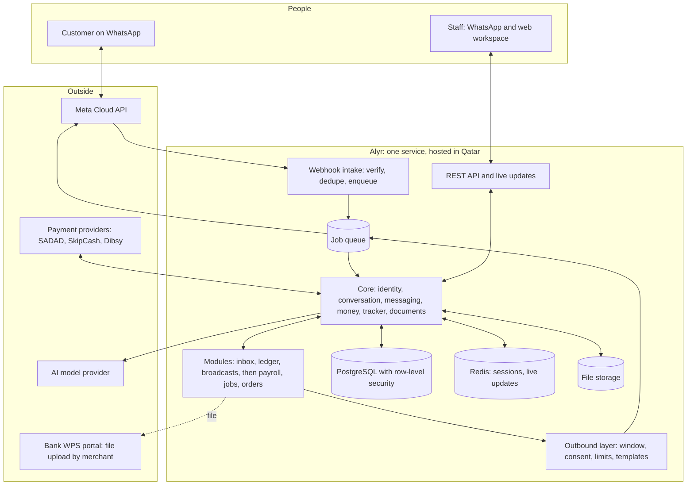

# Alyr master plan

Version 1, 7 October 2026. Owner: Akmal. This is the source of truth for what Alyr is, what it builds in what order, and why. Tasks live in Linear ("Alyr Launch"); this file explains the decisions behind them. When a decision changes, change it here first.

## 1. The one-paragraph plan

Alyr is the business layer on top of a Qatari SMB's existing WhatsApp number. A merchant keeps their number and their WhatsApp Business app, connects it to Alyr in a few minutes, and gets a shared team inbox plus tools that turn conversations into money: credit ledger, payment links, reminders, broadcasts. That is **Product 1**. Once a merchant is using Alyr every day, we sell them more modules on the same number and the same data: payroll and WPS, expiry trackers, jobs and quotes, ordering. We do not build all of it at once, and we do not sell a platform. We sell one painful job done well, then the next.

## 2. Where the brief needs correcting

The feature list is a good map of the territory. Several items in it are wrong for Qatar or out of date, and some of the plan's earlier assumptions do not survive checking. Each row was checked against current sources on 7 October 2026 (links in section 12).

| The brief or earlier plan says | What is actually true | What we do |
|---|---|---|
| 60 features across CRM, payroll, field service, e-invoicing and verticals | That is the combined scope of Wati, Bayzat, Jobber and a tax gateway, each a funded company. Two people cannot build it, and SMBs do not buy "everything" | One product first. Everything else is sequenced in section 4, and most of it collapses into eight shared building blocks (section 5) |
| "GOSI Contribution Engine" | GOSI is Saudi Arabia's body. Qatar's is GRSIA, under Social Insurance Law No. 1 of 2022. The 7% + 14% rates are right, but they apply to Qatari nationals only, on earnings up to QAR 100,000. Expatriates get end-of-service gratuity instead | Rename it. Small feature inside payroll, since most SMB staff are expatriates |
| E-invoicing with ECDSA-P256K1 signing, real-time clearance, PDF/A-3, 24-hour B2C reporting | Those are Saudi Arabia's ZATCA rules. Qatar's Cabinet approved a draft e-invoicing law on 6 May 2026. It is not in force, the technical model is unpublished, and it is expected to follow VAT, which Qatar has not introduced | Park the whole section. Keep invoices cleanly structured so a serializer can be added when the GTA publishes its specification |
| "Dynamic payment links (Sadad/Fawran/NAPS)" | SADAD is a payment company. NAPS is the national debit card network. Fawran is the central bank's instant transfer service; its request-to-pay runs inside bank apps and expires after six hours. None of the rails has an open API for us. Links come from a licensed provider: SADAD, SkipCash or Dibsy | One payment adapter over licensed providers. Fawran is offered as "pay by bank transfer" instructions until a provider exposes it |
| "Integrates with Sadad, Paywise, 7sab" | Paywise is the company behind Dibsy, so that is one provider, not two. We could not verify "7sab" as a licensed provider | Use the three verified providers |
| Pass Meta's message fees through with a 10% margin | Only Meta Solution Partners hold a credit line and can invoice clients for messages. A Tech Provider's clients pay Meta directly with their own card. Becoming a Solution Partner is slow | Become a Tech Provider. Merchants pay Meta directly. Drop the markup and earn from subscriptions |
| Per-conversation message prices (QAR 0.124 marketing, QAR 0.044 utility) | Meta has charged per delivered template message since 1 July 2025. Qatar rates: marketing USD 0.0341, utility USD 0.0091, authentication USD 0.0091. Replies inside the 24-hour window are free, and so are utility templates sent inside an open window | Show merchants their Meta cost; do not bill it |
| Customers are identified by phone number | WhatsApp usernames arrive in 2026. Webhooks have carried a business-scoped user ID (BSUID) since 31 March 2026, and a customer who adopts a username may have no phone number in the webhook at all | Key every contact on the BSUID, with phone as an optional attribute. Our current schema keys on phone and must change before real traffic (ALY-49) |
| "Hosting must remain domestic" under PDPPL | The law's general principle is the opposite: controllers should not restrict cross-border flows, with exceptions. Localisation duties fall on government and some regulated sectors. Also, WhatsApp messages pass through Meta's servers outside Qatar regardless | Keep Qatar hosting as the default and as a sales point, but stop treating it as an absolute legal bar. Get a written opinion (ALY-51) before deciding where the AI model runs |
| Run everything, including AI, in Azure Qatar Central | The region has reported capacity constraints, and Azure OpenAI is not offered there. Google Cloud's Doha region offers Cloud Run and Cloud SQL | One-day comparison of the two regions before writing infrastructure code (ALY-10) |
| "Fine-tuned on Gulf Arabic dialect datasets" | Fine-tuning needs data we do not have and a team to maintain it. Current general models handle Gulf Arabic and code-switching well | Rules for digits, amounts and keywords; a general model for intent and voice notes; a test set we grow from real merchant messages |
| Biometric and facial-recognition attendance | Biometric data is "special nature" personal data under PDPPL and needs explicit consent and a permit request | Not building. Attendance, if ever, starts as a WhatsApp location check-in |
| Instalment plans in chat | Scheduling a merchant's own customer's payments is fine. Financing them is lending, which the central bank regulates | Schedules only. Alyr never extends credit |
| Usage billing through Stripe | Stripe does not serve Qatar-based businesses | Bill subscriptions through our own Qatar payment provider account |
| Hindi as the third language | Qatar's workforce also writes Malayalam, Urdu, Bengali, Nepali and Tagalog. This matters most for staff-facing features such as payslips | Customer-facing: Arabic and English. Staff-facing messages: add languages by demand, starting with what alpha merchants' staff use |
| Build every module, then launch | Selling starts when Product 1 works on a real number | Launch moves ahead of payroll, jobs and ordering |

## 3. Who we sell to first

Qatar has roughly 25,000 registered private businesses and about 96% are SMEs. It is a small market, so two things follow. First, we need high revenue per customer, which is why modules stack on one number. Second, the architecture must let us enter the UAE and Saudi Arabia later without a rewrite: everything country-specific (payroll rules, tax, payment providers) sits behind a country pack.

First customers, in order:

1. **Wholesale and trading businesses that sell on credit** (Industrial Area, Salwa Road): electrical, hardware, auto parts, building materials. They run a paper credit book and chase by WhatsApp today. Product 1 pays for itself the first time a reminder collects.
2. **Service businesses with several staff on one number**: AC and maintenance contractors, clinics, salons, car services. They need the shared inbox first, then jobs or bookings.
3. **Any business with 10+ staff**: payroll and WPS, sold through the PROs and accountants who already do this work by hand.

## 4. The sixty features, sorted

**Now** means part of Product 1. **Next** means the second and third products. **Later** means only when paying customers ask. **No** means we have decided against it and why.

### 4.1 Conversational commerce and CRM

| Feature | Verdict | Note |
|---|---|---|
| Unified team inbox | Now | The daily habit. Assignment, notes, collision warning |
| Khaleeji-aware understanding | Now, differently | Rules plus a general model, not fine-tuning |
| Session window management | Now | Core of the outbound layer, not a feature |
| In-chat checkout | Now | Links from a licensed provider; part payment already built |
| Broadcast and campaigns | Now, basic | Segment, schedule, opt-out, cost preview. A/B testing later |
| Conversation analytics | Now, basic | Response time, open conversations, money collected. Sentiment: no |
| Lead pipeline | Next, small | Stages and labels on conversations, not a separate CRM |
| Native catalog sync | Next | One-way push to WhatsApp's catalog first, with the ordering product |
| Visual flow builder | Later | A product in itself. Ship ready-made flows per business type first |
| SMS and email fallback | Later | SMS only for sign-in codes at the start |

### 4.2 Payroll, WPS and workforce

| Feature | Verdict | Note |
|---|---|---|
| WPS SIF generator | Next | Product 2. CSV per RFC 4180, two-line header, per-bank rules |
| Payroll pre-validation | Next | This is the product: catch rejections before the bank does |
| Gratuity calculator | Next | Three weeks' basic wage per year after one year (Labour Law Art. 54) |
| Ramadan hours | Next | 36 hours a week, a rule in the country pack |
| GRSIA contributions | Next, small | Qataris only |
| Contract and visa lifecycle | Next | A tracker (section 5), not custom code |
| Employee self-service | Next, in WhatsApp | Payslip and leave by chat. No separate app |
| Attendance | Later | Location check-in by WhatsApp. Biometrics: no |
| Regulatory rule engine | Later | Versioned rules in the country pack. No-code editing: no |
| Multi-currency disbursement | No | We do not move money |

### 4.3 Field service

| Feature | Verdict | Note |
|---|---|---|
| Customer notifications | Next | Booking confirmed, on the way, done, review request |
| Dynamic quoting | Next | Quote in chat, accept, convert to invoice |
| Recurring jobs | Next | AC maintenance contracts are the Qatar use case |
| Mobile job execution | Next | In the web app and by WhatsApp: photos, notes, done |
| Photo inspection reports | Later | Falls out of jobs plus the document building block |
| Inventory and parts | Later | |
| Asset history | Later | |
| Performance dashboards | Later | |
| Safety checklists | Later | A form attached to a job |
| AI dispatch and routing | No | Manual assignment is enough below 30 technicians |
| Subcontractor portal | No | |

### 4.4 E-invoicing

All ten features are **parked** until the GTA publishes the final technical specification. What we do now: sequential invoice numbers, a clean invoice record, an invoice PDF, and an archive. The three-day signing experiment (ALY-19) is cancelled; it would have tested Saudi rules.

### 4.5 Vertical micro-modules

| Feature | Verdict | Note |
|---|---|---|
| Digital ledger | Now | Built and demoed |
| Feedback collector | Now, small | One question after a payment or job |
| Supplier document chaser | Next | Tracker |
| Bid security tracker | Next | Tracker |
| Insurance compliance tracker | Next | Tracker |
| Visa sponsorship lifecycle | Next | Tracker |
| Restaurant procurement | Later | The ordering product pointed at suppliers |
| Salon and spa suite | Later | Bookings module |
| Photo inspection reporter | Later | See jobs |
| Arabic content calendar | No | A different product for a different buyer |

### 4.6 Platform

| Feature | Verdict | Note |
|---|---|---|
| Feature toggles | Now | Built (`tenant_modules`) |
| Tenant isolation | Now | Built and tested. Per-tenant encryption keys: later |
| Localisation | Now | Arabic and English, right to left. Hijri dates: display only, later |
| Payment adapter | Now | One interface, three providers |
| Audit trail | Now | Append-only event log |
| Roles and permissions | Now | Owner, manager, agent, accountant |
| API-first | Now, internal | REST with OpenAPI. Public API and webhooks later. GraphQL: no |
| Usage meter | Later | Seats and numbers are enough to bill on at the start |
| Offline sync engine | No | WhatsApp already works offline and queues. That is the point of building on it |
| White-label | No | Until a reseller pays for it |

## 5. Eight building blocks

Almost every feature above is one of these eight things configured differently. We build the blocks once, in the core, and modules stay thin.

| Block | What it is | Features it carries |
|---|---|---|
| **Identity** | Tenants, users, roles, contacts keyed on WhatsApp's BSUID | Inbox, CRM, every module |
| **Messaging** | Channels, the outbound layer (window, consent, limits, templates), delivery status | Inbox, broadcasts, every notification |
| **Conversation** | Session state, ready-made flows, hand-off to a human, the understanding layer | Flow builder, self-service, booking |
| **Money** | Payment requests through licensed providers, ledger entries, invoices | Checkout, ledger, deposits, billing |
| **Tracker** | Any item with a due or expiry date, an owner and a reminder sequence | Visa, licence, bid bond, insurance, contract renewal, document chasing |
| **Documents** | Files in and out: photos read by OCR, PDFs generated, everything archived | Delivery notes, statements, payslips, inspection reports, invoices |
| **Records** | Simple typed records per module with forms: jobs, orders, bookings, employees | Field service, ordering, salon, payroll |
| **Country pack** | Rules that differ by country: wage file format, gratuity, working hours, tax, payment providers | WPS, GRSIA, Ramadan hours, e-invoicing, expansion |

The tracker is the clearest example. Bid security, visa renewals, insurance and supplier documents were four features in the brief. They are one table and one reminder engine with four templates.

## 6. Product 1: Inbox and Collect

**The promise to the merchant:** keep your number, see every customer chat in one place with your team, and get paid faster.

### 6.1 What is in it

1. **Connect in minutes.** Embedded Signup with coexistence: the merchant keeps using the WhatsApp Business app on their phone while Alyr works on the same number.
2. **Shared inbox.** All chats, live. Assign to a person, internal notes, saved replies, a warning when someone else is typing, a clear marker when the 24-hour window has closed and a template is needed.
3. **Contacts.** Name, labels, stage, notes, consent status, full history.
4. **Credit ledger.** Built: entries by chat, balance on request, ageing, reminders with tone and cooldown, promise to pay, part payment, credit-limit warning, entry notices.
5. **Payment links.** Through the merchant's own SADAD, SkipCash or Dibsy account.
6. **Broadcasts.** To customers who agreed, with a cost preview and automatic opt-out.
7. **Arabic and English**, right to left, on a phone.
8. **Sign-in and roles.** Code sent by WhatsApp. Owner, manager, agent, accountant.
9. **Order link** (added 7 Oct, decision D-016). Products on one shareable page, a cart, and checkout that lands in the chat. Pay by link or put it on account.

### 6.2 What is deliberately not in it

*Updated 17 Oct 2026: product options and stock moved into scope; see D-039 and the Catalog plan.*

Flow builder, delivery zones, sync with WhatsApp's own catalog, bookings, payroll, AI auto-replies beyond the ledger's commands, SMS, public API, native mobile app.

### 6.3 A day with it

- Morning: the owner opens the workspace on their phone. Three chats are unassigned; they assign two to the counter and answer one.
- A regular customer takes cables on credit. Staff message the shop's own number: "Ahmed 450 credit". Ahmed gets a notice with his new balance.
- Afternoon: the owner presses Send reminders. Twenty customers get a message with a payment link. Two pay within the hour, one promises next week, and the workspace shows what was collected.
- Thursday: a broadcast about new stock goes to the 140 customers who opted in. The preview said it would cost about QAR 17.

### 6.4 Finished when

A real merchant, on their own number, with their own staff, has used the inbox daily for two weeks, collected at least one debt through a reminder link, and paid us.

### 6.5 Price

Flat monthly price per connected number with a set of seats included, in the range the plan already set (QAR 450 to 1,200), plus the setup fee. No per-message charge from us. A fixed launch price is chosen in ALY-32.

## 7. Architecture

### 7.1 Principles

1. **One deployable service.** A modular monolith. Modules are folders with clear boundaries, not services. We split something out only when load forces it.
2. **PostgreSQL is the system of record,** and the database enforces tenant separation, not application code.
3. **Modules never touch a channel.** They return messages; the outbound layer decides whether, when and how to send.
4. **Everything that can fail is a job.** Sends, webhooks, reminders, OCR and model calls run from a queue with retries, so a slow provider never loses a message.
5. **WhatsApp is the mobile app.** Staff use chat and a web workspace. No native app, no offline engine.
6. **Country rules are data and tested functions,** kept in a country pack with golden files.
7. **Boring technology.** Nothing we cannot run and debug ourselves.

### 7.2 The system

### 7.3 Decisions

| Area | Decision | Why |
|---|---|---|
| Backend | Python 3.13, FastAPI, asyncpg | Already built on it. Good libraries for documents and data |
| Database | PostgreSQL 16, forced row-level security, plain SQL migrations | Built and tested |
| Contact identity | `(tenant, wa_user_id)` unique; phone optional; handle Meta's ID-change webhook | Usernames and BSUID |
| Queue | PostgreSQL-backed job queue with an outbox table | A job is committed in the same transaction as the data it belongs to. One less system than a broker |
| Scheduling | Scheduled jobs in the same queue | Reminders, tracker alerts, window expiry |
| Live updates | Server-sent events fed by Redis | Simpler than WebSockets for a one-way inbox feed |
| Sessions | Redis, 24-hour expiry | As specified in spec 000 |
| Web | Next.js, installable, Arabic and English | Built on it |
| Files | Object storage in the hosting region | Media, PDFs |
| AI | One internal gateway. Rules first, model second. Personal identifiers removed where the task allows. Every prompt has a test set | Keeps provider and hosting region swappable |
| Payments | Adapter per provider, signed webhooks, idempotent | Non-custodial |
| Sign-in | One-time code by WhatsApp authentication template (about USD 0.009 each), email link as backup | The user already has WhatsApp open |
| API | REST with OpenAPI, versioned from the first public endpoint | |
| Hosting | Containers plus managed PostgreSQL and Redis in Qatar. Azure Qatar Central or Google Cloud Doha, decided by ALY-10 | Capacity and service gaps reported in Azure's region |
| Infrastructure as code | Whichever cloud's native tool; two environments, staging and production | |
| Observability | Error tracking and metrics with personal data removed before it leaves | |
| Secrets | The cloud's secret store. Per-merchant WhatsApp and provider tokens encrypted at rest | |

### 7.4 What changes in the code we already have

1. Contacts gain `wa_user_id` and stop requiring a phone number (ALY-49).
2. Sends and webhook handling move from in-request and background tasks to the job queue (ALY-50).
3. The outbound layer gains the 24-hour window, consent and limit checks it was designed for (ALY-40, ALY-41).
4. Duplicate-message tracking and sessions move to Redis (ALY-14).
5. The workspace gets sign-in and roles, and the demo's "everyone is the demo shop" shortcut is removed (ALY-18).

## 8. WhatsApp platform facts we build on

Checked 7 October 2026. Re-check before each phase starts; Meta changes these often.

- **Access route.** Tech Provider: our app, reviewed by Meta, with advanced access to the messaging and management permissions. Requires business verification. Merchants pay Meta directly.
- **Onboarding.** Embedded Signup. Version 2 is retired on 15 October 2026; build on the current version. Coexistence lets a merchant keep the WhatsApp Business app (version 2.24.17 or later) on the same number, at a fixed 20 messages per second, which is ample.
- **Identity.** BSUID in every webhook since 31 March 2026. Sending by BSUID is supported. Phone numbers may be absent once a user adopts a username.
- **Pricing.** Per delivered template message. Qatar: marketing USD 0.0341, utility USD 0.0091, authentication USD 0.0091. Free inside the 24-hour window for replies and utility templates. (16 Oct 2026: third-party sources report service replies billed beyond about 1,000 a month per number from 1 October 2026; Meta's own page still says free. Unconfirmed, see D-028.) Conversations started from a click-to-WhatsApp ad are free for 72 hours.
- **Limits.** New business portfolios start at 250 different customers per 24 hours for business-started messages, rising with verification, volume and quality.
- **AI policy.** From 15 January 2026 Meta bars general-purpose AI assistants from the Business Platform. AI that serves a business's own customers (orders, bookings, balances) is allowed. Alyr is on the allowed side and must stay there: no "ask me anything" bot.
- **Rules that never change.** Opt-in before business-started messages. Templates approved per language. Honour opt-outs at once.

## 9. Phases

No calendar dates. A phase is finished when its exit test passes.

| Phase | What | Exit test |
|---|---|---|
| 0 · Founder's side | Meta developer app and business verification, Tech Provider application, payment provider accounts, bank salary file samples, legal opinion | Runs alongside everything |
| 1 · Foundation and first demo | Core, ledger, simulator | **Done.** Demo 1 runs |
| 2 · Real WhatsApp | Meta channel live, BSUID identity, job queue, window, templates, consent, limits, hosting, Embedded Signup | Demo 1 runs on a real phone through a number connected by Embedded Signup |
| 3 · Product 1 and first customers | Inbox, contacts, sign-in and roles, broadcasts, a real payment provider, billing, onboarding kit, two alpha merchants | A merchant has paid us (section 6.4) |
| 4 · Product 2: payroll, WPS, trackers | Salary file engine with pre-validation, gratuity, payslips by chat, tracker block | An alpha merchant's bank accepts a file made by Alyr |
| 5 · Next products, by demand | Jobs and quotes, ordering and catalog, bookings, forms in chat, delivery-note reading | Chosen by what Phase 3 and 4 customers ask for |
| Parked | E-invoicing | Starts when the GTA publishes the specification |

## 10. Company matters the brief left out

- **Legal entity and licence.** Meta's business verification and every payment provider need a Qatar commercial registration whose activities cover software services. Confirm with the lawyer in ALY-32.
- **Support is part of the product.** These merchants will message us on WhatsApp when something breaks. From the first alpha, Alyr runs its own support on its own inbox.
- **Onboarding is the growth limit, not code.** Each merchant needs their data loaded and staff shown how. The 48-hour playbook (ALY-33) matters as much as any feature.
- **Number quality is a shared risk.** One merchant spamming can get their number restricted and blame us. The outbound layer's limits and consent checks are our protection; they are not optional.
- **Dependence on Meta.** Price, policy and API changes are outside our control. We reduce exposure by keeping channels behind one interface and by earning from subscriptions rather than message margin.
- **Arabic quality.** Every customer-facing Arabic string is reviewed by a native Gulf speaker before a merchant sees it.
- **Money we never touch.** No pooled accounts, no lending, no holding funds. This keeps us outside central bank licensing.

## 11. Decisions needed from the founder

1. Agree that Product 1 is Inbox and Collect, and that launch comes before payroll.
2. Agree to drop the 10% message markup and go the Tech Provider route.
3. Agree to park e-invoicing.
4. Is the Qatar commercial registration in place, and under what name and activities?
5. Who is the native Gulf Arabic reviewer?
6. Which two businesses do we approach first for alpha?

## 12. Sources

WhatsApp platform
- Meta, business-scoped user IDs: https://developers.facebook.com/documentation/business-messaging/whatsapp/business-scoped-user-ids/
- Twilio changelog on BSUID: https://www.twilio.com/en-us/changelog/whatsapp-usernames--new-business-scoped-user-id--bsuid--field-re
- Meta, onboarding WhatsApp Business app users (coexistence): https://developers.secure.facebook.com/documentation/business-messaging/whatsapp/embedded-signup/onboarding-business-app-users
- Meta, getting started for Tech Providers: https://developers.facebook.com/documentation/business-messaging/whatsapp/solution-providers/get-started-for-tech-providers
- Meta, solution providers overview: https://developers.facebook.com/documentation/business-messaging/whatsapp/solution-providers/overview/
- Meta, pricing: https://developers.facebook.com/documentation/business-messaging/whatsapp/pricing
- Qatar rates: https://whautomate.com/whatsapp-business-api-pricing-qatar
- AI policy: https://mobileecosystemforum.com/2025/12/01/metas-whatsapp-ai-chatbot-ban/

Qatar regulation and market
- E-invoicing draft law: https://www.fiscal-requirements.com/news/5418 and https://www.vatupdate.com/2026/08/08/qatar-to-make-e-invoicing-mandatory-after-vat-launch/
- VAT status: https://www.vatcalc.com/qatar/qatar-bides-its-time-on-vat-implementation/
- WPS file format (Commercial Bank): https://cbq.qa/-/media/project/cbq/cbqwebsite/documents/wps-file-format.pdf
- WPS (QNB): https://qnb.com/sites/qnb/qnbqatar/page/en/enwps.html
- Social Insurance Law: https://www.clydeco.com/en/insights/2022/09/qatar-announces-new-retirement-pension-plan and https://wtwco.com/en-ae/insights/2022/05/qatar-expanding-the-social-security-system-to-the-private-sector
- Fawran request to pay: https://qnb.com/sites/qnb/qnbqatar/page/en/enfawran.html
- SADAD: https://sadad.qa/en/why_sadad/
- Dibsy (Paywise) licence: https://www.qatar-tribune.com/article/67868/latest-news/qcb-grants-paywise-license-to-provide-digital-payment-services
- PDPPL overview: https://www.clym.io/regulations/law-no13-of-2016-qatar
- SME count: https://www.gulf-times.com/story/628419/96-of-25-000-registered-private-sector-businesses-in-Qatar-are-SMEs-QDB-chief

Infrastructure
- Azure Qatar Central: https://www.azurespeed.com/Information/AzureRegions/QatarCentral
- A Qatar project's note on Azure capacity and Azure OpenAI: https://qpost-docs.elqnt.ai/docs/05-infrastructure-design
- Google Cloud Doha: https://www.networkworld.com/article/972086/google-picks-qatar-for-second-middle-eastern-cloud-region.html

Not verified, treat as assumptions: exact service list in each Qatar cloud region; whether coexistence is enabled for Qatar numbers; "7sab"; the count of businesses (the 25,000 figure is from 2019); gratuity and Ramadan rules were taken from the brief and general knowledge of Labour Law No. 14 of 2004, not re-checked today.
