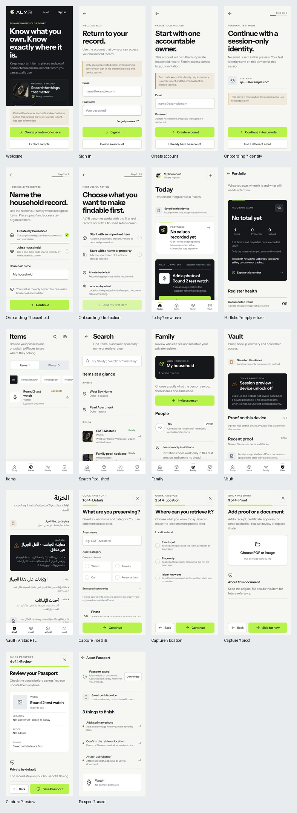
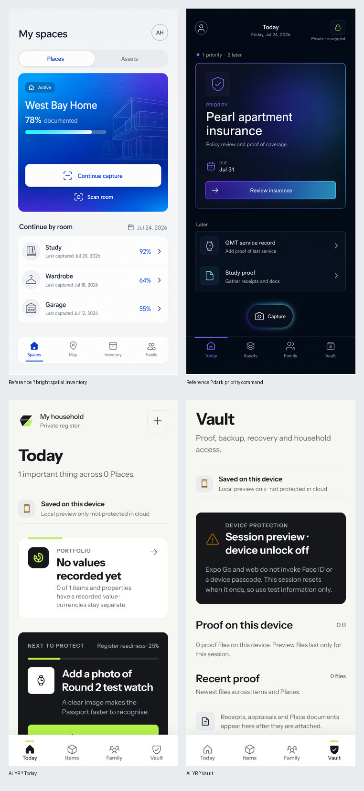

# ALYR native round-2 premium visual QA

**Date:** 27 July 2026
**Target:** current Expo/React Native app rendered on web at an iPhone-sized viewport
**Design direction:** ALYR Carbon Volt, light-first command system, restrained premium surfaces
**Result:** no P0/P1 visual blockers found in the reviewed core journey. One visible Search hierarchy defect was corrected and re-verified.

## Visual evidence

The original references contributed useful traits—clear priority, high-value contrast, compact navigation and one dominant action. The current product applies those traits through ALYR’s approved Carbon Volt system instead of copying the references’ blue/purple gradients. This gives the app a more ownable, calm and operational identity.

## Evidence matrix

| Journey / surface | Evidence | Verdict | Product and visual notes |
|---|---|---|---|
| Welcome | [00-welcome.png](./00-welcome.png) | Pass | Strong brand recognition, clear product promise, realistic preview boundary and two unambiguous entry actions. Volt remains a signal. |
| Sign in | [01-sign-in.png](./01-sign-in.png) | Pass | Excellent form hierarchy, persistent labels, recovery action, restrained notice and reachable primary action. |
| Create account | [02-sign-up.png](./02-sign-up.png) | Pass | Clear ownership consequence, password guidance and legal context. The pinned action area preserves the main action while fields remain scrollable. |
| Onboarding — identity | [03-onboarding-value.png](./03-onboarding-value.png) | Pass | Honest session-only identity state, masked email and clear step progress. |
| Onboarding — household | [04-onboarding-workspace.png](./04-onboarding-workspace.png) | Pass | Choice architecture is explicit and ownership is explained before continuation. |
| Onboarding — first action | [05-onboarding-privacy.png](./05-onboarding-privacy.png) | Pass | The journey ends with a useful product action rather than a decorative completion screen. Privacy and location consequences remain visible. |
| Today / new user | [11-today-new-user.png](./11-today-new-user.png) | Pass | Strong “next to protect” priority, honest local-only state, concise portfolio entry and clear first-Place action. |
| Portfolio | [12-portfolio-empty.png](./12-portfolio-empty.png) | Pass | Premium Carbon summary, honest “not net worth” boundary, recorded-value privacy control and useful register-health framing. |
| Items | [13-items.png](./13-items.png) | Pass | Clear Items/Places segregation, compact filter rail and strong row scanability. The partly visible trailing filter communicates horizontal continuation. |
| Search | [14-search-polished.png](./14-search-polished.png) | Pass after polish | Search scope is clear. Group labels now show **2 Places** and **6 items**, replacing the visually orphaned generic “items” label and improving scan confidence. |
| Family | [15-family.png](./15-family.png) | Pass | Household scope, role consequence and session-only invite boundary are visually prominent. |
| Vault | [16-vault.png](./16-vault.png) | Pass | Strong security posture without overclaiming. Device protection, local proof, backup and recovery are ordered by consequence. |
| Arabic RTL | [17-vault-arabic.png](./17-vault-arabic.png) | Pass structurally | Navigation, alignment, typography and icon direction read correctly in RTL. Public Arabic still needs a human linguistic review before release. |
| Capture — details | [06-first-capture.png](./06-first-capture.png) | Pass | Clear first task, common category shortcuts, optional photo and visible progress. |
| Capture — location | [07-capture-location.png](./07-capture-location.png) | Pass | Exact / Place-only / unknown states are distinct and truthfully described. |
| Capture — proof | [08-capture-proof.png](./08-capture-proof.png) | Pass | File type and size boundary are visible before selection; skipping remains explicit. |
| Capture — review | [09-capture-review.png](./09-capture-review.png) | Pass | Review card accurately summarizes location, proof, local-first saving and household privacy before commit. |
| Saved Passport | [10-capture-saved.png](./10-capture-saved.png) | Pass | The post-save hierarchy is excellent: confirmed result, sync truth, next readiness actions, then identity and retrieval detail. |

## Implemented polish

### Search group counts

**Before:** the item group was labelled only `items`, which looked like missing data in the new-user Search state.

**After:** Search uses the existing bilingual count formatters for both result groups:

- `2 Places`
- `6 items`

This improves English scanability, preserves Arabic plural handling and keeps the copy truthful.

## Validation

- `npm.cmd test --workspace=@alyr/native -- --runInBand tests/searchLocalization.test.ts tests/i18n-copy.test.ts tests/rtlCoreJourney.test.tsx`
  - 3 suites passed
  - 8 tests passed
- `npm.cmd run typecheck --workspace=@alyr/native`
  - passed
- Browser QA used a 390 × 844 device override; the rendered CSS content viewport was 354 × 767 after browser chrome.

## Remaining release evidence

These are device-validation gates rather than visual redesign tasks:

1. Signed iPhone camera, document picker, location permission and keyboard behavior.
2. VoiceOver rotor order, Dynamic Type at accessibility sizes and Reduce Motion on a physical device.
3. App-switcher privacy shielding and Face ID/device-passcode behavior in a signed build.
4. Human linguistic review of release Arabic.
5. Fresh screenshots from the signed iOS build after those checks.
