# ALYR iPhone Preview — Premium Product Design Audit

**Date:** 2026-07-27
**Viewport:** 390 × 844 px
**Design standard:** ALYR Quiet Precision, evaluated against the interaction clarity and craft expected from first-party Apple apps and mature Airbnb-quality consumer products.
**Evidence boundary:** This is a screenshot-led design audit of the accepted current-run captures listed below. It is not a functional, VoiceOver, Dynamic Type, RTL, keyboard, performance, or reduced-motion certification.

## Executive verdict

The final pass now presents a coherent premium product rather than a collection
of generated-looking screens. Quiet Precision is consistent, the first action
is obvious, the sample demonstrates real payoff, Portfolio stays truthful,
Atlas has geographic context and an accessible list, and Today · Items · Search
· Vault gives every primary destination one job.

The product is **ready for a personal Expo Go iPhone walkthrough**. It is not a
production-signed release: real-device permission behavior still needs the
owner's pass, the external Supabase project has not been deployed, encrypted
Recovery Kit needs its audited native password-protection adapter, and
localization outside the core English/Arabic journey remains backlog.

**Overall health: Premium personal-pilot ready; production infrastructure and
signed-native security gates remain open.**

## Post-audit remediation update

The following release blockers were repaired and recaptured after the original
22-screen audit:

| Gate | Current result | Evidence |
|---|---|---|
| Welcome decisions | **Closed at 390 × 844** — Sign in is top-right; Create private workspace and Explore sample remain visible in the fixed footer. | 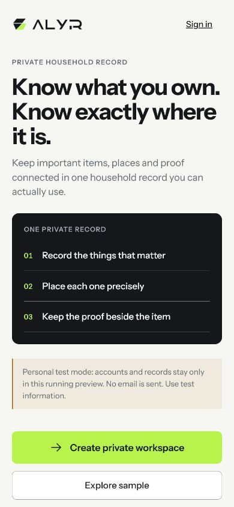 |
| First item/property decision | **Closed at 390 × 844** — both choices now precede trust detail and remain visible above the fixed action. | 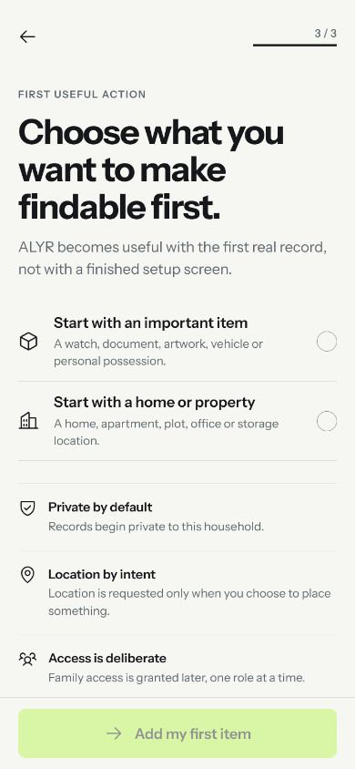 |
| Quick Passport proof footer | **Closed at 390 × 844** — Back and Skip for now are fully visible without collision. |  |
| Post-save route and Passport hierarchy | **Closed for the no-photo/no-location/no-proof case** — Passport saved, Go to Today, and the three missing tasks all precede optional recorded value. | 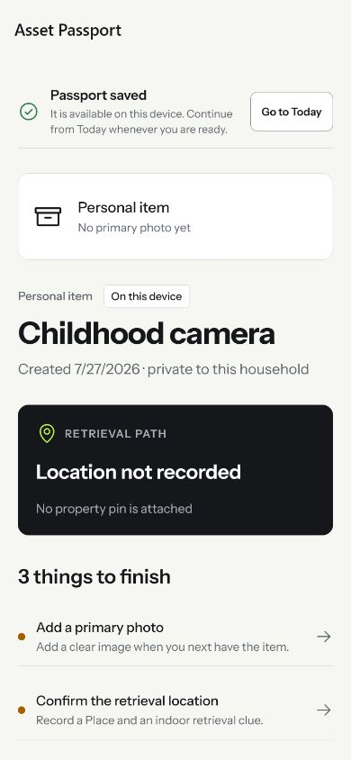 |

The same checks still require a physical-iPhone pass at larger Accessibility
Sizes.

### Final remediation evidence

| Gate | Final result | Evidence |
|---|---|---|
| Welcome and language entry | English/Arabic switch plus all three entry actions remain visible at 390 × 844. |  |
| Today truth | Portfolio currencies stay separate; confirmed pins and pins needing review are counted independently. | 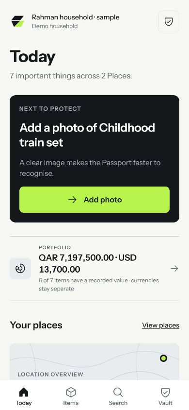 |
| Vault and Recovery Kit | Recovery routes are live, with a calm installed-build boundary instead of a dead row. | 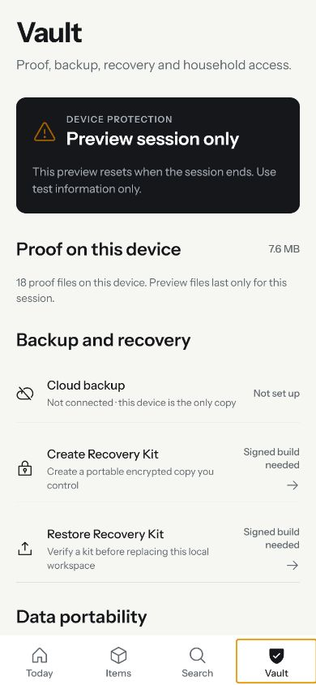 · 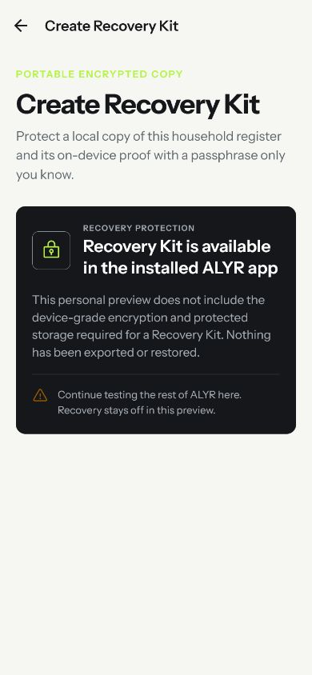 |
| Required-field recovery | Quick Passport keeps Continue reachable and focuses the missing name at 320 × 844. | 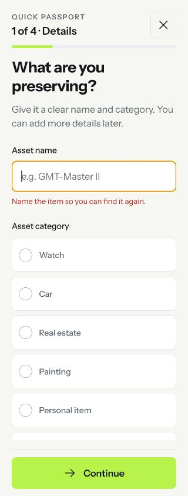 |
| Recorded value | Raw ISO entry is replaced by Day / Month / Year; invalid submission is reachable. | 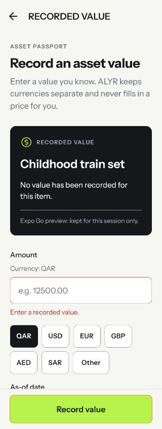 |
| Arabic Quick Passport | RTL reading order, category rows, progress, typography and direction icon were visually replayed at 320 × 844. |  |

## What is already strong

- **Brand discipline:** The ALYR mark, Instrument Sans, Paper/Carbon/Volt palette, restrained corner radii, and hairline separators form a coherent system. No ornamental gradient or glass effect is needed.
- **Trust:** The UI avoids false claims about measured GPS precision, verified ownership, automatic valuation, or guaranteed cloud backup.
- **Readable action hierarchy:** Today’s next action, Place retrieval, and the Quick Passport flow usually offer one obvious next step.
- **Anti-card-soup foundation:** Most dense content is expressed as rows and grouped sections rather than a dashboard made entirely of floating cards.
- **Icon coherence:** Phosphor-style line icons are used consistently at sensible optical sizes.
- **Touch-target intent:** Visible primary controls and list rows appear comfortably tappable, with state communicated through labels as well as color.
- **Portfolio composition:** The Portfolio screen is the strongest example of ALYR’s intended voice: calm hierarchy, truthful totals, and useful completeness guidance.

## Accepted visual evidence

The following are the accepted original screenshots. Screens **11** and **21** are retained as **historical pre-fix evidence**; their source hierarchy has since been updated and requires a new visual confirmation.

| Journey | Evidence |
|---|---|
| 01 · Welcome | 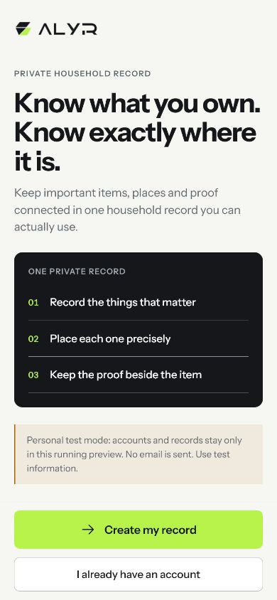 |
| 02 · Create account | 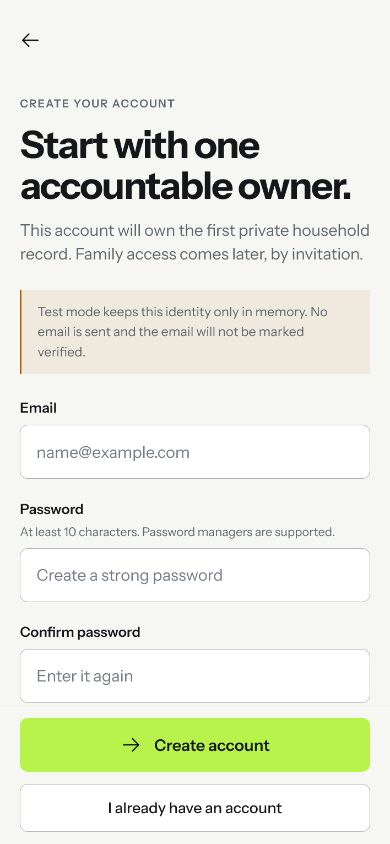 |
| 03 · Create-account validation | 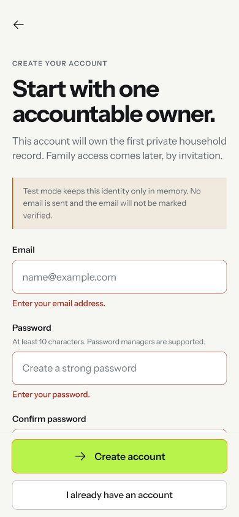 |
| 04 · Preview confirmation | 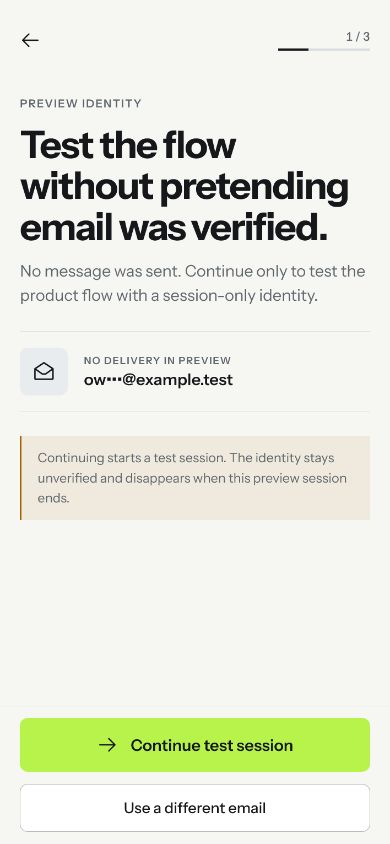 |
| 05 · Household setup | 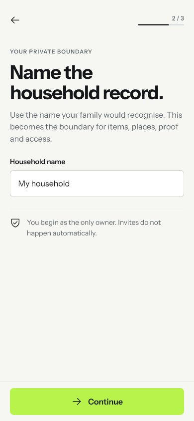 |
| 06 · Privacy-first action | 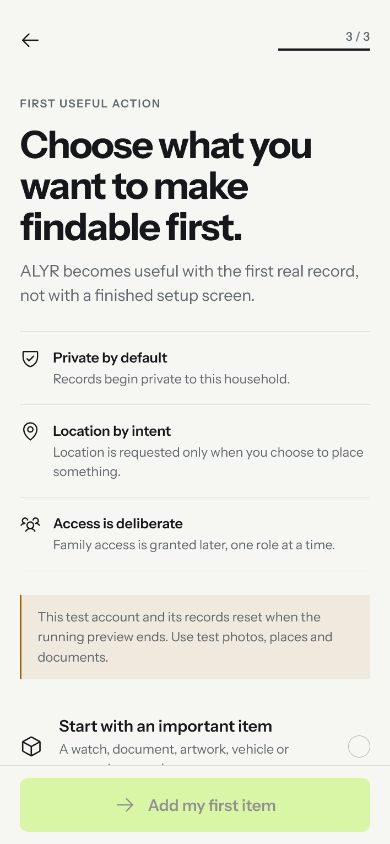 |
| 07 · Passport details | 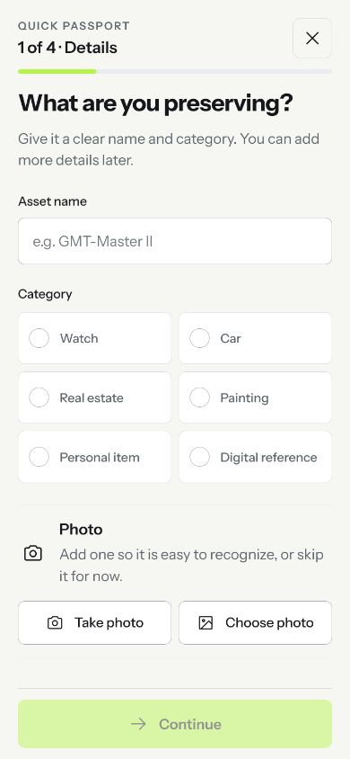 |
| 08 · Passport location | 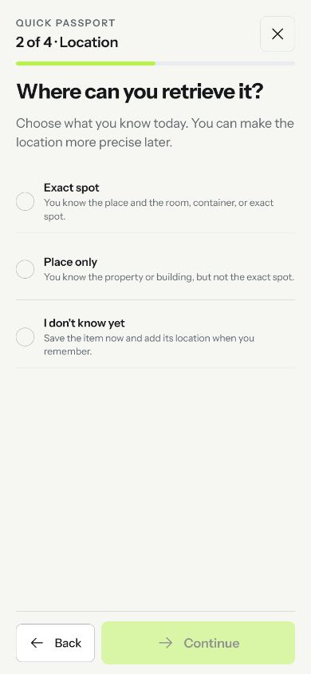 |
| 09 · Passport proof | 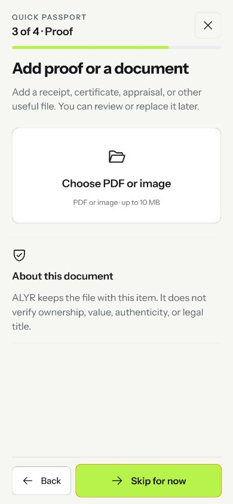 |
| 10 · Passport review | 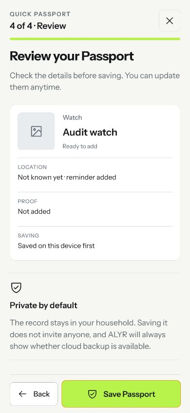 |
| 11 · New Passport — **pre-fix** | 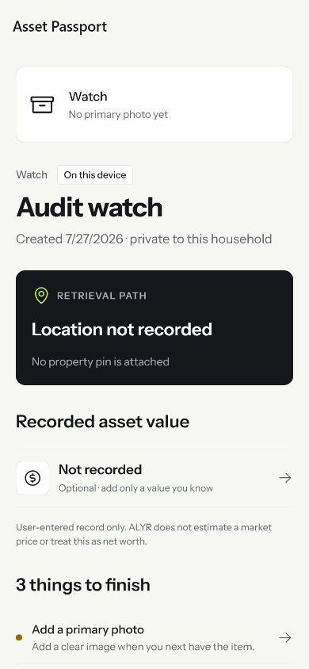 |
| 12 · Today | 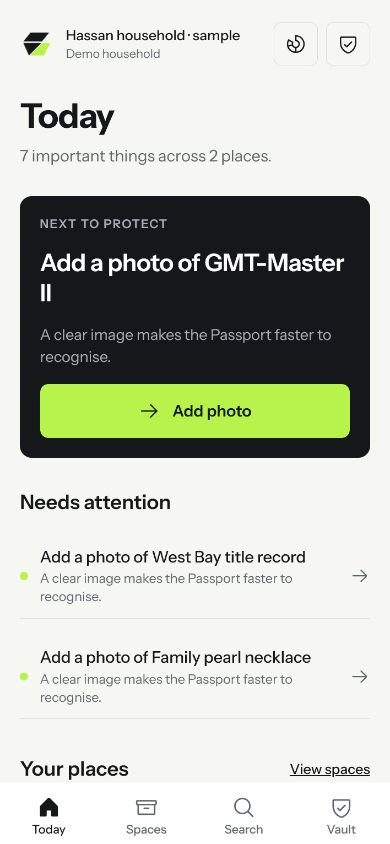 |
| 13 · Spaces / Places | 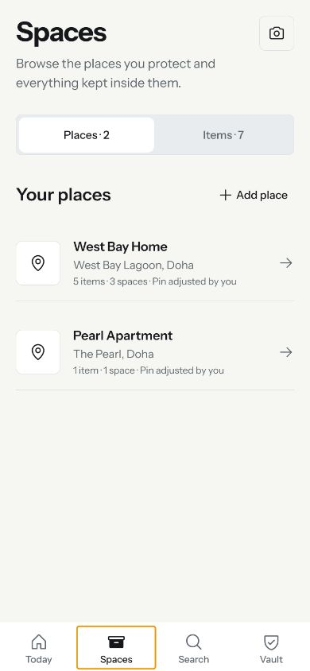 |
| 14 · Spaces / Items | 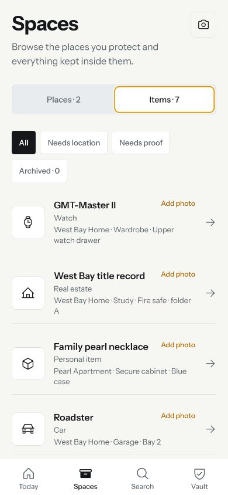 |
| 15 · Search | 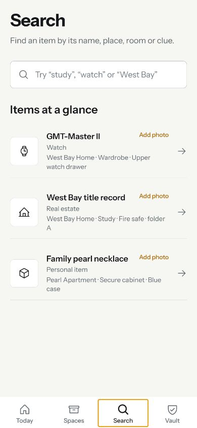 |
| 16 · Vault | 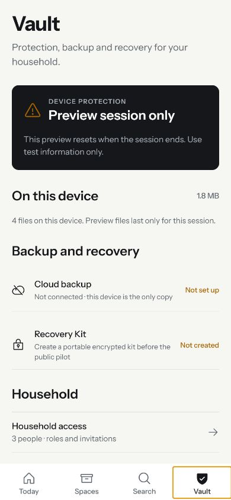 |
| 17 · Family access | 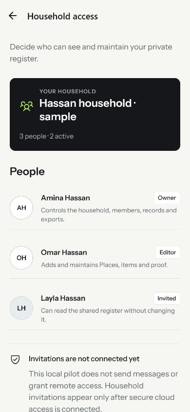 |
| 18 · Portfolio | 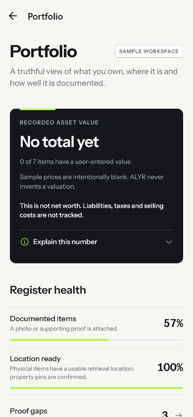 |
| 19 · Atlas | 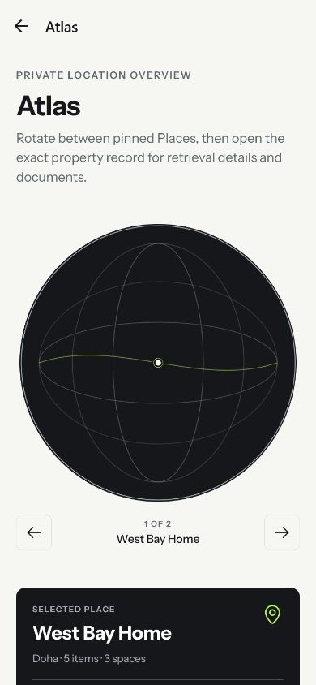 |
| 20 · Place detail | 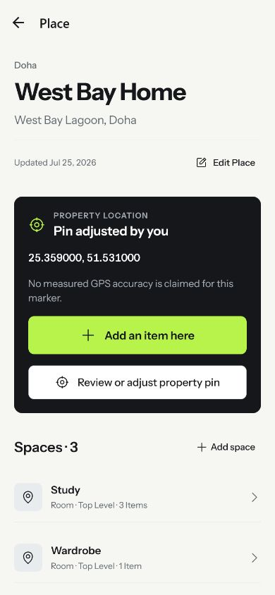 |
| 21 · Sample Passport — **pre-fix** | 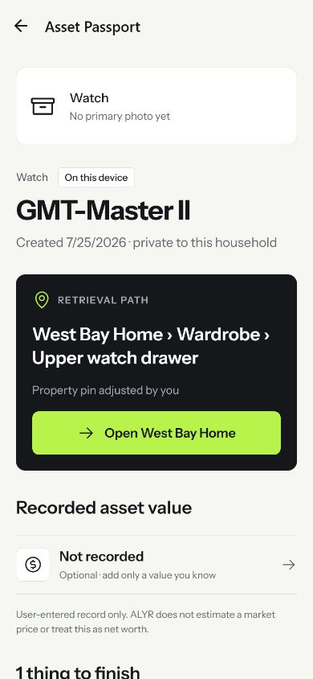 |
| 22 · Value entry | 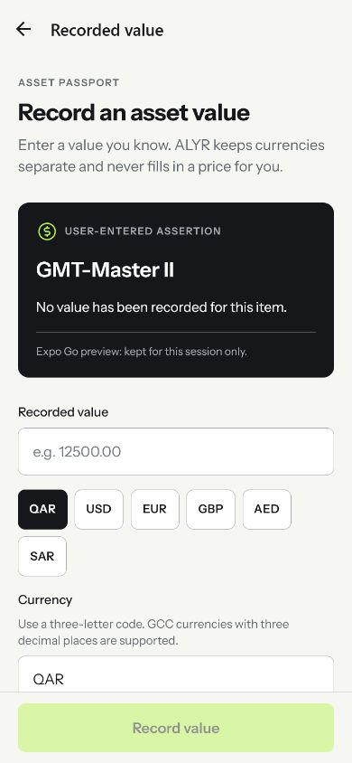 |

## Journey review

| # | Step | Health | Review |
|---:|---|---|---|
| 1 | Welcome | **Critical** | Brand and promise are strong, but “Explore a sample household” is not visible in the first 844 px. A user cannot see the fastest low-commitment path without scrolling. |
| 2 | Create account | **Strong** | Calm, legible form with sensible password guidance. “Start with one accountable owner” sounds operational rather than welcoming. |
| 3 | Account validation | **Needs work** | Inline errors are specific and preserve input. The lower confirm-password recovery state can fall behind scrolling plus the sticky action area. |
| 4 | Preview confirmation | **Needs work** | The state is honest, but “without pretending email was verified” reads like QA commentary. Large unused space makes the screen feel unfinished. |
| 5 | Household setup | **Strong** | Clear single-field step with good progress treatment. “Private boundary” is abstract product language. |
| 6 | First action | **Critical** | The screen asks for a choice, then places trust explanation before the choices. The initial viewport does not expose the complete decision. |
| 7–10 | Quick Passport | **Strong** | Good progress, small decisions, clear optional proof, and useful review. The proof disclaimer is too defensive and the category grid is slightly over-carded. |
| 11 | Saved Passport | **Retest** | Historical pre-fix evidence only. Source now places readiness/missing tasks above optional recorded value. Re-capture to prove the corrected hierarchy and post-save navigation on-device. |
| 12 | Today | **Needs work** | Excellent next-action hierarchy. The sample repeats the same missing-photo state, which prevents users from seeing the range and payoff of ALYR. |
| 13–14 | Places and Items | **Needs work** | Rows are disciplined, but the parent name “Spaces” conflicts with the selected “Places” segment and with room-level spaces. Filter chips wrap awkwardly. |
| 15 | Search | **Needs work** | Search field is obvious, but the empty state behaves like another asset list. It lacks recents, suggested scopes, result counts, and highlighting. |
| 16 | Vault | **Needs work** | Strong trust tone and information grouping. “Before the public pilot” and two unresolved setup statuses expose internal roadmap state instead of helping the user act. |
| 17 | Family | **Needs work** | Member roles scan well. The intro promises access management while the visible screen is read-only, and the invitation notice is technical roadmap copy. |
| 18 | Portfolio | **Strong** | Best overall composition. Duplicate native/static titles and a zero-value sample blunt the feature demonstration. |
| 19 | Atlas | **Critical** | The visual is attractive but not geographically legible. A wireframe orb with one small point does not help a user understand where assets are. |
| 20 | Place detail | **Strong** | Retrieval path, property/space hierarchy, and manual-pin provenance are excellent. Raw six-decimal coordinates imply more precision than a manually placed pin warrants. |
| 21 | Asset Passport | **Retest** | Historical pre-fix evidence only. Source ordering was corrected; visually verify that the next missing Passport task now appears before retrieval, optional value, and management content. |
| 22 | Value entry | **Needs work** | Entry is calm, but currency is represented by both preset chips and a separate input. “User-entered assertion” and decimal implementation notes sound internal. |

## Ranked findings and exact fixes

### P0 — Core-path or release-confidence blockers

#### P0.1 — Put the onboarding decision in the first viewport

**Evidence:** 01, 06
**Components:** Welcome action area; privacy-first action screen

The sample route is an important confidence-building entry, yet it is below the first viewport. Later, the first-action screen again puts explanation before the decision. Both moments make the user read product policy before experiencing value.

**Exact fix**

1. Move **Sign in** to a quiet top-right text action on Welcome.
2. Use the sticky footer for two vertically stacked actions: **Create private workspace** (primary) and **Explore sample** (secondary).
3. Keep one short privacy sentence above those actions; move the command list below the fold or behind “How ALYR protects your records.”
4. On the first-action screen, place the two choice rows immediately below the title. Mark **Add an item** as “Recommended” and keep both choices fully visible above the sticky footer at 390 × 844.
5. Collapse the trust explanation into one disclosure row below the choices.

**Acceptance:** A fresh user can identify and tap Create, Explore sample, or Sign in without scrolling; both first-action choices and the continue consequence remain visible at 390 × 844 and at one larger Dynamic Type step.

#### P0.2 — Revalidate the corrected Passport hierarchy before pilot

**Evidence:** 11 and 21, both explicitly **pre-fix**
**Components:** post-capture destination; Asset Passport readiness section

The captured historical state put optional value and Place retrieval ahead of the work required to complete the Passport. Source has since moved readiness/missing photo-location-proof tasks above optional recorded value, so this is now a verification gate rather than an unresolved source recommendation.

**Exact validation**

1. Capture an item without a photo, finish Save, and confirm the user lands on a Passport with a visible route back/Done.
2. Confirm the first above-fold command is the next missing Passport task.
3. Confirm **Open Place**, **Recorded value**, history, and archive controls follow readiness.
4. Repeat with only location missing and only proof missing.
5. Re-capture both new-item and sample-item states at 390 × 844.

**Acceptance:** No optional or navigational action visually outranks the next required Passport task, and post-save navigation never strands the user.

### P1 — Must resolve for a premium external pilot

#### P1.1 — Make Atlas a geographic product, not a decorative orb

**Evidence:** 19
**Components:** Atlas hero, globe renderer, place marker, interaction controls

The Carbon orb is brand-consistent, but it has no land, coast, country, or regional context. With one tiny point, it communicates “3D demo” rather than “where my assets are.” “Rotate” also does not match the visible previous/next controls.

**Exact fix**

- Retain Carbon/Volt and the restrained wire treatment, but add subtle geographic silhouettes or terrain lines.
- Give the selected marker a 10–12 px target, halo, label, and asset/place count.
- Support direct drag/rotate and pinch, while retaining accessible **Previous place** and **Next place** controls.
- Add **Globe / List** or **Map / List**, with the native accessible Place list always available.
- Cluster nearby locations and expose the selected Place summary beneath the globe.
- Use one title only; remove the duplicate static `Atlas` heading when the native stack title is present.

**Acceptance:** Without reading body copy, a user can identify the selected region, selected Place, number of represented locations, and how to reach the list alternative.

#### P1.2 — Resolve the information architecture and product vocabulary

**Evidence:** 12–15, 20–21
**Components:** bottom navigation; Spaces header; Places/Items segmented control; labels across Passport

`Spaces` currently means a tab containing Places and Items while also describing rooms/zones. `Items`, `Assets`, `things`, `records`, and `Passports` are used as near-synonyms. This is expensive cognitive load in a product whose promise is organization.

**Exact taxonomy**

- **Items**: the user’s physical/digital possessions.
- **Passport**: the evidence-rich record for one Item.
- **Places**: properties/buildings/land.
- **Spaces**: rooms, zones, shelves, containers, or sub-locations within a Place.

Rename the mixed `Spaces` tab to **Items** or **Collection**; give Places a clear route/filter within it. If Atlas is strategic, test this five-item information architecture:

`Today · Items · Atlas · Search · Vault`

Place household access under Vault/Profile unless Family activity becomes frequent enough to deserve a tab.

**Acceptance:** In a five-second label test, participants can predict where to add an Item, find a property, inspect a room, and open the globe without explanation.

#### P1.3 — Make the sample workspace demonstrate the finished product

**Evidence:** 12, 14, 18, 21
**Components:** sample fixtures; Item rows; Today tasks; Portfolio metrics; Passport identity

Every visible sample item has a generic archive glyph and the same “Add photo” gap; Portfolio has no recorded values. The sample therefore demonstrates setup debt, not the emotional payoff of remembering and retrieving important belongings.

**Exact fix**

- Seed 8–10 carefully art-directed, privacy-safe sample records with varied categories and useful thumbnails/illustrations.
- Include mixed states: complete Passport, manual pin, measured GPS, receipt proof, expiring insurance, shared family record, archived childhood object, and one genuinely incomplete item.
- Add explicitly labeled demo values in at least two currencies, with totals never silently converted.
- Use category-specific fallbacks when an image is absent; never use the same Archive box for a watch, deed, artwork, and document.
- Keep only one missing-photo task on Today and vary the remaining tasks.

**Acceptance:** The sample shows at least four distinct user outcomes and no more than one repeated missing-state prompt in the initial viewport.

#### P1.4 — Remove internal, defensive, and self-validating copy

**Evidence:** 04, 05, 09, 16, 17, 18, 22
**Components:** preview confirmation; setup helper text; proof disclaimer; Vault notice; Family notice; Portfolio intro; value-entry labels

Phrases such as “without pretending,” “private boundary,” “before the public pilot,” “truthful view,” and “user-entered assertion” expose implementation thinking. Repeated assurances about what ALYR does not do make the experience feel legally generated rather than calmly trustworthy.

**Exact copy direction**

| Current idea | Product-ready direction |
|---|---|
| Test the flow without pretending email was verified | **Continue in test mode** |
| Private boundary | **Household workspace** |
| User-entered assertion | **Your recorded value** |
| Truthful view of the value records you added | **Values you’ve recorded** |
| Before the public pilot | Remove roadmap language; show the real action or one `Preview` badge |
| Invitations are not connected yet | **Invites are coming later** only in internal builds; hide in pilot |

Keep one contextual disclosure at the point of consequence and move detailed limitations into an information sheet.

**Acceptance:** No user-facing string refers to pilots, internal connection state, implementation mechanics, or the product’s own honesty.

#### P1.5 — Align Family and Vault promises with available actions

**Evidence:** 16, 17
**Components:** Family intro/member rows; Vault backup/recovery rows

Family says users can decide who maintains records, but exposes no invite or role action. Vault presents “Backup not set up” and “Recovery not created” as static warnings without one clear recovery path.

**Exact fix**

- If editing is ready, add a single **Invite member** primary action and role-management affordances with consequence copy.
- If it is not ready, change Family to **Review household access** and remove the action promise.
- In Vault, combine backup and recovery into one guided **Create Recovery Kit** command with progress/status.
- Use one non-alarming unavailable-state message and reserve warnings for data that is actually at risk.

**Acceptance:** Every promise in the screen introduction maps to an enabled action or a clearly labeled read-only state.

#### P1.6 — Simplify value entry and localize recorded facts

**Evidence:** 20, 22; date format also visible in 11 and 21 pre-fix
**Components:** amount/currency input; preset chips; location coordinates; date rendering

Currency is selected twice, preset chips wrap, and decimal behavior is explained as implementation detail. Raw six-decimal coordinates visually overstate the accuracy of a manual pin. US-only dates weaken international polish.

**Exact fix**

- Use a single amount row: localized number input plus one currency selector.
- Show up to four recent currencies and a **More currencies** sheet; do not allow chips to create a one-item second line.
- Format decimals after selection rather than explaining currency precision in helper copy.
- Label manual coordinates as **Manually placed pin** and show 4–5 decimals in the summary; preserve full coordinates in details/export.
- Render dates through locale-aware, unambiguous formatting.

**Acceptance:** Currency can be chosen in one place, the row does not wrap at 390 px, and visible precision never exceeds the recorded location method.

#### P1.7 — Give each screen one distinctive job

**Evidence:** 12, 16–19, 21
**Components:** repeated Carbon `CommandSurface`; screen title system

The Carbon command card is effective, but repeated across Today, Family, Vault, Portfolio, Atlas, and Passport it becomes a template. Portfolio and Atlas also duplicate native and in-content titles.

**Exact fix**

- Reserve Carbon command surfaces for one high-value decision or status per screen.
- Use a typographic summary for Portfolio, an immersive geographic canvas for Atlas, a roster-led composition for Family, and a recovery-led composition for Vault.
- Choose either a native large-title stack that collapses or a custom in-content H1—never both.
- Keep Volt as a focus/accent signal, not a default decoration.

**Acceptance:** A grayscale silhouette test still lets a reviewer distinguish Today, Family, Vault, Portfolio, and Atlas.

### P2 — Craft and efficiency improvements

#### P2.1 — Fix filter density and wrapping

**Evidence:** 14
Use a horizontal filter rail with a clear selected state, or one **Filter** button with an applied-count badge. Do not leave `Archived` orphaned on a second line.

#### P2.2 — Design a real Search start state

**Evidence:** 15
Autofocus the field when appropriate; show recent searches, useful scopes (`Items`, `Places`, `Documents`), and suggested queries. Results should show count, highlighted match, and concise retrieval context rather than reproducing the default Item list.

#### P2.3 — Improve icon semantics

**Evidence:** 11–15, 21
Replace the universal Archive-box fallback with category-specific symbols; use **Plus / Add** rather than a camera icon when the action can create more than a photo; label icon-only Today shortcuts or place them in an explicit quick-actions row.

#### P2.4 — Tighten vertical rhythm selectively

**Evidence:** 04–06, 09, 16
The global generous spacing creates large empty fields on short forms while core decisions can fall below the fold. Keep calm spacing, but use screen-specific density: 20–24 px section rhythm for decision flows, 28 px for editorial summaries, and minimum 16 px around grouped rows.

#### P2.5 — Reduce small, muted metadata

**Evidence:** 12–16, 20
Several 10–12 px labels carry dates, status, or provenance. Promote consequential metadata to at least the semantic body-small token, preserve contrast, and test at large accessibility sizes.

#### P2.6 — Make error recovery visible as a complete state

**Evidence:** 03
On submit, focus the first invalid field, reveal a concise error summary when multiple fields fail, keep the affected field and message above the keyboard/sticky footer, and announce it to assistive technology.

## Accessibility review and evidence limits

### Positive visible signals

- Primary actions and row targets are visually large.
- Selected states generally combine label/icon treatment with color.
- Text contrast is strong on Paper and Carbon surfaces.
- Lists have predictable row structure and clear chevrons.
- A native list alternative is already part of the Atlas product direction.

### Risks requiring device validation

- 10–12 px all-caps and muted metadata may fail readability for low-vision users.
- Wrapped chips and sticky footers may become unusable under Dynamic Type.
- Icon-only shortcuts need explicit accessibility labels and visible text equivalents where meaning is not universal.
- Custom segmented controls and globe gestures require VoiceOver roles, values, and alternate actions.
- Arabic RTL must preserve icon direction, numerical data, map coordinates, currency layout, and bottom-tab order intentionally.
- Screen-reader focus after validation, modal close, save, and sync conflict has not been evidenced.
- Reduced Motion, Increase Contrast, Differentiate Without Color, keyboard traversal, and app-switcher shielding cannot be judged from these captures.

**Required test set:** VoiceOver, Dynamic Type through accessibility sizes, Arabic RTL, reduced motion, reduced transparency, increased contrast, keyboard traversal on web, and Switch Control/TalkBack parity before release.

## Recommended implementation order

1. Resolve **P0.1** and capture the full onboarding path at 390 × 844 plus one larger Dynamic Type size.
2. Complete the **P0.2** Passport revalidation and replace screenshots 11/21 with current post-fix evidence.
3. Lock the IA vocabulary and bottom-navigation model before adding more screens.
4. Upgrade the sample dataset and category imagery; use it to validate Today, Items, Portfolio, and Passport together.
5. Rebuild Atlas around geographic comprehension and its native list counterpart.
6. Run the copy edit, then align Family/Vault promises with actual capabilities.
7. Apply P2 density, search, icon, localization, and accessibility refinements.

## Release bar

ALYR is ready for a premium external design pilot when:

- every critical onboarding choice is visible without exploratory scrolling;
- a saved Passport visibly prioritizes its next missing task;
- one vocabulary system survives usability testing;
- the sample workspace communicates the finished benefit rather than setup debt;
- Atlas communicates real geography and an accessible list route;
- no internal roadmap or implementation copy appears;
- Family/Vault claims match enabled actions;
- the critical flows pass real-device Dynamic Type, VoiceOver/TalkBack, and RTL checks.

**Next action:** Convert P0.1 into the first implementation ticket and re-capture onboarding before beginning decorative polish.
