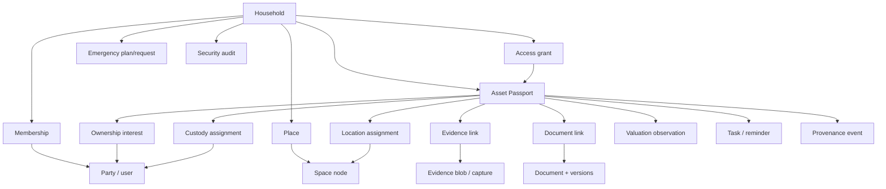
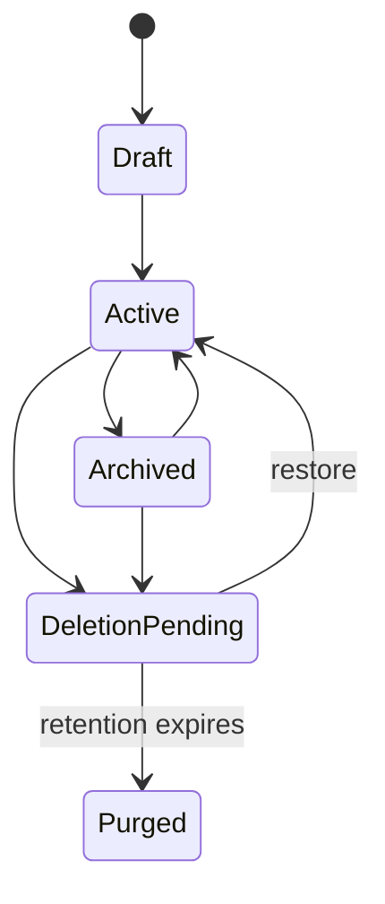
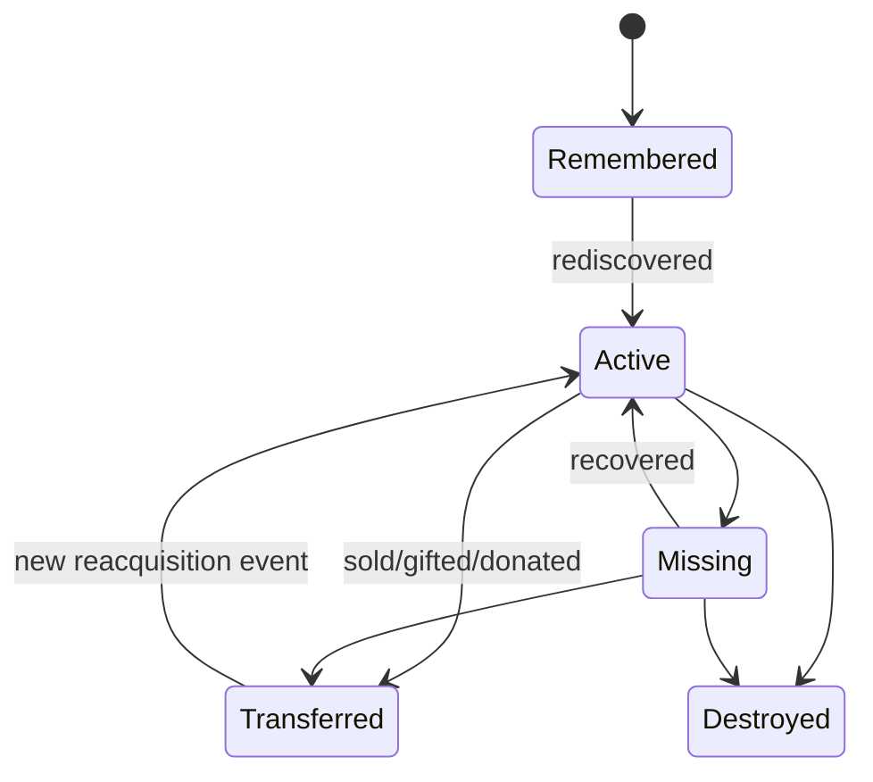
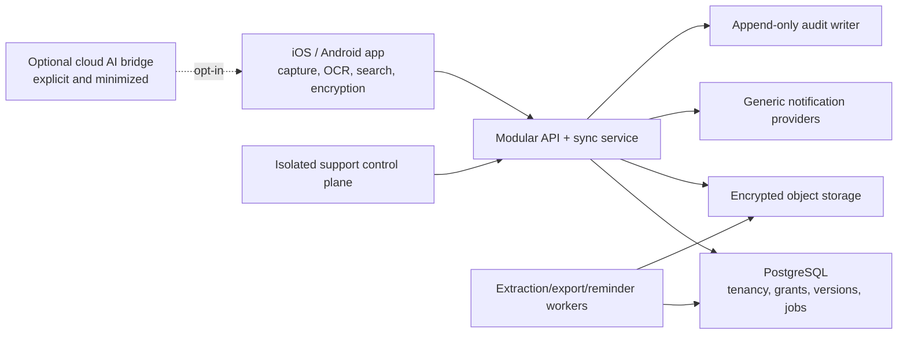
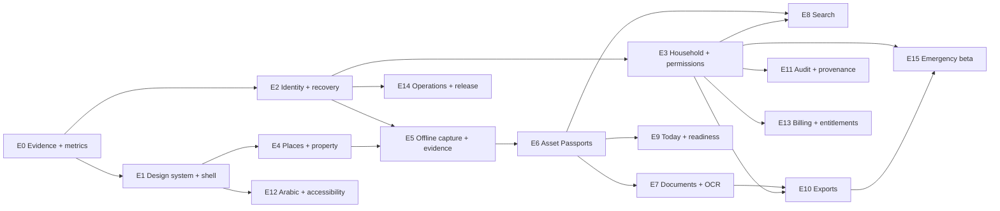

# Asset Continuity

## Product, UX, Business Logic, and Development Blueprint

**Version:** 0.1
**Date:** 24 July 2026
**Status:** Build-planning baseline
**Working description:** A private family asset vault that helps a household remember what it has, prove what matters, manage it over time, and hand it over safely.

### Document map

- [Executive decision and scope](#1-executive-decision)
- [Information architecture](#4-information-architecture)
- [End-to-end user flows](#7-end-to-end-user-flows)
- [Business logic and domain model](#8-business-logic-and-canonical-domain-model)
- [State machines and permissions](#9-state-machines-and-invariants)
- [Security and technical architecture](#12-security-privacy-recovery-and-continuity-architecture)
- [Metrics and validation](#15-analytics-metrics-and-research-plan)
- [Startup operating system](#16-startup-operating-system)
- [Roadmap and epic map](#18-development-roadmap)
- [QA gates and risks](#20-qa-strategy-and-release-gates)
- [First 30 days](#22-first-30-days)

---

## 1. Executive decision

### The product

Asset Continuity is not a generic inventory app and it is not a net-worth dashboard. It is a private continuity system for physical, digital, real-estate, collectible, and remembered assets.

Its promise is:

> If something happens to your home or to you, your family can find, understand, prove, and handle what matters.

The long-term vision is a durable memory and evidence layer for everything a family owns or has owned. The launch wedge is deliberately narrower:

> Help a high-complexity household create a useful evidence-and-handoff vault for one property and its 20 most important assets.

### The first customer

The primary design-partner profile is:

- A household with one or more properties, storage locations, or countries.
- At least 20 valuable, legally important, sentimental, or maintenance-heavy assets.
- One family member already acting as the informal “asset steward.”
- A current trigger such as moving, insurance renewal, estate planning, aging parents, a new property, or a growing collection.
- Willingness to invite at least one trusted person.

Secondary early cohorts are watch/jewelry collectors, internationally distributed families, and professionals who help households organize evidence.

### The activation moment

A household reaches the **First Useful Vault** milestone when it has:

1. Created a household and secured the first account.
2. Added one place.
3. Completed one room or zone evidence capture.
4. Created at least five useful records.
5. Promoted at least one important object into a full Asset Passport.
6. Attached one proof artifact.
7. successfully retrieved that record through Search.

The product should make this achievable in 15 minutes without a forced tutorial, subscription wall, or family invitation.

### The business thesis

People do not pay to maintain a list. They pay for reduced risk, less family confusion, stronger proof, easier retrieval, and a guided handoff. Recurring value comes from:

- Insurance and document reviews.
- Expiry, warranty, service, appraisal, and maintenance reminders.
- Moves and location changes.
- Family access reviews.
- Evidence freshness checks.
- Claim, estate, moving, and full-vault exports.

### The non-negotiable trust boundary

The app preserves assertions, evidence, verification, and history. It does not create legal truth.

- A photo shows that something was photographed; it does not prove ownership.
- A stored deed is a copy; the official registry remains authoritative.
- A value estimate is not a certified appraisal.
- An intended recipient is not a will or beneficiary designation.
- Emergency access reveals records; it does not transfer ownership or appoint an executor.

---

## 2. Product principles

1. **Capture first, organize progressively.** A dated room capture is useful before every object has a perfect record.
2. **One fact, one clear source.** Location, category, ownership, custody, value, status, and access are independent dimensions.
3. **Evidence is immutable.** Originals are never overwritten; corrections create versions.
4. **AI suggests; people confirm.** AI never silently decides ownership, value, legal status, coverage, access, or disposition.
5. **Private by design.** Access is denied by default, sensitive actions require reauthentication, and analytics never contain vault content.
6. **Family access is explicit.** Administrative authority is not the same as the right to see every private document.
7. **Offline work must be safe.** Capture cannot depend on perfect connectivity, and conflicts never silently destroy material facts.
8. **No lock-in.** Human-readable and machine-readable exports are available on every plan.
9. **Calm interface, clear urgency.** The product should feel premium and reassuring, not like an alarm system or finance terminal.
10. **Long-life product behavior.** Recovery, export, succession, deletion, and company-shutdown continuity are core product features.

---

## 3. Product scope

### MVP: paid-pilot scope

- Passkey-first account creation and trusted-device management.
- Recovery setup and recovery-health checks.
- Household creation, member invitations, and role presets.
- Places, properties, rooms, zones, and storage containers.
- Room/zone photo capture with pause and resume.
- Quick Items, grouped ordinary items, full Asset Passports, and Memory Items.
- Original evidence, documents, receipts, serial numbers, and notes.
- On-device OCR where practical, with explicit human confirmation.
- Property Passport for a house, apartment, or plot.
- Search across permitted assets, places, documents, people, and tasks.
- Today queue with reminders and transparent readiness gaps.
- Controlled sharing with a “what they will see” preview.
- Claim pack, moving pack, household overview, and full archive export.
- Offline capture and deterministic conflict handling.
- English, Arabic, LTR, RTL, light mode, dark mode, Dynamic Type, VoiceOver, and TalkBack.
- Append-only provenance and security audit history.
- Subscription entitlements that never hold customer data hostage.

### Post-MVP beta

- Delayed emergency access with independently reviewed key recovery.
- Multiple approval contacts and approval quorum.
- Professional/advisor workspace.
- QR labels for boxes, safes, and move workflows.
- Advanced collection views and valuation history.
- Optional market-data integrations for selected asset classes.
- Concierge digitization operations.
- B2B2C sponsor administration that exposes activation status, never vault contents.

### Explicitly out of scope for the initial product

- Bank or brokerage aggregation.
- Crypto custody, seed-phrase storage, or private-key storage.
- Will creation, probate execution, or legal beneficiary designation.
- Insurance sales, binding coverage advice, or claims adjudication.
- Marketplace, resale, or auction execution.
- Automatic authoritative property-registry updates.
- Universal automatic valuation.
- Advertising, data brokerage, or model training on customer vaults.

---

## 4. Information architecture

### Global navigation

The approved product shell has four top-level destinations:

| Destination | User question it answers | Primary contents |
|---|---|---|
| **Today** | What needs my attention now? | Priority task, reminders, readiness gaps, recent activity |
| **Spaces** | Where is it, and what do I have? | `Places` and `Assets` segmented views |
| **Search** | Can I find it immediately? | Universal query, OCR text, filters, recent retrievals |
| **Family** | Who can see or help with what? | Members, invitations, permissions, access reviews, emergency setup when beta-enabled |

**Capture is an action, not a navigation destination.** It is available contextually from Today, Spaces, a Place, a Room, and an Asset Passport.

### Spaces hierarchy

```text
Household
├── Places
│   ├── Property / home / apartment / plot / office / storage
│   │   ├── Room or zone
│   │   │   ├── Safe / shelf / cabinet / box
│   │   │   └── Evidence sessions
│   │   └── Linked real-estate Asset Passport
│   └── Virtual place, only when a physical location is not relevant
└── Assets
    ├── Individual Asset Passports
    ├── Grouped ordinary items
    ├── Collections
    └── Historical Memory Items
```

The location tree answers **where**. Categories answer **what**. Collections answer **which group**. Ownership answers **whose**. These must never be collapsed into a single folder structure.

### Asset families

System asset families are stable, localized facets:

1. Property and land.
2. Vehicles and mobility.
3. Watches, jewelry, and valuables.
4. Art and collectibles.
5. Electronics and equipment.
6. Furniture and household.
7. Digital and intellectual assets.
8. Business and ownership interests.
9. Financial references, without credentials.
10. Personal and family memories.
11. Other.

Users may create tags and collections. A custom category uses the generic passport schema until the team deliberately adds a versioned specialist schema.

### Four capture depths

| Capture depth | Intended use | Required to save |
|---|---|---|
| **Room Evidence** | Ordinary items and broad proof of contents | Place/zone plus one original photo or video |
| **Quick Item** | Something worth finding later | Photo or name, plus current location or `Location unknown` |
| **Asset Passport** | Valuable, legal, meaningful, insured, or serviced item | Identity, ownership assertion, location/custody, and visibility |
| **Memory Item** | Lost, childhood, inherited, gifted-away, or remembered object | Description or story, approximate period, and memory status |

### Asset Passport sections

The screen uses progressive disclosure:

1. **Overview** — name, hero evidence, category, priority, state, current location.
2. **Proof** — receipt, serial/reference, certificate, photos, original files, source quality.
3. **Ownership & custody** — owner assertions, shares, custodian, possession.
4. **Value & insurance** — dated valuations, currency, appraisal, coverage links.
5. **Care** — service, maintenance, warranty, upcoming tasks.
6. **Story & provenance** — acquisition, people, history, memory.
7. **Access & handoff** — visibility, trusted viewers, intended instructions, export.
8. **Timeline** — append-only provenance events and versions.

### Screen inventory

| Area | Required screens and states |
|---|---|
| Entry | Launch lock, language, account, passkey, device approval, recovery, sign-in failure |
| Onboarding | Intent selection, first household, first place, first capture, activation success |
| Today | Normal, all caught up, overdue, offline, permission alert, emergency alert |
| Spaces | Place list, asset list, map/list mode, empty, filtered, archived |
| Place | Place overview, property details, rooms, documents, people, readiness, history |
| Room/zone | Evidence sessions, grouped contents, promoted assets, stale-capture state |
| Capture | Action sheet, room capture, item capture, document scan, import, memory item |
| Capture review | Processing, suggestions, duplicates, partial upload, confirm, resume later |
| Asset | Quick record, full passport, edit, conflict, lifecycle transition, export |
| Documents | Scanner, crop, extraction review, link target, sensitive visibility, versions |
| Search | Query, filters, OCR match, no result, permission-safe result, offline result |
| Family | Members, invitations, roles, scoped grants, access preview, revocation, audit |
| Emergency (post-MVP beta) | Setup, contact verification, test, request, countdown, deny, active, expiry |
| Export | Pack type, selection, redaction, generating, ready, failed, expired |
| Settings | Profile, devices, security, recovery, language, notifications, billing, delete |

---

## 5. People, roles, and jobs

### Product personas

| Persona | Primary job | Main fear |
|---|---|---|
| **Household steward** | Organize and keep the vault current | Nobody else will understand it |
| **Co-owner/partner** | Verify, retrieve, and share responsibility | Being excluded or surprised |
| **Collector** | Preserve proof, provenance, service, and value history | Loss, theft, counterfeit doubt, missing papers |
| **Property owner** | Keep each property and its records together | Missing official papers or maintenance history |
| **Adult child** | Help an aging parent without taking over | Overstepping or discovering gaps too late |
| **Trusted family viewer** | Find what they need in a stressful moment | Too much information or unclear authority |
| **Professional advisor** | Review a deliberately shared subset | Receiving stale, excessive, or legally ambiguous data |

### Administrative role presets

- **Owner:** household administration, billing, member management, transfer, and last-owner protections.
- **Admin/co-owner:** most household administration except destructive ownership transfer.
- **Steward:** capture, edit, verify, and manage assigned tasks.
- **Contributor:** create evidence and edit their own drafts in assigned places.
- **Viewer:** read only within an explicit scope.
- **Advisor:** time-limited, explicit, usually no-download access.
- **Emergency contact:** no access until a configured request becomes active.

Administrative roles do not by themselves prove legal ownership of assets.

### Data capabilities

Access is evaluated as:

```text
membership is active
AND role permits the operation
AND resource scope includes the object
AND sensitivity grant includes the requested fields
AND time/device/step-up conditions are satisfied
```

Resource scopes can be household, place, collection, asset, document, or export bundle. Sensitive field groups are:

- Basic catalog.
- Location detail.
- Financial/value.
- Legal/document.
- Story/private note.
- Export/download.

---

## 6. Experience rules

### Premium interaction standard

- The interface uses one restrained purple-to-cyan accent system; gradients signal focus or priority, not decoration.
- Light and dark screens are modes of one product, with identical information hierarchy and icon language.
- Navigation and utility surfaces remain quiet; expressive dimensional art is reserved for a few hero/category moments.
- Use familiar platform symbols first and consistent custom icons only when the system set is insufficient.
- Minimum interactive target is 44 × 44 points.
- Every meaningful control has a text or accessibility label.
- Layouts support large text, mixed Arabic/English content, reduced motion, and screen readers.
- Loading, empty, offline, partial, error, conflict, success, and permission-denied states are designed before build.
- Never hide destructive or sharing consequences behind an icon-only action.
- The app-switcher snapshot and sensitive notifications reveal no vault content.

### Language and tone

- Use “record,” “evidence,” “copy,” “estimate,” “asserted owner,” and “intended handoff.”
- Avoid “verified owner,” “official registry,” “guaranteed value,” or “beneficiary” unless an external authority supplies that status.
- Explain security in plain language at the moment it matters.
- Keep Today calm: one clear priority, a small Later list, and an explicit All caught up state.

---

## 7. End-to-end user flows

### Flow 1 — New owner onboarding

**Goal:** Reach the first useful record without weakening account security.

1. User selects English or Arabic; layout direction changes immediately.
2. One screen explains the promise: find, prove, manage, and pass on what matters.
3. User creates an account and registers a passkey.
4. Device biometrics become the convenience unlock; the passkey remains the account authenticator.
5. User creates and names a household.
6. App explains that household membership does not automatically reveal every sensitive field.
7. User registers a second trusted authenticator or creates a recovery kit.
8. User selects one starting intent:
   - Add my home or property.
   - Scan a room.
   - Add an important asset.
   - Remember something from the past.
9. App opens that flow directly.
10. The first useful save replaces any “tutorial completed” success metric.

**Branches and recovery**

- Existing invitation found: offer to join before creating a new household.
- Passkey unsupported: permit a supported fallback and create a Today security task.
- No network: account creation waits; do not create an unsecured anonymous cloud vault.
- Recovery skipped: permit capture but keep a visible, non-dismissible security-health task.
- User already has a household: offer household switching; never merge automatically.
- App closes mid-onboarding: resume at the last safe checkpoint.

**Acceptance**

- No credit card, complete profile, address, family invite, or forced tour is required before first capture.
- The user can explain whether a saved record is private or shared before completing onboarding.

### Flow 2 — Invited member onboarding

1. Invitee opens a signed, single-use invitation.
2. App shows the inviter, household, proposed role, exact record scope, visible field groups, and expiry.
3. Invitee signs in or creates an account and registers a secure device.
4. Invitee accepts or declines.
5. If accepted, membership activates and opens the first permitted location or collection.
6. Invitation, acceptance, device registration, and first protected access are audited.

**Branches**

- Expired or revoked: reveal no household detail beyond safe inviter metadata; request a fresh invite.
- Email/identity mismatch: inviter must correct the invitation.
- Scope changed before acceptance: display the new terms and require acceptance again.
- Access revoked while viewing: clear protected content and show a neutral “Access changed” state.

### Flow 3 — Add a place or property

1. User chooses `Spaces → Places → Add place`.
2. Select type: home, apartment, plot/land, office, storage, or other.
3. Select relationship: own, co-own, rent, manage, family property, or third-party storage.
4. Enter a familiar nickname; official name is optional.
5. Add address or map pin. Location permission remains optional.
6. Add cover image, country, jurisdiction, and base currency.
7. If relationship is owned/co-owned, create one linked real-estate Asset Passport.
8. Offer a structure:
   - Home/apartment: floor and suggested rooms.
   - Plot/land: parcels, zones, and structures.
   - Storage: unit, aisle, cabinet, shelf, and box.
9. User edits suggestions and saves.
10. Place opens with `Start capture` as the primary action.

**Branches**

- Similar address/name: offer `Open existing` or `Create separately`.
- Rented/managed place: no owned real-estate asset is created.
- Ownership unclear: save `Relationship unknown` and create a review task.
- Address unavailable: accept a manual description and optional coordinates.
- Property sold later: keep the Property Passport and require every still-located asset to be moved, transferred, marked unknown, or deliberately retained against the former place.

### Flow 4 — Guided room or zone capture

1. User taps Capture and chooses `Scan a room`.
2. Household, place, and room are prefilled from context where possible.
3. Camera and microphone permissions appear only when needed.
4. On-screen guidance requests broad coverage, important containers, and optional close-ups.
5. User may pause, resume, remove images, add notes, or add an audio description.
6. Review shows place, room, date, media count, excluded images, and current backup status.
7. User saves; an encrypted local draft enters the sync outbox.
8. Originals are checksum-verified and committed remotely.
9. On-device recognition proposes notable objects and possible documents.
10. For each proposal the user can:
    - Promote to an Asset Passport.
    - Link to an existing asset.
    - Leave covered by Room Evidence.
    - Dismiss.
11. Room readiness and capture date update.

**Branches**

- Offline: show `On this device — not backed up yet`; sync automatically later.
- App terminated: restore the exact local draft.
- Interrupted upload: resume by chunk and idempotency key.
- Poor coverage: save anyway and offer `Finish this room` later.
- Low-confidence proposal: do not create a record.
- Private image: exclude it or restrict the full session.
- Insufficient role: block before opening the camera.

### Flow 5 — Capture an individual object

1. User chooses `Capture object`.
2. Confirm current place/container or choose `No physical location` / `Location unknown`.
3. Capture an overview and identifying detail; serial/reference is optional.
4. App suggests category, brand, model, and identifier fields.
5. User confirms or edits each material fact.
6. Select importance: ordinary, important, critical, or legacy.
7. Add ownership assertion and current custodian.
8. Confirm visibility.
9. Save the minimum passport.
10. Offer exactly one highest-value next action: proof, value, insurance, service, story, or handoff.

**Duplicate branch**

- Similar image, identifier, or title presents candidates.
- User chooses `Link evidence`, `Merge`, or `Keep separate`.
- Merge preserves both source IDs, all originals, conflicts, and an audit redirect.

### Flow 6 — Remember a childhood, lost, or former asset

1. User chooses `Remember something`.
2. Add a name or natural-language description.
3. Add an approximate date, former place, people, and story.
4. Add a photo, scan, or voice memory if available.
5. Choose remembered state: lost, stolen, sold, gifted, donated, destroyed, or simply remembered.
6. Save without demanding present location, serial, receipt, value, or proof.
7. Exclude the item from current-value totals and active-place readiness.
8. If rediscovered, `Mark as found` creates an active state while preserving the memory history.

Dates support exact date, month, year, range, circa, and unknown.

### Flow 7 — Complete an Asset Passport

1. User opens a passport.
2. Header shows state, importance, current location/custody, and documentation readiness.
3. `Next best step` opens the highest-value missing section.
4. User completes sections progressively:
   - Identity.
   - Whereabouts and custody.
   - Ownership assertion.
   - Photos and proof.
   - Value and insurance.
   - Care and service.
   - Story and provenance.
   - Continuity instructions.
   - Access.
5. Category-specific fields extend the common model.
6. A material change creates a timeline and audit event.
7. Derived tasks update by stable key instead of duplicating.

**Special rules**

- Digital/financial records store provider, account alias, owner, renewal, and the location of recovery instructions—not credentials.
- Obvious passwords, private keys, or seed phrases trigger a local warning and are rejected from designated secret fields.
- Ownership percentages above 100% are blocked; totals below 100% remain allowed with a warning.
- Category changes never discard unmatched data; it moves to `Additional details`.
- A Property Passport opens the same canonical record from Places and Assets.

### Flow 8 — Add and process a document

1. Capture, import, or share a supported file into the app.
2. Choose a link target: asset, property, policy, person, lifecycle event, or `Decide later`.
3. File enters format validation, malware handling, and OCR/extraction.
4. Original bytes remain immutable.
5. App shows document type, names, identifiers, dates, and expiry as sourced suggestions.
6. User confirms every critical field.
7. User selects sensitivity and viewers.
8. Optional expiry/review reminder is created.
9. Confirmed metadata and OCR text become searchable within the same permission scope.
10. Replacing a document creates a new version and preserves the prior one.

**Branches**

- Same checksum: link the existing document instead of duplicating bytes.
- Unsupported/corrupt: keep the recoverable local original and offer replacement.
- Malware or unsafe format: quarantine without rendering; permit deletion or support escalation.
- OCR fails: document remains usable with manual metadata.
- One document proves multiple assets: one canonical document has multiple links.
- Multi-linked deletion: show every affected record first.

### Flow 9 — Today task

1. Today shows one Priority card and no more than two additional urgent items.
2. Later contains the rest, grouped by time and purpose.
3. Opening a task explains why it exists, its source, and what completion changes.
4. User can:
   - Complete now.
   - Add evidence.
   - Snooze.
   - Reassign.
   - Dismiss/cancel.
5. Completion updates the source record and timeline.
6. Today reveals the next priority or `All caught up`.

**Task sources**

- User-created action.
- Missing critical proof or continuity field.
- Document, insurance, warranty, or review expiry.
- Loan return or service interval.
- Stale Room Evidence.
- Security, access, recovery, or emergency-plan review.

**Rules**

- One requirement has one active task using a stable deduplication key.
- Priority considers due state, asset importance, security/legal impact, user pinning, and dependency blocking.
- AI confidence alone never makes a task critical.
- Recurrence creates a new task; it does not reopen completed history.
- Dismissing a suggestion suppresses it until the source facts materially change.
- No streaks, shame, or false urgency.

### Flow 10 — Search and retrieval

1. Search accepts name, alias, identifier, tag, place, room, OCR text, or remembered phrase.
2. Authorization removes forbidden records before ranking, counting, snippets, or autocomplete.
3. Ranking order:
   1. Exact name or identifier.
   2. Alias or tag.
   3. Confirmed metadata.
   4. OCR/document text.
   5. Story and memory text.
4. Result shows type, current location/state, and why it matched.
5. Filters include record type, place, category, owner, state, importance, date, and readiness.
6. Opening a result lands on the matching passport section.
7. Recent queries remain device-private unless the user opts into sync.

**Zero-result actions**

- Capture it now.
- Add a memory.
- Search archived records.
- Remove filters or correct spelling.

### Flow 11 — Invite and manage access

1. User chooses `Family → Add person`.
2. Add relationship and select a role preset.
3. Select household, place subtree, collection, or explicit records.
4. Configure field groups: location, value, ownership, legal documents, private stories, export.
5. Set expiry for advisor/guest access.
6. Preview `What this person will see`.
7. Send invitation.
8. Pending invitation is visible and revocable.
9. Acceptance activates auditable permissions.
10. Owner/admin may edit, suspend, or revoke.

**Branches**

- Existing member: update grants instead of duplicating identity.
- Multiple grants: effective permission is their union, limited by field masks and role maximums.
- Revocation: server access stops immediately; protected cache is removed on the next verified connection.
- Moving an asset changes place-derived access: preview who gains or loses visibility before save.
- Advisor expiry: access ends without deleting evidence they contributed.

### Flow 12 — Emergency access (post-MVP beta)

**Setup**

1. Owner selects a verified contact.
2. Select an exact emergency bundle.
3. Select allowed actions: read, download selected files, or export.
4. Choose delay, notification channels, and optional approval quorum.
5. Contact accepts and registers strong authentication.
6. App confirms the contact has no current content access.
7. Owner runs a continuity test and schedules periodic review.

**Activation**

1. Contact requests access and states a reason.
2. Strong identity verification runs.
3. All configured owners receive neutral but urgent alerts.
4. Request enters the configured countdown; 72 hours is the recommended starting default.
5. An owner may approve early, deny, cancel, or lock for investigation.
6. At expiry, only the preselected read-only bundle is released.
7. Access is time-limited, audited, and watermarked where useful.
8. Owner may revoke; expired grants are destroyed.

**Failures**

- Failed identity checks never start the countdown.
- Repeated requests rate-limit and lock the plan.
- Denial reveals no record details.
- Editing a live bundle requires reauthentication and restarts the countdown.
- Removing the emergency contact cancels pending requests.

### Flow 13 — Move, loan, service, loss, and disposition

Ownership, custody, location, and record state remain independent.

| User action | Business result |
|---|---|
| Move | Close current location assignment and create the next one |
| Loan | Change custody, optionally create a return task |
| Send for service | Change custody to provider and create service history/task |
| Return | Restore custody and complete the linked task |
| Mark lost | Record last-known time/place and enter missing state |
| Mark stolen | Record stolen subtype and offer police/insurance tasks |
| Recover | Return to active possession and preserve recovery event |
| Sell | Close ownership interest with date, buyer note, and optional receipt/value |
| Gift/donate | Close ownership interest with disposition reason and optional recipient note |
| Inherit | Create acquisition and provenance event |
| Destroy | Create terminal disposition with date, reason, and optional evidence |
| Rediscover memory | Create active state without deleting remembered history |
| Archive | Hide an inactive record without changing lifecycle facts |

Transferred, destroyed, and historical assets remain searchable under archived filters.

### Flow 14 — Export and continuity package

1. User selects purpose:
   - Full backup.
   - Insurance evidence.
   - Moving pack.
   - Advisor packet.
   - Estate/emergency continuity.
2. Select household, place, collection, or records.
3. Select fields, originals, OCR text, thumbnails, and timeline.
4. Preview excluded and redacted information.
5. Reauthenticate.
6. Generate asynchronously from a versioned snapshot.
7. Package contains:
   - Human-readable PDF.
   - Structured CSV and JSON.
   - Selected originals.
   - Schema version.
   - File manifest and checksums.
8. Encrypt the download with a separately communicated passphrase or recipient key.
9. Link expires; creation, download, and sharing are audited.

**Branches**

- Unauthorized records never enter the job.
- Mid-generation edits do not alter the recorded snapshot.
- Failure exposes no partial public file and can retry from the same configuration.
- Full backup is either restorable by the product or openly documented and machine-readable.

### Flow 15 — Account recovery and household transfer

**Recovery order**

1. Existing passkey or trusted device.
2. Registered recovery kit.
3. Configured encrypted recovery process.
4. Human support may verify identity and guide the process but has no universal decryption bypass.

**Ownership transfer**

1. Current owner chooses an active co-owner.
2. Both parties reauthenticate.
3. Recipient accepts.
4. Cooling-off period begins and all owners are notified.
5. Transfer completes; the prior owner’s resulting role is confirmed.
6. The last-owner rule prevents an ownerless household.

**Deletion**

1. Offer full export.
2. Explain effects on members, shared records, devices, and recovery.
3. Last owner must transfer ownership or choose household deletion.
4. Household deletion enters a published recovery window.
5. Restore during that window requires strong reauthentication.
6. At expiry, cryptographic material and content are purged under the retention policy; minimal legal/security logs remain separated and minimized.

### Flow 16 — Offline sync and conflict recovery

Every record receives a stable client-generated identifier before upload.

User-visible sync states are:

```text
On this device → Queued → Uploading → Processing → Synced
                         ↘ Needs attention ↗
```

Rules:

- Retry is idempotent and cannot duplicate an asset, document, task completion, or evidence session.
- Non-overlapping field changes merge.
- Same-field conflicts in ownership, permissions, value, identifiers, lifecycle, or location require visible resolution.
- Attachments use checksums, immutable versions, and resumable upload.
- Revoked access overrides queued offline edits. The user’s unsynced contribution remains locally recoverable without revealing now-forbidden content.
- The interface never says `Backed up` until the server confirms durable storage.

---

## 8. Business logic and canonical domain model

### The four kinds of truth

The product must distinguish:

1. **Assertion:** A person states, “I own this watch.”
2. **Evidence:** A receipt, image, serial, deed copy, or certificate supports a fact.
3. **Verification:** A person confirms an entered or extracted fact.
4. **Legal truth:** An external authority, original agreement, registry, insurer, or court determines legal status.

The app stores the first three and clearly points to the fourth. It must never imply that internal verification creates legal title.

### Core records

| Domain | Records |
|---|---|
| Identity | `User`, `Authenticator`, `Device`, `Household`, `Membership`, `Invitation`, `Party` |
| Physical organization | `Place`, `SpaceNode`, `LocationAssignment` |
| Assets | `AssetPassport`, `AssetRelation`, `CategoryFacet`, `Collection`, `LifecycleEvent` |
| Rights and possession | `OwnershipInterest`, `CustodyAssignment` |
| Evidence | `CaptureSession`, `EvidenceBlob`, `EvidenceLink`, `Document`, `DocumentVersion` |
| Extraction | `ExtractionRun`, `ExtractedField`, `VerificationDecision` |
| Financial context | `AcquisitionEvent`, `ValuationObservation`, `InsurancePolicy`, `CoverageLink` |
| Care | `Warranty`, `MaintenanceEvent`, `Task`, `ReminderRule` |
| Access and continuity | `AccessPolicy`, `AccessGrant`, `EmergencyPlan`, `EmergencyRequest`, `RecoveryEnvelope` |
| Integrity and portability | `ProvenanceEvent`, `AuditEvent`, `ExportBundle`, `SyncOperation` |
| Commercial | `Subscription`, `Entitlement`, `SponsorGrant`, `UsageCounter` |

### Domain relationship map



### Modeling rules

1. `Household` is the primary tenant, billing, sync, and audit boundary.
2. A property is represented once in the UI but composed from:
   - `Place` for rooms, zones, containers, and located assets.
   - Linked `AssetPassport(kind=real_estate)` for ownership, parcel/title details, value, coverage, and documents.
3. Rented/managed places may exist without a real-estate asset.
4. Land may be an asset/place without rooms.
5. Category, location, ownership, custody, lifecycle, collection, and access remain separate.
6. An individual asset has at most one current primary location. History is time-ranged.
7. Ownership and custody assignments are also time-ranged.
8. `Loaned`, `stored`, and `at service` are custody states, not dispositions.
9. `Insured` is a coverage relation, not a lifecycle state.
10. Ordinary objects may be stored as a grouped record or remain represented only by Room Evidence.
11. Evidence and original documents are immutable. Corrections create versions or compensating events.
12. Values are dated observations with currency, source, and confidence—not one universal current truth.
13. Money uses integer minor units plus ISO 4217 currency.
14. Currency conversion stores the dated FX source used for display; it never rewrites the original amount.
15. Approximate historical dates preserve granularity and uncertainty.
16. Duplicate detection only proposes a merge. A person confirms it.
17. A merge retains source identifiers, links, conflicts, and a redirect from the retired record.
18. A deleted record becomes a tombstone before final retention expiry.
19. List totals, search counts, snippets, notifications, and exports obey the same permission engine as record detail.
20. Subscription expiry never causes customer data deletion.

### Common record plus versioned category schema

Avoid both extremes: a rigid table for every imaginable object and an unqueryable entity-attribute-value system.

Use:

- A relational common core for identity, state, place, ownership, custody, timestamps, importance, and access.
- `attributes JSONB` validated against a versioned schema for category-specific fields.
- Specialist relational tables only where business rules require them, initially real estate, insurance policies, and documents.
- A migration function when a category schema changes.
- An `Additional details` preservation area for fields no longer recognized by the active template.

### Material fact provenance

Every material fact stores:

```text
source_type
source_id
asserted_by
observed_at
server_received_at
confidence
verification_status
verified_by
verified_at
```

Precedence for the displayed current fact:

1. Human-confirmed and evidence-supported.
2. Human-confirmed without attached evidence.
3. Trusted structured import.
4. OCR or AI suggestion.
5. Unverified inference.

A higher-precedence fact becomes the selected value; conflicting alternatives remain visible in history. The system never silently deletes a conflicting assertion.

### Source labels

- `User confirmed`
- `Imported`
- `OCR suggested`
- `AI suggested`
- `Professional confirmed` — later, only for verified professional accounts
- `Registry linked` — later, only when an authoritative integration supplies the fact

### Asset importance

| Level | Meaning | Product behavior |
|---|---|---|
| Ordinary | Broad evidence is enough | Room Evidence may satisfy readiness |
| Important | Should be individually retrievable | Identity, location, and proof prompted |
| Critical | Loss or ambiguity would materially hurt | Ownership, proof, continuity, and restricted access prompted |
| Legacy | Story and handoff are central | Provenance, intended instructions, and trusted access prompted |

Importance is not the same as market value. A low-value childhood object may be Legacy.

### Values and totals

- `ValuationObservation` includes amount, currency, as-of date, source type, source reference, confidence, and optional professional.
- Purchase price, insured amount, user estimate, market estimate, and certified appraisal are different observation types.
- Household totals exclude Memory Items, disposed assets, unknown amounts, and values the viewer cannot access.
- Converted totals display `Approximate` and the rate date.
- The app never changes insurance coverage based on an estimate.

### Evidence quality

Evidence quality is descriptive:

| Level | Example |
|---|---|
| Context | Dated room image |
| Identifying | Close-up, serial, model, distinguishing mark |
| Transactional | Receipt, invoice, transfer agreement |
| Professional | Appraisal, service report, certificate |
| Authority copy | Deed, registry extract, policy copy |

Quality does not mean authenticity or legal sufficiency.

### Documents

- One canonical `Document` may link to multiple assets, properties, policies, people, or events.
- `DocumentVersion` preserves original bytes, hash, media type, capture/import source, and timestamps.
- OCR/extraction results are derived, versioned records.
- A superseding document does not delete the prior version.
- Deleting a multi-linked document requires an impact preview.
- Unsupported or unsafe files are never rendered in-process.

### AI and OCR confirmation rules

Pipeline:

```text
safe ingestion
→ OCR
→ classification
→ structured extraction
→ schema validation
→ human review
→ confirmed fact
```

- Confidence is field-specific; there is no universal auto-accept threshold.
- Low-risk descriptive fields may be prefilled but remain visibly suggested.
- Ownership, legal identifiers, addresses, values, policy coverage, expiry, access, intended recipients, deletion, and disposition always require explicit confirmation.
- Each suggestion links to a page/region and source excerpt.
- Store provider/model, model version, extraction schema, and processing date.
- Document text is hostile input. Extraction has no tools or permission to perform actions.
- Prefer on-device OCR. Cloud extraction is an explicit per-use choice, minimized to necessary regions, short-lived, no-training by contract, and subject to residency review.
- Rejecting a suggestion is not consent to use it for training.

### Task-generation rules

Each derived task has a stable key:

```text
{household}:{source_record}:{requirement_type}:{effective_period}
```

This prevents duplicates when records reprocess or sync.

Task priority bands:

- **P0 Security:** active emergency request, suspicious access, recovery failure, or destructive-action confirmation.
- **P1 Time-critical:** overdue/near-due legal, insurance, return, or service obligation.
- **P2 Protection gap:** missing proof or continuity information on a Critical/Legacy asset.
- **P3 Maintenance:** stale Room Evidence, ordinary review, or optional improvement.

The user can pin, snooze, dismiss, or reassign within policy limits. System tasks explain their source.

### Documentation readiness

Readiness is a transparent checklist, not an AI quality score and never a legal claim.

#### Asset readiness

Weights are normalized when a section is not applicable:

| Component | Weight |
|---|---:|
| Identity | 20% |
| Current location/custody | 15% |
| Ownership assertion | 15% |
| Photos and proof | 25% |
| Value/coverage | 10% |
| Continuity instructions/access | 15% |

AI-only suggestions do not count as complete. User-confirmed facts may receive partial credit; evidence-supported facts receive full credit.

#### Room readiness

| Component | Weight |
|---|---:|
| Broad visual coverage | 40% |
| Important containers captured | 20% |
| Notable proposals reviewed | 20% |
| Evidence freshness | 20% |

#### Place readiness

| Component | Weight |
|---|---:|
| Declared room/zone coverage | 35% |
| Important/Critical asset readiness | 35% |
| Essential property records, when applicable | 20% |
| Family/recovery continuity | 10% |

Tapping any percentage opens `What counts` and the exact missing components. Guessed objects never reduce a score.

---

## 9. State machines and invariants

### Asset record state



Disposition is independent:



### Capture and evidence

```text
local_draft → queued → uploading → processing → ready
                   ↘ needs_attention ↗
local_draft → abandoned
ready → archived → deletion_pending → purged
```

Extraction proposal:

```text
proposed → confirmed/promoted
proposed → linked_to_existing
proposed → dismissed
```

### Document

```text
local_draft → uploading → scanning → processing → active
                              ↘ quarantined
processing → active_with_suggestions
processing → failed → retry
active → superseded
active/superseded → deletion_pending → purged
```

The document can be active while material extracted fields remain `Suggested`.

### Task

```text
open → in_progress → completed
open/in_progress → snoozed → open
open/in_progress → dismissed
open/in_progress → cancelled
```

### Invitation and membership

```text
draft → sent → viewed → active
sent/viewed → declined
sent/viewed → expired
sent/viewed → revoked
active → suspended → active
active → revoked/left
```

Last-owner constraints run before any downgrade, leave, or revoke transition.

### Emergency request

```text
requested → identity_verified → countdown
countdown → approved_early → active
countdown → active: delay expires
countdown → denied/cancelled/locked
active → expired/revoked
```

### Export

```text
configured → queued → collecting → packaging → ready → expired
queued/collecting/packaging → failed → retry/cancelled
```

### Subscription

```text
trial → active
trial → free
active → grace → active
grace → read_only_paid_features
active/grace → cancelled_at_period_end → free_or_read_only
sponsored → active
sponsored → grace: sponsor ends
```

Downgrade never deletes or hides existing customer content. Read, search, security, recovery, and full export remain available. Creation above the new allowance pauses until the household upgrades or reduces usage.

### Critical invariants

1. Every object belongs to exactly one household security boundary.
2. Every server operation rechecks current membership and capabilities.
3. No grant may exceed the grantor’s own authority.
4. The last active owner cannot leave or be removed.
5. One individual asset has no more than one active primary location.
6. Ownership percentages cannot exceed 100% for an effective period.
7. Original evidence bytes are never mutated.
8. Sensitive facts never silently use last-write-wins.
9. A material fact retains source and verification history.
10. AI cannot activate access, transfer, delete, insure, or confirm ownership.
11. Search authorization occurs before ranking, counting, or snippet creation.
12. Audit events contain no decrypted document content or asset values.
13. Export content cannot exceed the requester’s current permissions.
14. A deleted household cannot be restored after cryptographic purge.
15. A revoked device cannot obtain new key envelopes.
16. A subscription state cannot change access-control truth.
17. A stored credential, private key, or seed phrase is not a supported asset field.

---

## 10. Permissions matrix

Administrative role and content scope are evaluated separately.

| Capability | Owner | Admin | Steward | Contributor | Viewer | Advisor | Emergency active |
|---|---:|---:|---:|---:|---:|---:|---:|
| View assigned basic catalog | Yes | Yes | Yes | Own/assigned | Assigned | Explicit | Bundle only |
| View exact locations | Yes | Yes | Configurable | Assigned | Off by default | Explicit | Scoped |
| View values/financial fields | Yes | Configurable | Optional | No | Off by default | Explicit | Scoped |
| View legal documents | Yes | Configurable | Optional | Own uploads | Off by default | Explicit | Scoped |
| Capture evidence | Yes | Yes | Yes | Assigned places | No | If granted | No |
| Confirm facts | Yes | Yes | Yes | Own drafts | No | Comment/upload only | No |
| Edit passports | Yes | Yes | Yes | Own/assigned | No | Usually no | No |
| Invite/manage members | Yes | Yes | No | No | No | No | No |
| Share/export | Yes | Configurable | Configurable | No | No | Usually no | As configured |
| Configure emergency plan | Yes | Optional | No | No | No | No | No |
| Manage billing | Yes | Optional | No | No | No | No | No |
| Transfer/delete household | Last-owner protected | No | No | No | No | No | No |
| View security audit | Yes | Yes | Relevant actions | Own actions | No | Own access | Own access |

### Permission safety behavior

- Deny by default.
- Reauthenticate for export, permission expansion, owner transfer, recovery change, emergency change, and mass deletion.
- Advisor/guest access is time-limited, revocable, and no-download by default.
- Sharing always includes a content preview.
- Moving an asset previews place-derived access changes.
- Removing a member invalidates sessions immediately and stops issuing future content keys.
- Revocation cannot erase information already downloaded, photographed, or copied; say this clearly.
- Household administrators can manage membership without automatically decrypting a member’s separately restricted records.

---

## 11. Subscription and entitlement logic

### Recommended launch tiers

Exact prices should be validated with paid pilots. Product behavior should support:

| Tier | Intended use | Suggested entitlement shape |
|---|---|---|
| Free | Trial of the core value | One household, one place, limited active records/media, basic exports |
| Family | Core paid product | Multiple places, family roles, OCR, reminders, evidence/export packs |
| Private | Multi-property/high-complexity | Higher limits, advisors, advanced continuity, concierge options |
| Sponsored | Insurer/bank/advisor channel | Entitlements funded by partner; partner sees activation metrics only |

### Trust rules for billing

- Passkeys, encryption, account recovery, deletion, and full data export are never premium security add-ons.
- No advertising and no data sale on any tier.
- Downgrade does not delete, compress, or withhold originals.
- A past-due household enters a grace period, then keeps read/search/export access.
- Offline capture created during a recent valid entitlement sync receives a reasonable grace window.
- Sponsored entitlement ending never exposes data to the sponsor and never deletes the vault.
- Partners receive aggregated activation/completion status only with explicit household consent.
- Concierge staff use time-limited, user-visible grants and cannot bypass encryption.

---

## 12. Security, privacy, recovery, and continuity architecture

### Architecture decision

Build an **offline-first encrypted household asset graph**, not a cloud folder product with attachments.

The recommended privacy posture is:

- Encrypt original documents, media, sensitive structured records, and private notes on the device.
- Store only the minimum server-visible operational metadata needed for synchronization, membership, billing, and generic reminders.
- Prefer on-device OCR, classification, thumbnail creation, and search indexing.
- Make cloud AI an explicit per-item action, never a hidden background default.
- Do not market “zero knowledge” until key sharing, recovery, exports, emergency access, and metadata leakage have passed independent cryptographic review.

This choice costs more engineering time than ordinary server-side encryption, but it matches the product’s trust promise.

### Key hierarchy

```text
Device identity key pair
  └── wraps authorized household/scope keys
        ├── catalog scope key
        ├── location scope key
        ├── financial scope key
        ├── legal/document scope key
        └── private-story scope key
              └── wraps per-record/per-file data keys
```

- Device private keys live in iOS Keychain/Secure Enclave or Android Keystore.
- Scope keys are wrapped separately to each authorized member/device.
- Member removal stops future key delivery and rotates affected future-write keys.
- Per-file keys allow revocation boundaries and safe immutable versions.
- Use reviewed authenticated-encryption libraries and standard constructions such as AES-GCM or XChaCha20-Poly1305.
- Authentication passkeys and content-encryption keys are separate systems.

### Recovery design

- Recommend two registered passkeys/authenticators.
- Provide an offline recovery kit with a clear test workflow.
- Support a separately reviewed recovery envelope; no support employee has a universal vault key.
- Recovery changes require step-up authentication and notify all owners.
- A successful recovery revokes old sessions and offers device cleanup.
- Remote wipe is best effort. Revocation prevents future access but cannot guarantee removal from a compromised device.
- Test recovery quarterly with synthetic vaults and periodically prompt users to test their own setup.

### Data classification

| Tier | Examples | Analytics/logging rule | Default access |
|---|---|---|---|
| 0 Public product data | App version, generic help content | Normal operational logging | Public |
| 1 Operational metadata | Generic event type, sync duration, item count band | Short retention, no content IDs | Service only |
| 2 Catalog | Asset title, category, coarse status | Encrypted; never third-party analytics | Explicit household scope |
| 3 Sensitive | Exact location, values, ownership, family relationships | Client-encrypted; content-free logs | Field grant required |
| 4 Restricted | Deeds, IDs, policies, private stories, originals | Strongest scope key, reauth for export | Explicit record grant |
| 5 Prohibited secrets | Passwords, seed phrases, private keys, banking auth | Reject/warn locally; never upload intentionally | Unsupported |

### Threat model

The threat model must include:

- Account takeover and phishing.
- Lost, stolen, rooted, or shared devices.
- Cross-household authorization bugs.
- Cloud or object-storage compromise.
- Malicious or over-privileged staff.
- Mistaken sharing and permission drift.
- Family coercion, dispute, or unauthorized emergency request.
- Metadata leakage through logs, analytics, pushes, support, screenshots, or search.
- Malicious document files and OCR prompt injection.
- Export leakage and weak passphrases.
- Sync corruption, duplicate operations, conflict loss, and backup failure.
- Vendor outage, model/vendor retention, and jurisdiction transfer.
- Startup shutdown or acquisition.

### Security controls

- Passkeys/WebAuthn first; SMS is not the primary recovery path.
- Biometric/device confirmation plus fresh authentication for protected actions.
- Current-permission authorization on every server operation.
- Rate limiting, short-lived tokens, refresh rotation, device approval, and anomaly alerts.
- Content-free notifications such as “You have one item to review.”
- No decrypted content in crash reports, traces, logs, tickets, or support tools.
- No session replay on vault surfaces.
- Isolated support control plane with just-in-time, user-visible, audited access.
- Signed builds, dependency and secret scans, software-bill-of-materials generation, and controlled signing keys.
- Encrypted backups, cross-account backup protection, and scheduled restore drills.
- Independent mobile/API penetration test before paid public release.
- Public security contact, vulnerability intake, incident runbook, and breach-notification process.

### Audit and provenance

Maintain two histories:

- **Provenance timeline:** acquisition, assertion, evidence, movement, custody, service, valuation, correction, and disposition.
- **Security audit:** sign-ins, protected reads, permission changes, exports, recovery, emergency actions, and administrative support.

Security events contain actor, device, authentication strength, request ID, action, object/version, timestamp, and result—never decrypted content.

For tamper evidence:

- Hash-chain events per household.
- Periodically sign chain roots and store them separately in write-once storage.
- Corrections create compensating events rather than rewriting history.
- Exports contain hashes and a signed manifest.

This is tamper evidence, not notarization or legal certification.

### Privacy and regional launch work

Before a Qatar pilot:

- Complete controller/processor mapping and vendor data-processing agreements.
- Create a data inventory, retention schedule, and privacy impact assessment.
- Define lawful-purpose/consent, access, correction, objection, export, and deletion workflows.
- Decide the initial hosting region only after residency and international-transfer analysis.
- Document children’s and third-party personal-data rules.
- Prepare breach detection, regulator notification, and user communication.
- Review App Store and Play privacy declarations against actual data flow.
- Review Qatar launch structure with local counsel and repeat country analysis before GCC expansion.

### Company-shutdown continuity

The trust contract must state:

1. Users can always create a complete portable export.
2. The company maintains a tested read-only/export mode.
3. A shutdown plan provides a defined export window and client-side decryption path.
4. Customer content is not transferred to an acquirer without a disclosed lawful basis and user rights.
5. Cryptographic purge occurs after the published window, subject to minimal lawful retention.

---

## 13. Offline and sync design

### Client data model

- Encrypted SQLite/SQLCipher local database.
- Local full-text index for decrypted-on-device search.
- Atomic transaction writes the record and its outbox operation together.
- Stable UUIDv7/ULID identifier and idempotency key are created client-side.
- Each mutation includes the expected server version.
- Each household has an incremental sync cursor.

### Server apply sequence

```mermaid
sequenceDiagram
    participant U as User/device
    participant L as Encrypted local store
    participant S as Sync/API
    participant A as Authorization
    participant D as PostgreSQL
    participant B as Encrypted blob store

    U->>L: Save record + outbox atomically
    L->>S: Send idempotent operation
    S->>A: Check current membership/grant
    A-->>S: Allowed fields and action
    S->>D: Compare expected version
    alt No conflict
        S->>B: Commit verified encrypted chunks
        S->>D: Apply record, sequence, audit event
        S-->>L: Acknowledge version + cursor
    else Material conflict
        S-->>L: Return both versions for review
    else Access revoked
        S-->>L: Reject; retain recoverable local draft
    end
```

### Conflict rules

- Additive tags and similar low-risk sets may merge automatically.
- Orthogonal field edits may merge automatically.
- Never silently resolve ownership, location, lifecycle, access, value, legal identifier, or document-verification conflicts.
- Present both versions, authors, times, and sources.
- Resolution creates a new version and preserves both inputs.
- Device time is evidence only; the server also stores receipt time and monotonic sequence.

### Media rules

- Encrypt and chunk before upload.
- Resume by chunk without restarting the whole file.
- Verify plaintext hash locally and encrypted transport/object hashes as appropriate.
- Commit the parent record only after durable object confirmation.
- Create encrypted thumbnails on-device.
- Replacement produces a new immutable version.

### Sync quality targets

Internal launch targets:

- A 20-photo offline capture syncs exactly once after reconnection.
- App termination at any capture/upload point restores a coherent user state.
- 99.5% of ordinary sync operations succeed without user intervention.
- No acknowledged record is lost in backup/restore drills.
- A revoked member cannot fetch new protected content after server revocation.

---

## 14. Technical architecture

### System shape

Start with a modular monolith. Do not spend the startup’s limited “innovation tokens” on microservices.



### Recommended implementation stack

| Layer | Recommendation | Reason |
|---|---|---|
| Mobile | React Native + TypeScript with native modules | One small team, iOS/Android, shared business rules, Arabic/RTL |
| Native bridges | Camera, passkeys, secure storage, cryptography, on-device OCR | Premium capture and platform security require native capability |
| Local data | SQLite/SQLCipher + local FTS | Offline-first encrypted records and fast search |
| API | TypeScript modular monolith using NestJS/Fastify and OpenAPI | Explicit modules, shared types, boring deployment |
| Database | PostgreSQL with household IDs, constraints, and RLS defense-in-depth | Strong transactions and mature tooling |
| Files | S3-compatible object storage with per-object encryption and lifecycle policy | Durable large encrypted objects |
| Background work | PostgreSQL-backed durable jobs and transactional outbox | Avoid Kafka/Redis until scale proves need |
| Observability | OpenTelemetry plus privacy-scrubbed crash reporting | Trace reliability without vault content |
| Infrastructure | Infrastructure as code, separate dev/staging/prod accounts | Reproducibility and blast-radius control |

Before committing to the mobile stack, run a five-day technical spike covering the selected Today/Spaces visuals, room camera capture, encrypted local save, Arabic/RTL, large text, and 60 fps navigation on representative devices.

### Internal modules

1. Identity and authenticator adapter.
2. Household and membership.
3. Authorization and grants.
4. Catalog, place, and asset domain.
5. Sync and conflict engine.
6. Encrypted blob gateway.
7. OCR/extraction coordinator.
8. Search coordinator.
9. Tasks and notifications.
10. Export builder.
11. Billing and entitlements.
12. Audit writer.
13. Isolated support/admin plane.

Modules communicate through explicit interfaces and a transactional event outbox. Split a service only after operational evidence shows a real scaling or isolation need.

### Environment and release topology

- Local development uses synthetic data only.
- Preview builds use seeded, non-customer vaults.
- Staging mirrors production security boundaries.
- Production is a separate cloud account/project with tightly scoped service identities.
- Feature flags separate deployment from release.
- Migrations are forward-compatible, rehearsed, observable, and have a documented rollback or roll-forward path.
- Canary cohort precedes wider alpha and paid rollout.
- Trust-boundary changes are reviewed against an exact commit.

### Performance and quality budgets

Initial product targets:

| Experience | Target |
|---|---:|
| Today usable from encrypted local cache after unlock | <1 second p75 |
| Local search over 10,000 records | <300 ms p95 |
| Camera shutter feedback | Immediate; no visible blocking round trip |
| Common navigation animation | Sustained 60 fps on supported devices |
| Crash-free sessions | ≥99.8% |
| Room capture draft restoration | 100% in automated termination scenarios |
| Accessibility | All critical journeys usable with screen reader and large text |

These are engineering targets, not public promises, until measured on the supported device matrix.

---

## 15. Analytics, metrics, and research plan

### North-star metric

**Monthly Protected Households:** an activated household that completes at least one meaningful protection action in a rolling 28-day period.

Qualifying actions include:

- Confirming proof on an important asset.
- Refreshing Room Evidence.
- Completing a service, expiry, recovery, or access-review task.
- Inviting and activating a trusted family member.
- Producing or reviewing a continuity/evidence package.

Raw item count is not a north-star metric; it rewards clutter rather than protection.

### Funnel

```text
Account secured
→ Household created
→ First place created
→ First evidence saved
→ First Asset Passport promoted
→ First proof confirmed
→ First successful retrieval
→ Trusted person activated
→ First export/review
→ Recurring protection action
```

### Product metrics

| Stage | Metric | Paid-pilot target |
|---|---|---:|
| Activation | First Useful Vault completed in 7 days | ≥60% of guided households |
| Speed | Median time from security setup to first useful evidence | <5 minutes |
| Depth | Important assets with at least one confirmed proof artifact | ≥70% |
| Family | Activated households inviting one trusted person | ≥40% |
| Retrieval | Instrumented search/retrieval task success | ≥85% |
| Portability | Households generating or reviewing an export | ≥30% |
| Conversion | Guided pilot converting to annual paid | 15–20% |
| Retention | Activated households with a protection action in month two | Establish baseline; target ≥40% |

Targets are hypotheses for the first 30-household paid validation, not market forecasts.

### Trust and reliability metrics

- Permission-denied false positives and false negatives.
- Cross-household authorization test pass rate.
- Recovery setup and successful recovery-test rate.
- Emergency request errors, when beta launches.
- Sync conflict rate and median resolution time.
- Unrecoverable data-loss incidents: target zero.
- Export success and restore-readiness rate.
- Suspicious access and revocation latency.
- Trust-related support contacts.
- Crash-free and upload-completion rates.

### Privacy-safe event dictionary

Allowed examples:

- `onboarding_completed`
- `place_created`
- `capture_session_completed` with count band only
- `passport_promoted` with broad category
- `proof_confirmed`
- `task_completed` with task type
- `search_completed` with success boolean and latency band
- `invite_accepted` with role class
- `export_completed` with pack type
- `recovery_test_completed`
- `sync_conflict_presented` / `sync_conflict_resolved`

Forbidden analytics properties:

- Asset or person names.
- Exact addresses or coordinates.
- Values or account balances.
- Identifiers, serial numbers, policy numbers, or filenames.
- Document/OCR text.
- Search query text.
- Evidence IDs, thumbnails, or screenshots.
- Family relationships or contact details.

Use first-party or self-hosted analytics with short retention and opt-out. Disable session replay on all authenticated surfaces.

### Ninety-day validation

Recruit 30 households across:

1. Multi-property households.
2. Watch/jewelry or art collectors.
3. Families actively estate planning.
4. Households moving or recently moved.
5. International/GCC families.

Offer a concierge-assisted `High-Value 20 + one property` package. Test real paid offers rather than stated willingness. Observe:

- What users refuse to upload.
- Which permissions they expect by default.
- What they can retrieve under time pressure.
- Whether the app’s evidence package is useful to an insurer, lawyer, organizer, or advisor.
- Whether reminders create repeat value or notification fatigue.

Every interview updates an Assumption Register with evidence, confidence, owner, and next test.

---

## 16. Startup operating system

### Adapted gstack loop

The useful idea from [gstack](https://github.com/garrytan/gstack) is not its command syntax. It is the connected artifact chain in which product thinking, engineering planning, review, QA, release, and learning consume one another’s evidence.

For this product, use:

```text
Evidence
→ Scope
→ Trust design
→ Experience design
→ Engineering plan
→ Backlog-ready spec
→ Build
→ Independent review
→ Device QA
→ Controlled release
→ Monitor and reflect
```

### Stages, artifacts, and gates

| Stage | Owner | Required artifact | Exit gate |
|---|---|---|---|
| Evidence | Founder/PM + researcher | Opportunity Brief + Assumption Register | Named users, current workaround, urgency, and paid test defined |
| Scope | Founder/PM | Product thesis + PRD + exclusions | One primary user, one activation, explicit include/defer/cut decisions |
| Trust design | Security engineer + privacy counsel | Trust Contract, data inventory, threat model, recovery design | Security and engineering approval before sensitive implementation |
| Experience design | Product designer | IA, journeys, prototype, UI state table, accessibility notes | Five target users complete capture, retrieval, and access preview without coaching |
| Engineering plan | Tech lead | ADRs, domain/data flow, failure registry, test plan, rollback | Engineering, security, and QA approve critical failure handling |
| Specification | PM + engineer | Backlog-ready issue/spec | Numbered pass/fail acceptance criteria and out-of-scope list |
| Build | Assigned engineer | Vertical slice behind flag | Automated tests, observability, docs, and local verification complete |
| Independent review | Fresh reviewer(s) | Product/design/code/security findings | No unresolved release-blocking finding or unexplained scope drift |
| Device QA | QA/product engineer | Signed device-matrix report | Critical journeys pass on real devices, offline, Arabic/RTL, and accessibility |
| Controlled release | Release owner | Go/no-go record, runbooks, rollback | Named product, engineering, security/privacy, and QA approvals |
| Reflect | Whole team | Metrics review + maximum three actions | Owners and dates assigned; durable learning returned to briefs/specs |

Every artifact contains owner, status, date, source commit/version, unresolved decisions, and downstream consumers.

### Scope modes

Borrow gstack’s explicit scope review:

- **Expand:** the core request is too small to solve the user’s real job.
- **Selective expansion:** default; protect the wedge and decide each adjacent capability independently.
- **Hold:** scope is correct.
- **Reduce:** cut until a coherent vertical slice can ship and be learned from.

For Asset Continuity, apply “complete thinking” to trust, failure paths, and portability—not to launch feature count.

### Backlog-ready story template

Every implementation story includes:

1. Stakeholder and why the change matters.
2. Verified current state.
3. User journey and UI states.
4. Business rules and invariants.
5. Data/API/event changes.
6. Permission, privacy, and threat impact.
7. Numbered acceptance criteria.
8. Unit, integration, sync, E2E, accessibility, and device tests as applicable.
9. Observability and privacy-safe analytics.
10. Migration and rollback/roll-forward plan.
11. Explicit out of scope.
12. Dependencies and source design/decision links.

Stories should usually fit one to three implementation days. Larger work is an epic with a dependency graph.

### Change classes

| Class | Examples | Approval |
|---|---|---|
| Low risk | Copy, non-sensitive visual polish, static help | Reviewer + QA |
| Medium | New ordinary asset field, non-sensitive reminder | Product + engineering |
| High | Permissions, encryption, recovery, export, deletion, migration, emergency | Two-person review including security; named human release approval |

AI or automation may suggest fixes in high-risk code but must not silently apply and ship them.

### Weekly operating rhythm

- **Monday:** customer evidence, funnel, scope decisions, risk review.
- **Tuesday:** focused build and paired review of critical foundations.
- **Wednesday:** product/design/engineering review against approved flows.
- **Thursday:** real-device, offline, Arabic/RTL, and accessibility QA.
- **Friday:** canary release when ready, metrics review, and a short retrospective.

Shipping is gate-based, not calendar-forced. A week without a safe release is acceptable; a week without customer learning is not.

### Debugging rule

Borrow gstack’s root-cause discipline:

1. Reproduce.
2. Gather evidence.
3. State one falsifiable hypothesis.
4. Test it with the smallest diagnostic change.
5. Fix the root cause.
6. Add a regression test.
7. Re-run the relevant full journey.

After three failed fix hypotheses, stop and question the architecture. Never ship “this should fix it.”

### What not to copy from gstack

- Do not use commits, lines of code, or AI speed as the main productivity measure.
- Do not let non-interactive automation approve trust-boundary changes.
- Do not treat 100% line coverage as proof of safety.
- Do not place customer vault content into prompts, cross-project memory, test fixtures, screenshots, or telemetry.
- Do not auto-fix cryptography, permissions, deletion, recovery, emergency access, or migrations during QA.
- Do not equate a model’s second opinion with independent security approval.

---

## 17. Team and ownership

### Core 4–6 person team

| Role | Accountabilities |
|---|---|
| Founder/CEO acting as PM | Customer discovery, wedge, scope, partnerships, pricing, metrics, policy decisions |
| Senior product designer/researcher | End-to-end flows, native-grade UI, design system, usability, Arabic/RTL, accessibility |
| Mobile/full-stack engineer A | App shell, Today/Spaces/Search/Family, state management, accessibility |
| Mobile/full-stack engineer B | Camera, capture, local database, sync UX, native integrations |
| Backend/security engineer | Authorization, encryption/key flows, API, sync, storage, audit, infrastructure |
| QA/product engineer | Automation, device matrix, release ownership, accessibility, support feedback |

At four people, combine the two mobile roles and combine QA with a product engineer—but do not make security an unowned spare-time concern.

### Fractional specialists

- Qatar privacy and product counsel.
- Independent mobile/application security architect.
- External penetration-testing firm.
- Cryptography reviewer before zero-knowledge or emergency-access claims.
- Insurance/estate/property subject-matter advisors.
- Arabic content designer or reviewer.

### Decision ownership

| Decision | Accountable | Required consultation |
|---|---|---|
| MVP scope and pricing experiment | Founder/PM | Design, engineering, customer evidence |
| Information architecture and flow | Product design | PM, engineering, target users |
| Cryptography/recovery model | Backend/security lead | External security reviewer, PM |
| Permission defaults | PM + security | Design, privacy counsel, family test users |
| Data region/vendor | Security/engineering | Privacy counsel, finance |
| Release go/no-go | Named release owner | PM, engineering, security/privacy, QA |
| Legal wording | Founder/PM | Qualified counsel |

No single person may unilaterally ship a high-risk permission, recovery, encryption, export, deletion, or emergency change.

---

## 18. Development roadmap

The target is a paid design-partner pilot in **20–22 weeks**, conditional on the security and usability gates below. Customer discovery continues throughout.

### Phase 0 — Evidence and trust definition, Weeks 1–2

**Outcomes**

- Recruit at least 12 discovery participants and line up the 30-household pilot funnel.
- Test the `High-Value 20 + one property` proposition and paid offers.
- Approve the product thesis, First Useful Vault, MVP exclusions, and metrics.
- Prototype onboarding, room capture, passport, retrieval, access preview, and export.
- Complete initial data classification, threat model, Qatar privacy questions, and encryption/recovery decision.

**Gate M0: evidence to build**

- At least five target users show a current workaround and a recent trigger.
- At least three accept a paid or deposit-backed pilot offer.
- Five usability participants complete first capture and retrieval without coaching.
- No unresolved architecture decision blocks the secure data model.

### Phase 1 — Secure product foundation, Weeks 3–5

**Build**

- Design tokens, native icon system, light/dark shell, Arabic/RTL foundation.
- Passkey account, device registration, lock/unlock, recovery-health task.
- Encrypted local database and outbox.
- Household, membership, role presets, feature flags.
- Modular backend, PostgreSQL, encrypted object storage, audit skeleton.
- Privacy-safe event pipeline and synthetic-data environments.

**Gate M1: secure skeleton**

- Selected Today and Spaces screens meet visual, large-text, RTL, and frame-rate targets.
- A synthetic encrypted record survives offline create, process termination, sync, and restore.
- Cross-household tests fail closed.
- Threat model and recovery ADR are approved.

### Phase 2 — First Useful Vault vertical slice, Weeks 6–10

**Build**

- Place/property and recursive rooms/containers.
- Room capture with pause/resume and resumable encrypted upload.
- Quick Item, grouped evidence, Asset Passport, Memory Item.
- Document import, safe rendering, on-device OCR, human confirmation.
- Permission-aware local search.
- Basic documentation readiness.
- Full backup and insurance-evidence export.

**Gate M2: end-to-end value**

- New user completes the entire activation funnel.
- A 20-photo offline capture syncs exactly once.
- Search retrieves by name, identifier, place, and confirmed OCR.
- Export contains readable PDF, structured data, originals, version, and hashes.
- No original bytes are mutated by edit or extraction.

### Phase 3 — Family, property, and recurring utility, Weeks 11–14

**Build**

- Invitation and scoped permission editor with access preview.
- Property Passport fields and document relationships.
- Today priority, reminders, recurrence, and reassignment.
- Ownership, custody, location, lifecycle, and provenance timelines.
- Member revocation, key rotation for future writes, and audit views.
- Billing/entitlement state machine.

**Gate M3: family-ready alpha**

- Owner and invited viewer both understand effective access in tests.
- Revocation propagates to list, detail, search, notifications, and exports.
- Moving an asset previews access changes.
- Subscription downgrade preserves read/search/export.
- No unresolved P0/P1 UX, privacy, or authorization issue.

### Phase 4 — Hardening and localization, Weeks 15–18

**Build**

- Full Arabic copy and mixed-direction text handling.
- VoiceOver/TalkBack, large text, reduced motion, contrast.
- Conflict-resolution UI and stress data sets.
- Recovery drills, backup restore, account/household deletion.
- Performance, storage, battery, file-fuzzing, and malicious-upload work.
- Support/admin isolation, incident runbooks, privacy disclosures.

**Gate M4: release candidate**

- All release-blocker tests pass on the real-device matrix.
- Backup restore and full export are independently verified.
- No critical/high security finding is open.
- Legal/privacy launch checklist is signed.
- External penetration test is completed or scheduled before accepting paid public users.

### Phase 5 — Closed alpha and paid pilot, Weeks 19–22

**Rollout**

- Internal synthetic canary.
- 5 trusted households.
- 15-household cohort.
- 30-household paid design-partner cohort.
- Feature flags and kill switches protect capture, OCR, sharing, and export changes.
- Weekly user interviews and funnel review.

**Gate M5: continue, narrow, or pivot**

Continue investment if:

- ≥60% reach First Useful Vault with guidance.
- Median first useful evidence time is under five minutes after security setup.
- ≥40% invite a trusted person.
- ≥30% generate/review a useful package.
- 15–20% accept annual payment after guided onboarding.
- No systemic trust, data-loss, or permission failure appears.

If setup remains the barrier, test concierge digitization and B2B2C distribution before adding broad features.

### When schedule pressure appears

Cut or defer first:

- Advanced emergency access.
- Map visualizations.
- Bulk CSV import.
- Market valuations.
- Advisor comments/workspace.
- Audio capture.
- QR move labels.
- Custom category builders.

Do not cut:

- Permission correctness.
- Recovery and export.
- Original evidence integrity.
- Offline-draft safety.
- Arabic/RTL accessibility for the target market.
- Security testing and restore drills.

---

## 19. Epic map and sequencing



| Epic | Definition of done for pilot |
|---|---|
| E0 Evidence + metrics | Assumption Register, cohort recruitment, event dictionary, baseline dashboard |
| E1 Design system + shell | Approved tokens/components and functional Today/Spaces/Search/Family in both modes |
| E2 Identity + recovery | Passkeys, device list, lock, recovery kit, recovery tests, no support master key |
| E3 Household + permissions | Roles, scoped field grants, preview, invitation, last-owner rule, negative authorization suite |
| E4 Places + property | Place/space tree, owned/rented logic, one linked Property Passport, former-property handling |
| E5 Offline capture + evidence | Room/object capture, local draft restore, resumable encrypted upload, immutable originals |
| E6 Asset Passports | Quick/full/memory records, category schemas, ownership/custody/location/lifecycle separation |
| E7 Documents + OCR | Safe import, versions, duplicate link, on-device OCR, field confirmation, quarantine |
| E8 Search | Permission-first local search, filters, match reason, zero-state recovery, no existence leakage |
| E9 Today + readiness | Stable derived tasks, priority rules, snooze/recurrence, explainable readiness |
| E10 Exports | Snapshot, redaction preview, step-up auth, PDF/CSV/JSON/originals/manifest/hashes |
| E11 Audit + provenance | User timeline, content-free security audit, tamper-evident roots |
| E12 Arabic + accessibility | RTL, mixed text, screen readers, large text, reduced motion, contrast, real-device pass |
| E13 Billing + entitlements | Trial/active/grace/downgrade/sponsor states with permanent read/search/export |
| E14 Operations + release | Environments, flags, observability, backup/restore, incident/deletion/shutdown runbooks |
| E15 Emergency beta | Verified contact, scoped delayed grant, alerts, denial/revocation/expiry, independent review |

---

## 20. QA strategy and release gates

### Test layers

1. **Domain/unit:** invariants, readiness rules, entitlements, state transitions.
2. **Property-based:** permission combinations, ownership totals, idempotency, merge invariants.
3. **Integration:** API, database constraints, object commits, job retries, key envelopes.
4. **Sync simulation:** offline creation, duplicate operations, conflicts, revocation, tombstones.
5. **Security:** cross-household attacks, field leaks, authorization bypass, file attacks, dependency/secret scans.
6. **E2E:** the full user journeys on production-like builds.
7. **Accessibility/localization:** English/Arabic, RTL, mixed text, screen reader, large text, reduced motion, contrast.
8. **Resilience:** app/process termination, low storage, slow network, service outage, backup restore, migration rollback.
9. **Human adversarial:** mistaken sharing, coercion, emergency abuse, support-insider scenarios, confusing legal language.

### Device and state matrix

| Axis | Required cases |
|---|---|
| Roles | owner, admin, steward, contributor, viewer, advisor, emergency contact |
| Scope | household, place subtree, collection, asset, document, sensitive fields, export |
| Connectivity | online, offline, slow, interrupted, reconnect, conflict |
| Locale | English LTR, Arabic RTL, mixed text, multiple currencies/time zones |
| Device | supported iPhone/Android tiers, tablet sanity pass, low storage, replaced/lost device |
| Data volume | zero, one, hundreds, 10,000 records, duplicate media, large document |
| File | valid, corrupt, encrypted, unsupported, malicious, OCR failure |
| Trust | recovery, revocation, owner transfer, deletion, backup restore, emergency beta |
| Accessibility | VoiceOver, TalkBack, large text, reduced motion, increased contrast |
| Appearance | light, dark, screenshot/app-switcher privacy |

### MVP acceptance criteria

#### Outcome

- A new owner secures an account, creates a household, adds a place, and saves Room Evidence without optional forms.
- First useful evidence is achievable within five minutes after security setup in moderated tests.
- User retrieves an important asset using name, location, identifier, tag, confirmed document text, or story.
- An invited family member can explain exactly what they can and cannot access.
- An owner creates a portable, understandable continuity package without staff help.

#### Functional

- Place, nested space, room capture, direct object, memory, passport, document, task, search, invitation, lifecycle, and export work end to end.
- An owned property has exactly one linked asset/place presentation.
- Ordinary items may remain covered by dated Room Evidence.
- Retry cannot create duplicates.
- Low-confidence extraction never becomes a confirmed fact.
- Permission changes propagate consistently to navigation, lists, detail, search, tasks, notifications, and exports.
- Asset movement previews access changes.
- Last-owner, ownership-total, deletion-window, and entitlement rules are enforced.

#### Data integrity

- Terminating the app during capture restores the draft.
- A 20-photo offline capture syncs once after reconnection.
- Critical same-field conflicts require resolution.
- Material changes record actor, time, source, and version.
- Merge preserves every attachment, relationship, identifier, and conflicting assertion.
- Original documents remain immutable and versioned until deliberate purge.
- Backup restore recreates all acknowledged records and verifies media hashes.

#### Privacy and access

- A restricted user cannot infer hidden asset names, counts, values, documents, snippets, thumbnails, tasks, or notifications.
- Revocation blocks new server fetches immediately.
- Analytics/crash logs contain no names, queries, OCR text, values, addresses, identifiers, or evidence.
- Prohibited-secret forms warn and refuse designated password/private-key/seed fields.
- Exports contain no object outside the requester’s current grant.

#### UX quality

- Every MVP flow supports English and Arabic/RTL.
- Dynamic text does not truncate critical actions or consequences.
- Controls meet native touch-target and assistive-technology expectations.
- Capture, upload, processing, sync, and backup states are unambiguous.
- Every destructive action names its consequence and recovery window.
- Empty/error states present one useful recovery action.
- Readiness percentages explain exactly what counts.

### Release blockers

Do not release when any of these is true:

- Known cross-household, field-scope, search, notification, or export leak.
- Unresolved critical/high security finding.
- Backup restoration or complete export has not passed.
- Account recovery can orphan or silently expose a household.
- Data migration has no tested recovery path.
- Critical Arabic/RTL or accessibility journey is unusable.
- Incident response, support escalation, or deletion process has no named owner.
- Production build differs from the reviewed exact commit.

### Go/no-go checklist

- Fresh automated suites pass after the final change.
- Permission and content-key tests pass.
- Production-signed build passes real-device smoke tests.
- Data migration and rollback/roll-forward are rehearsed.
- Backup restore and export readability are verified.
- Secret, dependency, static-analysis, mobile, API, and privacy scans pass.
- Feature flags and kill switches are verified.
- App privacy declarations match measured network behavior.
- Monitoring and on-call escalation are active.
- Product, engineering, security/privacy, and QA owners sign the release record.

---

## 21. Risk register

| Risk | Severity | Early signal | Mitigation / response |
|---|---|---|---|
| Security breach reveals homes, valuables, or documents | Existential | Authorization anomaly, sensitive data in logs, pentest finding | Client encryption, deny-by-default grants, isolated support, two-person high-risk review, independent test |
| Setup is too much work | High | Low capture completion, long first-evidence time | Room Evidence first, High-Value 20 wedge, progressive passports, concierge onboarding |
| Family permission model causes conflict | High | Invite abandonment, access complaints, accidental sharing | Scope/field preview, least privilege, clear audit, adult-user testing, separate admin and content authority |
| Sync loses or duplicates evidence | Existential | Retry duplicates, conflict spikes, checksum mismatch | Atomic outbox, idempotency, immutable originals, conflict UI, restore drills |
| Users treat records as legal truth | High | “Verified owner” language, advisor confusion | Assertion/evidence/verification model, precise copy, authority links, legal review |
| Product has low recurring use | High | Activation but weak month-two actions | Reminders, evidence freshness, moves, service, access review, exports; measure protection actions |
| AI produces unsafe facts | High | Wrong serial/value/expiry, auto-created records | On-device/minimized processing, sourced suggestions, mandatory confirmation, no tool/action permissions |
| Emergency access is abused | Existential | Repeated requests, social engineering, stale contacts | Post-MVP, delay, multi-channel alerts, quorum, scoped read-only bundle, rate limits, external review |
| Startup longevity undermines trust | High | Export failures, unclear shutdown terms | Open formats, restore/export tests, read-only mode, shutdown plan |
| Qatar/GCC compliance assumptions do not transfer | High | New-country partner request, residency conflict | Country-by-country counsel, one launch region, vendor/data-flow inventory |
| Valuation data is expensive or licensed | Medium | Vendor restrictions, weak coverage | Dated user/appraiser observations first; integrate only proven high-value verticals |
| Premium UI slows shipping or becomes decorative | Medium | Animation regressions, generic gradients, poor readability | Quiet system surfaces, component tokens, real-device design review, performance/accessibility budgets |

### Pivot triggers

- If users will not complete even a guided High-Value 20, pivot the product toward a concierge evidence service rather than adding automation.
- If households use export only during a trigger and never return, prioritize B2B2C sponsorship and professional workflows over broad consumer subscriptions.
- If users refuse cloud storage despite encryption, test a local-first paid app with user-selected backup.
- If family invitations create more anxiety than value, begin with personal vaults and explicit one-way continuity packages.

---

## 22. First 30 days

### Week 1 — Make the wedge real

- Write the one-page Opportunity Brief and Assumption Register.
- Recruit 12 interviews and identify the 30-household pilot pipeline.
- Interview at least three users from the primary cohort using their actual current files, spreadsheets, photos, or boxes.
- Test the `High-Value 20 + one property` paid offer.
- Confirm which property and asset fields Qatar users actually recognize.
- Name the founder/PM, design, engineering, and security decision owners.

**Output:** Evidence-backed problem statement, primary cohort, paid-test script, and cut list.

### Week 2 — Prove the journey

- Turn the selected Today/Spaces visual language into a clickable sequence.
- Prototype onboarding, first place, room scan, promotion, passport, Search, access preview, and export.
- Test with five target users in both English and Arabic where possible.
- Measure time, confusion, privacy objections, and retrieval success.
- Complete the first threat-model workshop and data inventory.

**Output:** Approved core flow, UI state table, usability findings, and Trust Contract draft.

### Week 3 — Prove the foundation

- Run the five-day mobile spike: camera, encrypted SQLite, RTL, large text, local search, and selected visuals.
- Prototype idempotent offline outbox and resumable encrypted media.
- Decide and document key hierarchy, recovery approach, hosting-region criteria, and cloud-AI boundary.
- Establish synthetic-data environments, CI, secret scanning, and baseline observability.

**Output:** Architecture Decision Records and a go/no-go on the proposed stack.

### Week 4 — Start the first vertical slice

- Break Epics E1–E6 into one-to-three-day stories.
- Build account/device, household, place, local capture, and minimal passport in one thin path.
- Create the negative permission matrix before broader family functionality.
- Set up the product/trust dashboard and weekly release record.
- Schedule fractional counsel and independent security review dates.

**Output:** A secure local vertical slice and a backlog whose next four weeks are implementation-ready.

---

## 23. Decisions required before Phase 1

These decisions should be recorded as ADRs:

1. Is the first paid pilot iOS-only or simultaneous iOS/Android?
2. Which Qatar/GCC hosting regions and vendors are legally and operationally acceptable?
3. Which content is client-encrypted versus intentionally server-visible?
4. What exact recovery kit and support-assisted recovery boundary will exist?
5. Does a household admin have any visibility into separately restricted member records?
6. What are the default visibility and sensitivity settings for Room Evidence, values, and legal documents?
7. Which property identifiers belong in the Qatar pilot schema?
8. What is the free-tier record/media allowance, and what remains writable during billing grace?
9. Which capabilities are MVP versus post-MVP emergency beta?
10. What minimum supported devices and OS versions define the QA matrix?

The recommended defaults in this blueprint are sufficient to begin design and technical spikes; these ten decisions must be closed before production data is accepted.

---

## 24. Evidence and reference base

### Product-development method

- [gstack overview](https://github.com/garrytan/gstack)
- [gstack Builder Ethos](https://github.com/garrytan/gstack/blob/main/ETHOS.md)
- [Office Hours: evidence and narrowest wedge](https://github.com/garrytan/gstack/blob/main/office-hours/SKILL.md)
- [CEO plan review: explicit scope modes](https://github.com/garrytan/gstack/blob/main/plan-ceo-review/SKILL.md)
- [Engineering plan review: architecture, state, errors, and tests](https://github.com/garrytan/gstack/blob/main/plan-eng-review/sections/review-sections.md)
- [Design plan review: hierarchy, states, accessibility, and anti-generic review](https://github.com/garrytan/gstack/blob/main/plan-design-review/sections/review-sections.md)
- [Backlog-ready specification discipline](https://github.com/garrytan/gstack/blob/main/spec/SKILL.md)
- [Root-cause-first investigation](https://github.com/garrytan/gstack/blob/main/investigate/SKILL.md)
- [Security audit phases](https://github.com/garrytan/gstack/blob/main/cso/sections/audit-phases.md)

### Platform and security standards

- [Apple Human Interface Guidelines](https://developer.apple.com/design/human-interface-guidelines/)
- [Apple accessibility guidance](https://developer.apple.com/design/human-interface-guidelines/accessibility)
- [Apple SF Symbols guidance](https://developer.apple.com/design/human-interface-guidelines/sf-symbols)
- [Airbnb 2025 product-design direction](https://news.airbnb.com/airbnb-2025-summer-release/)
- [Airbnb accessibility statement](https://www.airbnb.com/accessibility)
- [NIST SP 800-63B: Authentication and authenticator management](https://pages.nist.gov/800-63-4/sp800-63b.html)
- [OWASP MASVS: Mobile Application Security Verification Standard](https://mas.owasp.org/MASVS/)
- [OWASP ASVS: Application Security Verification Standard](https://owasp.org/www-project-application-security-verification-standard/)

### Qatar launch context

- [Qatar Ministry guidance on the Personal Data Privacy Protection Law](https://www.mot.gov.qa/en/news/motc-releases-guidelines-personal-data-privacy-protection-law)
- [Amiri Diwan: Law No. 13 of 2016 announcement](https://www.diwan.gov.qa/en/briefing-room/legislations/2016/november/lg_03111601)
- [Qatar Ministry of Justice mobile applications and SAK](https://moj.gov.qa/en/mobile-applications)

---

## 25. Final product definition

The product is ready to enter development when the team can say:

> We are building a calm, private, bilingual family continuity vault. Its first job is to help one household protect one property and its 20 most important assets. It captures broad evidence quickly, promotes only what matters into detailed passports, keeps assertions separate from legal truth, shares by explicit scope, works safely offline, and always lets the family recover and export its data.

The build is not successful because it contains every asset category. It is successful when a household trusts it enough to store proof, can retrieve that proof under pressure, can involve the right person without oversharing, and returns because the vault continues to reduce real-world risk.
